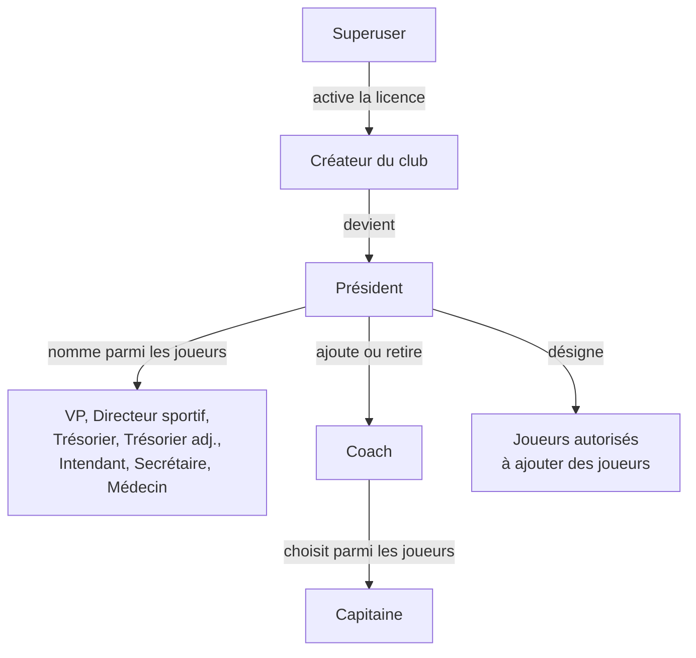
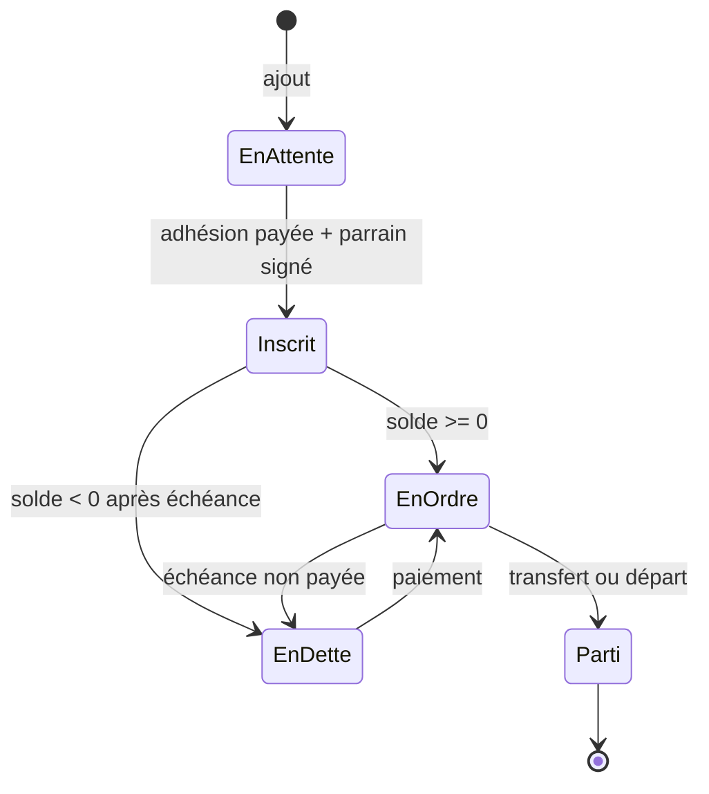
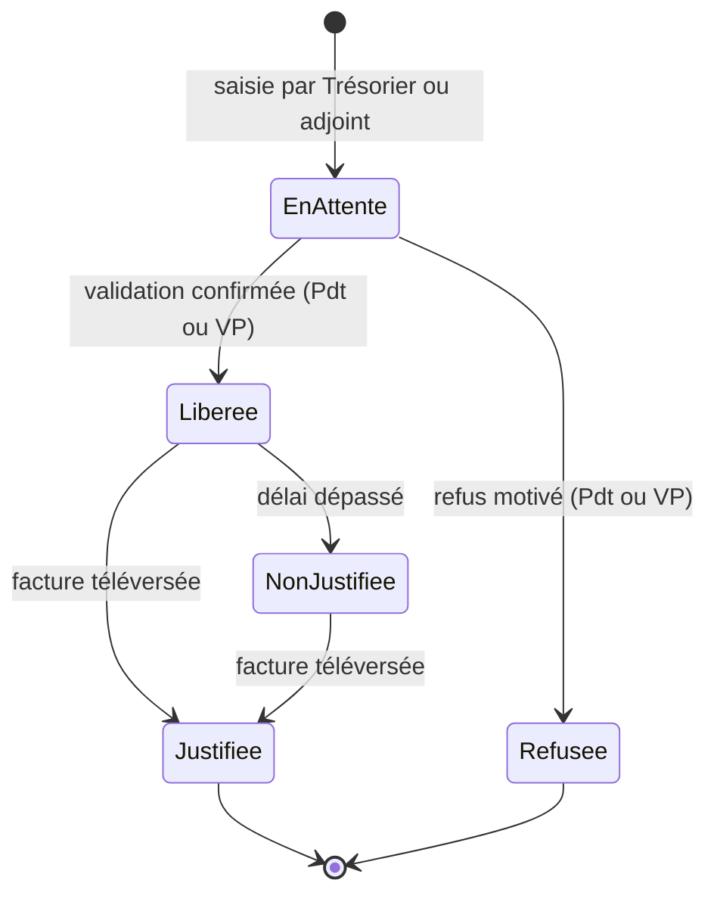
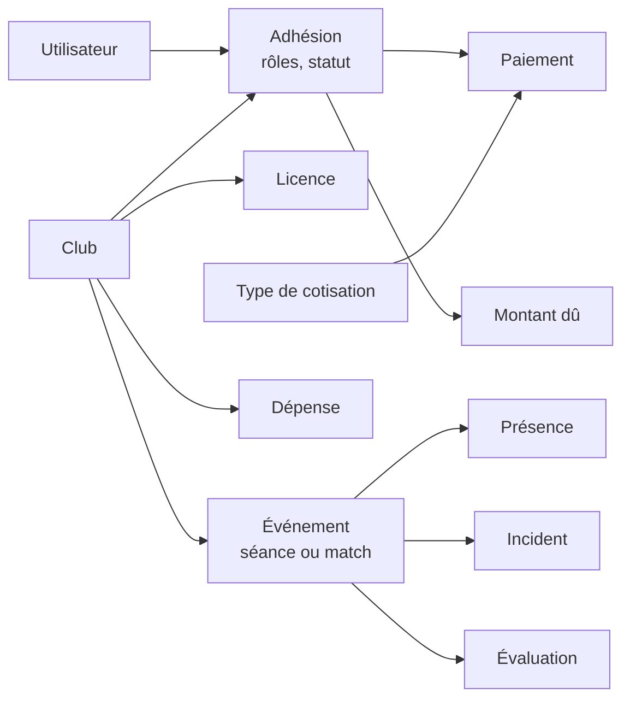

# Cahier des charges — Plateforme Vesta (v2)

Sep 25, 2026 · @Boendo Anicet

## 0. Pages liminaires

### 0.1 Objet du document

Ce cahier des charges définit la plateforme Vesta à reconstruire entièrement. Il remplace la version 1 et intègre les remarques du club pilote, Loisirs Club Discovery. Il sert de référence unique pour le développement, la recette et toute demande de changement.

### 0.2 Historique des versions

| Version | Date | Nature |
| --- | --- | --- |
| 2.1 | 25/09/2026 | Lot 0 : décisions Q1 à Q20 tranchées par le client (chapitre 10.2, entrées 15 à 37) ; confidentialité médicale (2.4, 4.12), licences (1.4), quorum d'AG (4.15), réinitialisation de mot de passe (7.1), signalement d'une publication (4.16) et caisse hors connexion (4.4.5, 6.6) précisés en conséquence |
| 2.0 | 25/09/2026 | Refonte complète, reconstruction de zéro |
| 1.0 | 2026 | Version initiale (remplacée) |

### 0.3 Principe structurant

Sur Vesta, **tout utilisateur d'un club est un joueur**, à commencer par le Président. Les fonctions (Président, Trésorier, Coach, Capitaine, Médecin, etc.) sont des rôles attribués à des joueurs. Seuls les Superusers ne sont pas joueurs : ils administrent la plateforme et les licences des clubs.

### 0.4 Glossaire

| Terme | Définition |
| --- | --- |
| Éditeur | Entité qui développe, héberge et exploite Vesta. Ses techniciens détiennent le rôle Superuser. |
| Superuser | Compte de l'Éditeur, non joueur. Gère les licences, les clubs, les comptes et le support. |
| Club (Tenant) | Équipe inscrite sur Vesta. Ses données privées sont strictement isolées des autres clubs. |
| Licence | Droit d'utilisation de Vesta accordé à un club pour une durée donnée (date de début, date de fin) ; aucune formule ni tarif au MVP (10.2 n° 20). |
| Joueur | Tout utilisateur membre d'un club, quelle que soit sa fonction. |
| Rôle | Fonction attribuée à un joueur dans son club (Président, Trésorier, Coach…). Un joueur peut en cumuler plusieurs. |
| Adhésion (Membership) | Lien entre un joueur et un club : dates d'entrée et de sortie, statut, rôles. |
| Statut du joueur | En attente, Inscrit, En ordre, En dette, Suspendu, Blessé, Parti. |
| Type de cotisation | Rubrique de recette définie par le club (mensuelle, spéciale, vestiaire, adhésion…). |
| Cotisation obligatoire | Cotisation dont le non-paiement à l'échéance crée une dette. |
| Cotisation libre | Cotisation volontaire, au montant choisi par le joueur. Elle ne crée jamais de dette. |
| Solde | Somme des paiements validés moins la somme des montants dus. Toujours calculé, jamais saisi. |
| En ordre | Joueur dont le solde des cotisations obligatoires échues est positif ou nul. |
| Quitus | Attestation numérique qu'un joueur n'a aucune dette envers son club. Requise pour un transfert. |
| Parrain | Joueur du club qui valide l'adhésion d'un nouveau joueur par sa signature électronique. |
| Confirmation | Modale qui récapitule une action sensible avant son exécution ; l'auteur de l'action est inscrit au journal. Remplace le code PIN, supprimé le 11/10/2026 (10.3 n° 177). |
| Séance | Entraînement du club, avec pointage et répartition en équipes A et B. |
| Feuille de match | Composition officielle d'un match, avec résultats et incidents. |
| Incident de terrain | Carton, blessure ou fait disciplinaire survenu en séance ou en match. |
| Ghost Mode | Affichage anonymisé des actions d'un Superuser : le club voit « Système Vesta ». |
| Boîte modale | Fenêtre qui s'ouvre au-dessus de la page courante sans la quitter. |

## 1. Présentation du projet

### 1.1 Vesta et son engagement solidaire

Une partie des revenus de Vesta est reversée à des orphelinats locaux. Cet engagement apparaît dans le footer de l'application. Le cahier des charges doit fixer :

- le pourcentage reversé et sa base de calcul (revenus des licences) ;
- la périodicité du reversement et les bénéficiaires ;
- le reporting publié (montant reversé par an).

Question ouverte : pourcentage et bénéficiaires, à définir par l'Éditeur.

### 1.2 Vision

Vesta est le « vestiaire numérique » d'un club de football amateur. Il réunit deux espaces :

- **l'espace privé du club** : trésorerie, présences, matchs, discipline, matériel, gouvernance ;
- **l'espace public** : fil d'actualité, cartes de joueurs, mercato, défis entre clubs.

L'objectif est d'automatiser les règles du club (cotisations, blocages, suspensions) tout en gardant la convivialité du football de loisir.

### 1.3 Public cible

| Cible | Besoins principaux |
| --- | --- |
| Équipes de vétérans (pilote : Loisirs Club Discovery) | Cotisations rigoureuses, présences du dimanche, convivialité, interface très simple |
| Clubs amateurs et locaux | Présences, statistiques, matériel, sans logiciel coûteux |
| Ligues et championnats de loisirs | Matchs amicaux, tournois, défis entre équipes |

### 1.4 Modèle économique : licences d'utilisation

Chaque club utilise Vesta sous licence, gérée par les Superusers.

- **Formules** : aucune formule ni tarif au MVP (décidé le 25/09/2026, 10.2 n° 20). Une licence est définie uniquement par une date de début et une date de fin, saisies par le Superuser. Le modèle de données doit permettre d'ajouter des formules plus tard sans migration destructive.
- **Durée** : la période d'essai suit la même mécanique (date de début/fin de 30 jours) ; au-delà, dates saisies par le Superuser à chaque attribution ou prolongation.
- **Cycle de vie** : essai → active → expirée (période de grâce) → suspendue → résiliée. Une licence suspendue bloque l'accès du club ; seule une licence expirée après la période de grâce passe le club en lecture seule (10.2 n° 19).
- **Effet d'une licence expirée** : après la période de grâce, le club passe en lecture seule. Ses données sont conservées et restent exportables.
- **Relances** : le Président est notifié 30 jours, 7 jours et 1 jour avant l'expiration.

Question ouverte restante : mode de paiement des licences côté Éditeur. Les formules et leur tarification ne sont plus une question ouverte : il n'y en a aucune au MVP (10.2 n° 20). Durée de l'essai et de la période de grâce actées (10.2 n° 1).

### 1.5 Périmètre du MVP

Inclus dans le MVP :

- gestion des clubs, des joueurs, des rôles et des licences ;
- trésorerie complète avec paiement par lien externe et validation manuelle ;
- entraînements, matchs, discipline, évaluations, plan tactique ;
- module médical ;
- logistique, assemblées générales, mercato ;
- fil public, communiqués, chat d'équipe interne ;
- notifications in-app et email, journal d'activité.

Hors MVP, prévus dans des lots ultérieurs :

- intégration de la passerelle FlexPaie ;
- API WhatsApp Business et SMS (le partage WhatsApp par lien simple est inclus) ;
- applications mobiles natives (le MVP est une PWA) ;
- tournois et championnats structurés entre clubs.

Toute demande absente de cette liste suit le processus de changement du chapitre 9.

## 2. Acteurs, rôles et gouvernance

### 2.1 Principe : tout utilisateur est un joueur

Chaque compte d'un club est d'abord un joueur, avec une fiche joueur complète (poste, numéro, statistiques, cotisations). Le Président, le bureau, le Coach, le Capitaine et le Médecin figurent donc dans le vestiaire, cotisent et peuvent être alignés. Les rôles s'ajoutent au statut de joueur, ils ne le remplacent pas.

Seuls les Superusers n'ont pas de fiche joueur. Ils n'apparaissent dans aucune liste de club.

### 2.2 Liste des rôles

| Rôle | Portée | Mission |
| --- | --- | --- |
| Superuser | Plateforme | Licences, clubs, comptes, support, surveillance des logs |
| Président | Club | Direction du club, nominations, validation des dépenses, identité du club |
| Vice-président | Club | Suppléance du Président, validation des dépenses, évaluations |
| Directeur sportif | Club | Mercato, suivi sportif global |
| Trésorier | Club | Encaissements, dépenses, types de cotisation, grille des cotisations |
| Trésorier adjoint | Club | Encaissements et saisie des dépenses |
| Intendant | Club | Matériel et inventaires |
| Secrétaire | Club | Communiqués officiels, archive des documents de réunion, préparation des assemblées générales (décidé le 11/10/2026, 10.3 n° 169) |
| Coach | Club | Séances, matchs, compositions, tactique, discipline, évaluations |
| Assistant du Coach | Club | Mêmes droits que le Coach, sauf nommer ou retirer un assistant ; nommé et retiré par le Coach seul (décidé le 13/11/2026, 10.3 n° 179) |
| Capitaine | Club | Pointage des présences, répartition A/B, saisie des incidents |
| Médecin | Club | Fiches de santé, blessures, soins et suivi |
| Joueur | Club | Profil, cotisations, consultation des compositions et du vestiaire |

Un joueur peut cumuler plusieurs rôles (par exemple Capitaine et Trésorier adjoint). Ses droits sont alors l'union des droits de ses rôles.

### 2.3 Qui nomme qui



Règles de nomination :

- Le joueur qui crée le club devient Président. Il crée en même temps sa propre fiche joueur.
- Le Président nomme les membres du bureau et le Médecin parmi les joueurs du club. Il peut les révoquer.
- Le Président ajoute ou retire le Coach, qui est lui aussi un joueur du club.
- Le Coach choisit le Capitaine parmi les joueurs. Il peut le changer.
- Le Président désigne les joueurs autorisés à ajouter de nouveaux joueurs.
- Le changement de Président se fait par passation (le Président sortant désigne son successeur) ou, en cas de blocage, par le Superuser sur demande écrite du club, après une assemblée générale.
- Un club a toujours un et un seul Président. Le nombre de titulaires par rôle du bureau est **configurable par club**, un seul par défaut (décidé le 25/09/2026, 10.2 n° 24 — extension acceptée du 10.2 n° 3).
- Toute nomination ou révocation génère un log et une notification au joueur concerné.
- **Secrétaire** (décision du client du 11/10/2026, demande formulée après la démonstration, circuit 9.4 ; 10.3 n° 169) : membre du bureau nommé et révoqué par le Président comme le Vice-président, **un seul titulaire** par club (même mécanisme que les autres rôles du bureau, réglage `board_seats_per_role`, un par défaut). Il fait partie du canal « Bureau » (10.3 n° 165). Il peut cumuler avec un autre rôle ; ses droits sont alors l'union (2.2).
- **Assistant du Coach** (décision du client du 13/11/2026, circuit 9.4 ; 10.3 n° 179) : joueur du club (règle « tout utilisateur est un joueur ») auquel le **Coach seul** ajoute le rôle `assistant_coach`. Il a **exactement les mêmes droits que le Coach** (colonne « Coach » de la matrice 2.4, y compris le choix du Capitaine et les notifications de cartons ou de blessures), **sauf nommer ou retirer un assistant**. Même restriction médicale que le Coach : aptitude et date de retour prévue seulement, jamais le diagnostic, sans exception (2.4, 4.12). **Un seul assistant par Coach** : en nommer un nouveau remplace le précédent (le retrait de l'ancien est journalisé et notifié). **Si le Coach change ou perd son rôle, l'assistant garde son poste** (aucune révocation automatique) jusqu'à ce que le nouveau Coach le retire ou le remplace. Le Président ne nomme ni ne retire l'assistant. Nomination et retrait sont journalisés avec leur auteur et notifient l'intéressé ; l'assistant reste soumis aux règles habituelles d'un joueur (dette, suspension, inaptitude).

### 2.4 Matrice des permissions

Légende : **É** = lecture et écriture, **L** = lecture seule, **P** = uniquement ses propres données, **D** = seulement si désigné par le Président, **—** = aucun accès. Abréviations : Pdt (Président), VP, DS (Directeur sportif), Trés (Trésorier), Adj (Trésorier adjoint), Int (Intendant), Séc (Secrétaire), Coach, Cap (Capitaine), Méd (Médecin), J (Joueur).

| Fonctionnalité | Pdt | VP | DS | Trés | Adj | Int | Séc | Coach | Cap | Méd | J |
| --- | --- | --- | --- | --- | --- | --- | --- | --- | --- | --- | --- |
| Identité du club (nom, logo, couleurs) | É | L | L | L | L | L | L | L | L | L | L |
| Nomination du bureau et du Médecin | É | L | L | L | L | L | L | L | L | L | L |
| Ajout ou retrait du Coach | É | L | L | L | L | L | L | L | L | L | L |
| Choix du Capitaine | L | L | L | L | L | L | L | É | L | L | L |
| Nomination ou retrait de l'Assistant du Coach | L | L | L | L | L | L | L | É | L | L | L |
| Ajout et import de joueurs | É | D | D | D | D | D | D | D | D | D | D |
| Profil et fiche joueur | P | P | P | P | P | P | P | P | P | P | P |
| Numéro de maillot et poste des joueurs | L | L | L | L | L | L | L | É | L | L | L |
| Types de cotisation | É | L | — | É | L | — | — | — | — | — | — |
| Enregistrement des paiements | L | L | — | É | É | — | — | — | — | — | P |
| Grille des cotisations (tous joueurs) | L | L | — | É | É | — | — | — | — | — | P |
| Catégories de dépenses | É | L | — | É | L | — | — | — | — | — | — |
| Saisie d'une dépense | L | L | — | É | É | — | — | — | — | — | — |
| Validation d'une dépense | É | É | — | L | L | — | — | — | — | — | — |
| Demande d'assistance sociale | P | P | P | P | P | P | P | P | P | P | P |
| Séances : création | L | L | L | — | — | — | — | É | L | L | L |
| Séances et matchs : pointage, répartition A/B | É | L | L | — | — | — | — | É | É | L | L |
| Feuille de match et composition | L | L | L | L | L | L | L | É | L | L | L |
| Incidents et cartons | L | L | L | — | — | — | — | É | É | L | P |
| Évaluation des performances | É | É | L | — | — | — | — | É | — | — | P |
| Plan tactique | L | L | L | L | L | L | L | É | L | L | L |
| Fiches de santé et blessures | L | — | — | — | — | — | — | L | — | É | P |
| Matériel et inventaires | L | L | — | L | — | É | — | L | — | — | — |
| Mercato : offres et transferts | É | L | É | L | — | — | — | L | — | — | P |
| Assemblées générales | É | É | L | L | L | L | É | L | L | L | L |
| Communiqués officiels | É | É | L | L | L | L | É | L | L | L | L |
| Archive des documents officiels (PV de réunion, convocations, autres) | É | É | L | L | L | L | É | — | — | — | — |
| Fil public : publier | É | É | É | É | É | É | É | É | É | É | É |
| Chat d'équipe | É | É | É | É | É | É | É | É | É | É | É |
| Journal d'activité | — | — | — | — | — | — | — | — | — | — | — |

Précisions :

- **Assistant du Coach** : il n'a pas de colonne propre ; ses droits sont **identiques à la colonne « Coach »** pour chaque ligne de la matrice, à l'exception de la ligne « Nomination ou retrait de l'Assistant du Coach », réservée au Coach (10.3 n° 179). Un assistant est aussi un joueur : il cumule avec les droits de la colonne « J ».
- Sur les fiches de santé, le Coach ne voit que l'aptitude (apte, apte avec restriction, inapte) et la date de retour prévue, jamais le diagnostic, **sans aucune exception**. Le Président voit la même chose par défaut, sauf si le joueur lui a donné, depuis son profil, un consentement explicite à un accès complet à son dossier médical ; ce consentement est révocable à tout moment par le joueur, avec effet immédiat, et attaché à la fonction de Président (il ne se transmet pas automatiquement à un nouveau titulaire). Chaque octroi, chaque révocation et chaque consultation du dossier par le Président sont journalisés, sans copier le contenu médical dans le journal (voir 4.12 et 10.2 n° 15).
- Le Joueur voit en lecture seule le plan tactique, les compositions publiées et le vestiaire.
- Le journal d'activité n'est visible que par les Superusers.

### 2.5 Superuser et gestion des licences

Le Superuser est un technicien de l'Éditeur. Il n'est membre d'aucun club et n'a pas de fiche joueur. Il dispose d'un espace d'administration séparé de l'espace club.

Ses fonctions :

- **Licences** : créer, activer, prolonger, suspendre ou résilier la licence d'un club ; consulter l'historique et les échéances. La résiliation exige la saisie du nom du club en confirmation, en plus du motif habituel (décidé le 25/09/2026, 10.2 n° 26).
- **Clubs** : liste de tous les clubs, statut de licence, nombre de joueurs, date de dernière activité.
- **Comptes** : liste de tous les utilisateurs et de leur identifiant ; réinitialisation du mot de passe sur demande (mot de passe temporaire aléatoire de 8 caractères, affiché une seule fois, valable 48 h — 10.2 n° 21), avec changement obligatoire à la connexion suivante.
- **Support** : intervention sur les données d'un club (correction d'un paiement, d'un score), en Ghost Mode.
- **Surveillance** : consultation et filtrage du journal d'activité de tous les clubs.
- **Paramètres globaux** : engagement solidaire, modèles de documents, versionnement des CGU (10.2 n° 27). Aucune formule de licence au MVP (10.2 n° 20).

Le Superuser a accès à tout. Ces pouvoirs sont mentionnés dans les CGU de Vesta, et chacune de ses actions est journalisée avec son identité réelle (voir chapitre 5).

## 3. Charte UX/UI et règles d'interface

Ce chapitre s'impose à tous les écrans. Il est validé par le client avant le début du développement, et tout écart est traité comme une anomalie.

### 3.1 Principes généraux

- **Mobile-first** : chaque écran est conçu d'abord pour un smartphone de 360 px de large, utilisé au bord du terrain, puis adapté à la tablette et à l'ordinateur.
- **Densité maîtrisée** : texte courant de 14 à 16 px, titres de page de 20 à 24 px au maximum. Pas de gros boutons ni de gros caractères décoratifs.
- **Boutons** : hauteur de 36 à 40 px, une seule action principale par zone. Les actions secondaires sont en bouton discret ou dans un menu « … ».
- **Zones tactiles** : 44 × 44 px minimum sur mobile, même si le bouton paraît plus petit.
- **Hiérarchie** : chaque page a un titre, une ligne de contexte (nom du club, période) et des sections en cartes. On consulte d'abord, on agit ensuite.
- **Cohérence** : mêmes composants, mêmes couleurs de statut et mêmes libellés sur toutes les pages.

### 3.2 Règle des formulaires : boîtes modales obligatoires

**Tout formulaire s'ouvre dans une boîte modale.** On ne crée jamais une page qui ne contient qu'un formulaire. La page affiche l'information ; le bouton d'action ouvre le formulaire par-dessus, et l'utilisateur revient à la même page une fois l'action terminée.

La règle couvre notamment :

- la création et la modification de toute donnée (joueur, paiement, dépense, séance, match, incident, type de cotisation, catégorie de dépense, publication) ;
- la modification du profil, de l'identifiant et du mot de passe ;
- la confirmation d'une action sensible (modale de confirmation, 7.2) ;
- les imports CSV ;
- les demandes (assistance sociale, offre de transfert) ;
- la gestion de la composition d'un match (liste à cases à cocher).

Comportement des modales :

- Fermeture par un bouton « Fermer » (croix en haut à droite), la touche Échap ou un clic en dehors.
- Si des données ont été saisies, la fermeture demande une confirmation (« Abandonner les modifications ? »).
- Sur mobile, la modale s'affiche en plein écran ou en panneau glissant depuis le bas.
- Les boutons « Annuler » et « Enregistrer » restent visibles en bas de la modale, même si le formulaire défile.
- Les erreurs s'affichent sous le champ concerné, en français clair, jamais sous forme de message technique.
- Après enregistrement : fermeture de la modale, message de confirmation bref, mise à jour de la page sans rechargement.

Exception : un processus à plusieurs étapes (inscription d'un club, création d'une assemblée générale) prend la forme d'un assistant pas à pas dans une grande modale. Une page dédiée n'est admise que sur justification validée par le client.

### 3.3 Règle des listes

- Par défaut, une liste affiche les derniers éléments, avec un bouton « Voir plus » en bas.
- Le nombre affiché dépend de la section : 5 pour les séances, matchs et incidents ; 20 pour les paiements ; 10 pour les notifications.
- Un clic sur un élément ouvre une modale de détail. Les actions possibles sur l'élément (modifier, supprimer) sont dans cette modale.
- Au-delà de 30 éléments possibles (joueurs, transferts), on utilise un tableau avec recherche, filtres et pagination. Une liste déroulante (select) n'est jamais utilisée pour choisir un joueur ; on utilise un champ de recherche avec suggestions.
- Les tableaux larges défilent horizontalement dans leur propre cadre, sans faire défiler la page.

### 3.4 Composants communs

- **Loader** : affiché à chaque chargement de page et pendant chaque action. Sur les listes, on affiche des blocs gris animés à la place du contenu.
- **États vides** : chaque section vide affiche un message et, si le rôle le permet, l'action pour commencer (« Aucun incident pour l'instant »).
- **Confirmations** : toute suppression ou action irréversible demande une confirmation ; les actions sensibles (7.2) se confirment par une modale qui récapitule l'action, avec les boutons « Annuler » et un verbe explicite.
- **Badges de statut** : couleurs fixes pour toute l'application.

| Statut | Couleur |
| --- | --- |
| En ordre, Validé, Présent | Vert |
| En attente, À justifier | Orange |
| En dette, Refusé, Absent, Inapte | Rouge |
| Suspendu | Violet |
| Parti, Archivé | Gris |

- **Notifications** : l'icône cloche, avec un compteur, ouvre une modale listant les notifications.
- **Avatar** : la photo du joueur est affichée partout où son nom apparaît ; à défaut, ses initiales.

### 3.5 Identité visuelle par club (marque blanche)

L'application porte l'identité du club connecté, jamais un nom de club écrit en dur dans le code.

- En haut de la barre latérale : logo et nom du club.
- Page de connexion : logo du club en filigrane, lorsque le club est identifié par son adresse (voir 7.3).
- Fil public, documents PDF, espace Coach : nom et logo du club.
- Le Président modifie le nom, le logo et les couleurs du club dans une modale.
- Footer, sur toutes les pages : « VESTA by IMARA TECH Group — une partie de nos revenus est destinée aux orphelinats locaux ». C'est la seule mention de l'Éditeur dans l'application.
- Le bas de la barre latérale (nom de l'utilisateur connecté, déconnexion) doit tenir sur la largeur de la barre sans débordement.

### 3.6 Thèmes

- **Classic** : couleurs extraites du logo du club (couleur principale et secondaire).
- **Clair** et **Sombre** : versions neutres.
- Le choix du thème est propre à chaque utilisateur et mémorisé.
- Tous les textes respectent un contraste suffisant pour être lus en plein soleil.

### 3.7 Processus de validation du design

1. Maquette de chaque écran clé (accueil, profil, trésorerie, espace coach, séance, match, comité, mercato, AG) avant développement.
2. Validation écrite du client sur la maquette.
3. Développement conforme à la maquette validée.
4. Recette visuelle sur smartphone réel.

Le design déjà posé par le client sur la version précédente sert de point de départ aux maquettes.

## 4. Spécifications fonctionnelles par module

Chaque module décrit : objectif, acteurs, écrans et modales, règles métier, cas limites, logs et notifications, critères d'acceptation. Tout formulaire suit la règle 3.2 (boîte modale).

### 4.1 Comptes, inscription et profils

**Objectif** : créer le club et ses joueurs, et permettre à chacun de gérer son profil.

**Création d'un club** (assistant en modale) :

1. Informations du club : nom, logo, couleurs, ville, pays, devise (USD par défaut, CDF possible), fuseau horaire.
2. Fiche joueur du créateur, qui devient Président.
3. Activation de la licence d'essai (ou d'une licence fournie par le Superuser).

**Ajout d'un joueur** (modale, par le Président ou un joueur désigné) :

| Champ | Obligatoire | Remarque |
| --- | --- | --- |
| Prénom, nom | Oui |  |
| Email | Oui | Sert d'identifiant de connexion ; unique sur la plateforme |
| Téléphone (WhatsApp) | Non | Pour les reçus et communiqués |
| Poste | Oui à la création manuelle | Gardien, Défenseur, Milieu, Attaquant ; poste précis facultatif |
| Numéro de maillot | Non | Unique dans le club |
| Date de naissance | Non | L'âge est calculé |
| Poids (kg), taille (cm) | Non |  |
| Photo | Non à la création | Demandée au joueur à sa première connexion |
| Type de cotisation mensuelle | Oui | Par exemple catégorie 20 $, 10 $ ou 5 $ |
| Parrain | Oui pour un nouveau joueur | Voir 4.3 |

Aucun nom d'utilisateur n'est demandé : l'email est l'identifiant. Le mot de passe initial est l'email, conformément à la demande du club, mais **le joueur doit le changer à sa première connexion**. Tant qu'il ne l'a pas changé, il n'accède à aucune donnée.

**Import CSV des joueurs existants** (modale) :

- Colonnes : email, prenom, nom, telephone, poste, numero, date\_naissance, poids, taille, type\_cotisation.
- Seuls email, prenom et nom sont obligatoires. Un poste ou une date vide n'empêche pas l'import.
- Dates acceptées : JJ/MM/AAAA et AAAA-MM-JJ.
- Un email déjà présent dans le club met à jour la fiche au lieu de créer un doublon.
- Les joueurs importés sont membres historiques : ils passent directement « Inscrit », sans parrainage.
- Un modèle CSV est téléchargeable depuis la modale.
- Le rapport liste les lignes importées et les lignes en échec, avec le numéro de ligne et un message en français (« Ligne 12 : email invalide »).

**Page « Mon profil »** (consultation) :

- En-tête : photo, nom, poste, numéro, rôles, badge de statut.
- Informations personnelles et physiques : âge, poids, taille, téléphone.
- Situation financière : solde, prochaines échéances, derniers paiements, bouton « Contribuer » (voir 4.6).
- Statistiques de la saison et historique de carrière.
- Aptitude médicale (apte, restriction, inapte).
- Bouton « Modifier mon profil » : modale à onglets « Informations », « Photo », « Identifiant et mot de passe » (l'onglet « Code PIN » est supprimé depuis le 11/10/2026, 10.3 n° 177).

**Mot de passe oublié** : le joueur envoie une demande depuis la page de connexion. Le Superuser réinitialise le mot de passe : un mot de passe temporaire aléatoire de 8 caractères est généré, affiché une seule fois au Superuser, valable 48 heures ; le joueur doit le changer obligatoirement à la connexion suivante (décidé le 25/09/2026, 10.2 n° 21). La création initiale d'un compte reste inchangée : mot de passe = email, changement obligatoire à la première connexion.

**Statuts du joueur** :



Les statuts « Suspendu » (discipline) et « Blessé » (médical) se superposent à la situation financière : un joueur peut être à la fois En ordre et Suspendu.

**Critères d'acceptation** : un club importé de 40 joueurs sans poste ni date passe sans échec ; un joueur ne peut rien consulter avant d'avoir changé son mot de passe initial.

### 4.2 Cartes de joueurs et statistiques

**Carte de joueur** (style FC/FIFA) : photo, nom, poste, numéro, note globale, et six indicateurs lisibles en toutes lettres (matchs, buts, passes décisives, cartons, taux de présence, note moyenne). Aucun libellé tronqué.

**Fiche détaillée** (inspirée de Football Manager), ouverte au clic sur une carte :

- **Aperçu** : identité, attributs sur graphique radar, forme récente (5 dernières notes).
- **Statistiques** : par saison et en cumul.
- **Évaluations** : courbe des notes par séance et par match.
- **Présences** : taux, retards, absences.
- **Discipline** : cartons avec leur cause, suspensions.
- **Carrière** : clubs successifs sur Vesta.
- **Aptitude** : apte, restriction ou inapte, sans diagnostic.

**Attributs** : les attributs du radar (par exemple technique, physique, mental, discipline, assiduité, contribution offensive) sont calculés à partir des évaluations (4.10) et des statistiques.

**Comparaison de joueurs** : sélection de 2 à 4 joueurs par recherche, tableau côte à côte et radar superposé. La comparaison est possible entre joueurs de clubs différents sur les données publiques.

**Visibilité publique** : la carte et les statistiques sportives sont publiques. Le poids, la taille, le téléphone, les finances et la santé ne le sont jamais.

### 4.3 Adhésion et parrainage

**Objectif** : valider l'entrée d'un nouveau joueur par un paiement et la signature d'un parrain.

Déroulement :

1. Le joueur est ajouté avec le statut « En attente » et un parrain choisi parmi les joueurs inscrits.
2. Les frais d'adhésion sont payés. Ils correspondent au type de cotisation marqué « adhésion », dont le montant est fixé par le club (5 $ pour Discovery). **Décidé le 17/11/2026 (10.3 n° 100) : les frais d'adhésion sont une somme à payer.** À l'ouverture de l'adhésion, un montant dû unique est créé (tarif « adhésion » du club à la date d'entrée, échéance à la date d'entrée) ; le paiement des frais, total ou en plusieurs fois, s'y impute : une fois payés, le solde du joueur est à 0 et ses mensualités ne sont pas touchées (un surplus reste un crédit). Tant que les frais ne sont pas réglés, le joueur reste « En attente », jamais « En dette ». Sans type « adhésion » défini, aucun montant dû n'est créé.
3. Le système génère la fiche d'adhésion en PDF, aux couleurs du club.
4. Le parrain reçoit une notification et signe par un bouton, après une modale de confirmation ; la signature (parrain, date) est journalisée.
5. La fiche signée est archivée ; le joueur passe « Inscrit ».

Cas limites :

- **Le parrain refuse** : il indique un motif ; le Président est notifié et décide de désigner un autre parrain ou d'annuler l'adhésion. Le sort du paiement (remboursement ou conservation) est enregistré. En cas d'annulation, le montant dû d'adhésion est neutralisé par une écriture d'annulation motivée (jamais supprimé), sauf si les frais entièrement payés sont conservés.
- **Le parrain ne répond pas** : rappel après 3 jours, alerte au Président après 7 jours.
- **Le joueur ne paie pas** : il reste « En attente » et ne peut être aligné nulle part.

**Logs et notifications** : ajout, paiement, génération de la fiche, signature ou refus.

**Double envoi du paiement des frais** : même mécanisme anti-doublon que 4.4.4 (identifiant `client_uuid`, 10.3 n° 178) : un double envoi de la confirmation ne crée qu'un seul paiement, un seul reçu et une seule notification ; le dossier est renvoyé tel quel ; refus si le même identifiant est réutilisé avec un contenu différent.

### 4.4 Trésorerie et cotisations

**Objectif** : suivre toutes les recettes du club, calculer la situation de chaque joueur et en déduire automatiquement qui est en ordre.

#### 4.4.1 Types de cotisation

Le Président et le Trésorier créent, modifient et archivent les types de cotisation dans une modale.

| Attribut | Valeurs | Rôle |
| --- | --- | --- |
| Nom | Texte | Par exemple « Mensuelle catégorie 20 $ » |
| Nature | Obligatoire ou libre | Seule une cotisation obligatoire crée une dette |
| Montant | Fixe (obligatoire) ou suggéré (libre) | En devise du club |
| Périodicité | Mensuelle, annuelle, ponctuelle | Les ponctuelles ont une date limite |
| Échéance | Jour du mois (par exemple le 10) | Date après laquelle l'impayé devient une dette |
| Frais d'adhésion | Oui ou non | Son paiement fait passer le joueur « Inscrit » |
| Concernés | Tous, une liste de joueurs, les joueurs rattachés | Les mensuelles se rattachent joueur par joueur |
| État | Actif ou archivé |  |

Un type qui a déjà reçu des paiements ne peut pas être supprimé, seulement archivé. Une modification de montant ne s'applique qu'aux mois suivants, jamais aux mois passés.

Exemples pour Discovery : trois types mensuels obligatoires (20 $, 10 $, 5 $), l'adhésion (5 $, frais d'adhésion), la cotisation spéciale (libre, ponctuelle), la cotisation vestiaire (libre).

#### 4.4.2 Échéances et calcul du solde

Chaque premier du mois, une tâche automatique crée le montant dû du mois pour chaque joueur actif, selon son type mensuel. Ce montant ne devient une dette qu'après la date d'échéance du type, plus une tolérance configurable par le club (0 jour par défaut). Ainsi, personne n'est bloqué le 1er du mois.

Le solde n'est jamais saisi ni stocké. Il est recalculé à chaque consultation :

```latex
\text{Solde} = \sum \text{Paiements validés (types obligatoires)} - \sum \text{Montants dus échus (types obligatoires)}
```

Les cotisations libres (spéciale, vestiaire) sont suivies et affichées, mais n'entrent jamais dans le solde. Le solde est reporté d'un mois et d'une saison à l'autre.

Frais d'adhésion (décidé le 17/11/2026, 10.3 n° 100) : un montant dû unique par adhésion, créé à l'ouverture de l'adhésion, échéance à la date d'entrée ; il entre dans le solde comme tout montant dû d'un type obligatoire (voir 4.3).

Un joueur est « En ordre » si son solde est positif ou nul, « En dette » sinon. Le statut change dès qu'un paiement est validé.

Cas particuliers à trancher par le club : joueur arrivé en cours de mois (mois entier dû ou non), joueur blessé de longue durée ou absent (suspension temporaire des cotisations par décision du Président, tracée).

#### 4.4.3 Répartition des paiements

Un paiement sur un type obligatoire est affecté automatiquement, dans cet ordre : les mois impayés les plus anciens, puis le mois courant, puis les mois à venir.

Exemple : un joueur à 10 $ par mois, à jour, verse 40 $ en mars. Le paiement couvre mars, avril, mai et juin.

La modale d'enregistrement affiche cette répartition avant validation.

#### 4.4.4 Enregistrement d'un paiement

Modale « Enregistrer un paiement » (Trésorier ou adjoint) :

- joueur, choisi par recherche sur le nom ;
- type de cotisation, choisi dans la liste des types actifs ;
- montant, mode (espèces, mobile money, lien de paiement), référence, date ;
- pièce jointe facultative ;
- aperçu de la répartition et du nouveau solde ;
- validation par un bouton, suivie d'une modale de confirmation qui rappelle le joueur, le montant et la répartition.

Chaque paiement validé génère un reçu numéroté (PDF aux couleurs du club) envoyé au joueur par email et consultable dans son profil.

**Double envoi de la confirmation** (10.3 n° 178, à valider par le client) : l'interface joint à la saisie un identifiant `client_uuid` généré à l'ouverture de la modale. Un double envoi de la confirmation (double clic, renvoi réseau) ne crée qu'un seul paiement, un seul reçu, une seule entrée de journal et une seule notification : le paiement déjà enregistré est renvoyé (200 au lieu de 201). Si le même identifiant est réutilisé avec un contenu différent, la saisie est refusée (409, code `client_uuid_conflict`).

Un paiement validé n'est jamais supprimé. Une erreur se corrige par une écriture d'annulation, avec motif, validée par le Président.

#### 4.4.5 Caisse Terrain Express

Écran simplifié pour le dimanche au bord du terrain :

- ouverture d'une **session de caisse** par le Trésorier ou l'adjoint, en ligne, par un bouton suivi d'une confirmation ; la session reste valable jusqu'à minuit (fuseau du club) ; **position provisoire, à poser au client** : la session de caisse est maintenue sans code PIN (10.3 n° 177) ;
- recherche du joueur par nom ou numéro, avec photo et solde affichés ;
- saisie du montant en espèces et du type (par défaut la mensuelle du joueur) ; chaque encaissement se valide par le bouton « Encaisser », sans confirmation supplémentaire (position provisoire, à poser au client) ;
- le joueur devient immédiatement sélectionnable s'il est désormais en ordre.

Cet écran fonctionne hors connexion (voir 6.6) : les encaissements saisis hors connexion pendant une session de caisse ouverte sont synchronisés au retour du réseau et journalisés avec l'identifiant de la session (décidé le 25/09/2026, 10.2 n° 22, modifié le 11/10/2026 : plus de code PIN, 10.3 n° 177 ; aucun secret n'est stocké sur l'appareil).

#### 4.4.6 Tableau de bord Trésorerie

- **Indicateurs** : encaissé du mois, taux de recouvrement, total des dettes, caisse disponible (encaissements moins dépenses libérées).
- **Membres du club** : tableau avec filtres par type de cotisation, statut et nom ; clic sur un joueur pour ouvrir son détail financier.
- **Derniers paiements** : les 20 derniers, bouton « Voir plus » ; clic sur un paiement pour ouvrir son détail en modale.
- **Actions** : enregistrer un paiement, Caisse Terrain Express, importer des cotisations.

#### 4.4.7 Grille des cotisations

Menu dédié dans la barre latérale pour le Trésorier, l'adjoint et le Président.

- Un tableau par type de cotisation, avec une année sélectionnable.
- Lignes : les joueurs rattachés. Colonnes : janvier à décembre, puis total.
- Cellule : montant affecté au mois, couleur selon l'état (payé, partiel, impayé échu, à venir).
- Un paiement anticipé s'étale sur plusieurs mois selon la règle 4.4.3.
- Le tableau défile horizontalement, la colonne des joueurs reste figée.
- Clic sur une cellule : détail des paiements du mois.
- Export CSV.

Chaque joueur voit sa propre ligne dans son profil.

#### 4.4.8 Import des cotisations historiques (CSV)

L'import reprend les fichiers de suivi existants du club (une ligne par joueur, une colonne par mois).

- La modale demande le **type de cotisation** concerné et l'année.
- Colonnes : email ou nom du joueur, puis un mois par colonne.
- « ok » dans une cellule = mois payé au montant plein du type.
- Un montant dans une cellule = paiement de ce montant, réparti selon la règle 4.4.3 (60 $ sur un type à 10 $ couvrent le mois et les 5 suivants).
- Une cellule vide = rien payé : le mois est dû et non payé, donc une dette réelle (décidé le 17/11/2026, 10.3 n° 174). Le Trésorier valide la grille de l'aperçu avant l'import définitif.
- Un aperçu de la grille résultante est montré avant l'import définitif.
- Le rapport liste les lignes en échec (joueur introuvable, valeur illisible).

### 4.5 Dépenses et assistance sociale

#### 4.5.1 Catégories de dépenses

Le Président et le Trésorier créent, modifient et archivent les catégories : nom, plafond facultatif, justificatif obligatoire (oui par défaut), et **« réservée aux membres en ordre »**. Cette dernière option s'applique aux dépenses qui bénéficient à un joueur, comme l'assistance sociale.

#### 4.5.2 Circuit d'une dépense



- La saisie comprend : catégorie, montant, bénéficiaire, motif, date, justificatif (facultatif à la saisie).
- Le justificatif (photo ou PDF) est obligatoire pour clôturer la dépense. Les photos sont compressées à l'envoi.
- Délai de justification : 7 jours après la libération (configurable).

**Blocage automatique** : tant qu'une dépense est « Non justifiée », aucune nouvelle dépense ne peut être libérée. Le Trésorier, l'adjoint et le Président reçoivent une alerte rouge.

**Dérogation** : en cas d'urgence (décès, blessé à soigner), le Président peut libérer une dépense malgré le blocage, avec un motif obligatoire, après une modale de confirmation. La dérogation est journalisée et signalée à la prochaine assemblée générale.

#### 4.5.3 Assistance sociale

- Un joueur fait une demande dans une modale : événement (naissance, mariage, décès), date, description, pièce justificative.
- La modale affiche avant l'envoi l'éligibilité, le montant prévu par le barème du club et le délai de traitement.
- Éligibilité : être en ordre à la date de l'événement. Un joueur en dette voit le montant à régulariser pour devenir éligible ; il peut néanmoins envoyer sa demande sans être éligible (décidé le 25/09/2026, 10.2 n° 33).
- Le Président ou le Vice-président valide ; la demande devient une dépense de la catégorie correspondante. L'éligibilité reste une condition de la validation, pas seulement de l'envoi : une demande d'un joueur toujours en dette ne peut pas être approuvée ni libérée (décidé le 25/09/2026, 10.2 n° 37).
- Le joueur suit l'état de sa demande dans son profil.

### 4.6 Paiement en ligne

**Phase 1 (MVP) : lien de paiement externe.**

- Chaque club configure son lien de paiement dans ses paramètres (pour Discovery, sa page de paiement laxtech). Aucun lien n'est écrit en dur.
- Le bouton « Contribuer » du profil ouvre ce lien dans un nouvel onglet.
- Au retour, le joueur peut déclarer son paiement par le bouton « J'ai payé » (modale : type, montant, référence de transaction, capture).
- La déclaration apparaît chez le Trésorier comme « À valider ». Une fois validée, elle est traitée comme un paiement normal.

**Phase 2 : intégration FlexPaie.**

- Le joueur choisit le type et le montant dans Vesta, puis paie par mobile money ou carte.
- La confirmation de FlexPaie valide automatiquement le paiement, met à jour le statut et envoie le reçu, sans intervention du Trésorier.

**Préparation dès la phase 1** : chaque transaction porte un fournisseur (manuel, lien, FlexPaie), une référence externe et un statut (initié, en attente, réussi, échoué). Le passage à FlexPaie n'exige donc aucun changement du modèle de données.

### 4.7 Entraînements

**Objectif** : organiser la séance du dimanche, pointer les présences et répartir les joueurs en équipes A et B.

**Création d'une séance** (Coach, en modale) : date, heure de rassemblement, heure limite d'arrivée, terrain, couleurs des maillots (A bleu et B rouge par défaut, modifiables), consignes.

**Pointage** (Coach ou Capitaine) :

- La liste des joueurs du club s'affiche avec photo et numéro.
- Un appui sur « Arrivé » enregistre l'heure exacte. Le Coach peut corriger l'heure le jour même.
- Arrivée avant l'heure limite : **Présent**. Arrivée après : **En retard, compté absent**, par défaut — ce comptage est **configurable par club** (décidé le 25/09/2026, 10.2 n° 25 — extension acceptée du 10.2 n° 6).
- Un joueur non pointé est **Absent**. Le Coach peut marquer une absence comme excusée (blessé, voyage) ; elle reste une absence mais est distinguée dans les statistiques.
- Le pointage fonctionne hors connexion.

**Répartition en équipes A et B** (Président, Coach ou Capitaine) :

- Les joueurs présents sont répartis automatiquement selon leur ordre d'arrivée. Règle par défaut : alternance (1er en A, 2e en B, 3e en A…) ; le club peut choisir une autre règle.
- L'écran affiche **deux terrains** côte à côte (sur mobile, l'un au-dessus de l'autre), aux couleurs des maillots.
- Un joueur se déplace d'une équipe à l'autre par glisser-déposer ou par le bouton « Passer en A/B ».
- Décidé le 25/09/2026 (10.2 n° 6, n° 25, précisé au n° 38) : un joueur en retard est compté absent dans les statistiques ; ce comptage est configurable par club. Il n'est **pas réparti automatiquement** et arrive dans la zone « Non répartis », mais, à la différence d'un joueur en dette, suspendu ou inapte (jamais placeable, même manuellement), le Coach ou le Capitaine **peut le placer manuellement** en équipe A ou B.
- Décidé le 30/09/2026 (10.2 n° 39) : chaque équipe a son propre terrain positionné, plafonné à 11 joueurs sur le terrain, avec une formation propre (bibliothèque du 4.11) ; l'excédent reste sur un banc par équipe, placeable sur le terrain par glisser-déposer (échange avec un coéquipier déjà en place si la case est occupée).

**Modification** : une séance (pointage et répartition) n'est modifiable que le jour même, selon le fuseau du club. À minuit, elle est verrouillée. Seul un Superuser peut corriger une séance verrouillée, sur demande du Président.

**Liste des séances** : les 5 dernières, bouton « Voir plus ». Une séance s'ouvre en détail et se referme par un bouton « Fermer ».

**Vestiaire du jour** : la page Vestiaire affiche automatiquement les joueurs pointés présents à la séance ou au match du jour, avec leur équipe. Elle est visible par tous les joueurs du club et mise en avant sur l'accueil du Président.

- Décidé le 01/10/2026 (10.2 n° 40) : par exception à la consultation pure décrite ci-dessus et dans `docs/ecrans/sport-vestiaire.md`, la vue « Terrain » de cette page devient modifiable pour le Coach, le Capitaine et le Président (mêmes rôles qu'en 4.7) : choix de formation, glisser-déposer/toucher pour placer et échanger des joueurs sur le terrain, et déplacement d'un joueur du banc d'une équipe vers le banc de l'autre pour changer son équipe. Pour tous les autres rôles, le terrain reste strictement en lecture seule, comme décrit plus haut.

**Après la séance** : évaluation des joueurs (4.10) et saisie des incidents (4.9).

### 4.8 Matchs et feuilles de match

**Création d'un match** (Coach, en modale) : adversaire (club Vesta ou équipe extérieure saisie en texte), date, heure, lieu, type (amical, championnat, tournoi), domicile ou extérieur.

**Défi entre clubs** : un club peut envoyer une demande de match amical à un autre club Vesta. Si elle est acceptée, le match apparaît dans les deux clubs.

**Pointage** : mêmes règles que pour les séances (Coach ou Capitaine).

**Composition** (Coach) dans une modale :

- Liste de tous les joueurs du club avec case à cocher, recherche et filtre par poste.
- Aucune limite artificielle : le Coach peut cocher tous les joueurs disponibles.
- Chaque joueur coché est marqué titulaire ou remplaçant, avec son poste et son numéro du jour.
- Les joueurs non sélectionnables sont grisés avec la raison : en dette (montant affiché), suspendu (nombre de matchs restants), inapte (avis médical), en attente d'adhésion.
- Régularisation sur place : un paiement validé par la Caisse Terrain Express rend le joueur immédiatement sélectionnable.
- Bouton « Publier la composition » : visible par les joueurs du club, en lecture seule, après connexion ; notification aux joueurs convoqués.

**Feuille de match** (après la rencontre, Coach) :

- score ;
- buteurs et passeurs décisifs ;
- cartons avec leur cause (4.9) ;
- blessures, transmises au Médecin (4.12) ;
- équipements reçus pour le match (maillots, bas, bottines, ballons…), avec quantités, liés au registre du matériel (4.13).

Le Coach peut modifier les buts et les passes décisives après coup ; chaque modification est journalisée. Les statistiques des cartes de joueurs se mettent à jour automatiquement.

**Liste des matchs** : les 5 derniers, bouton « Voir plus » ; ouverture et fermeture du détail comme pour les séances.

**Publication** : le résultat peut être publié sur le fil public en un clic.

### 4.9 Discipline et incidents de terrain

**Saisie d'un incident** (Coach ou Capitaine, en modale) :

- joueur, séance ou match, minute (facultative) ;
- type : carton jaune, carton rouge, sanction interne ;
- cause : liste (contestation, faute grossière, comportement, retard, autre) et précision en texte ;
- arbitre ou auteur de la sanction.

**Règles automatiques** (paramétrables par le club) :

| Règle | Valeur par défaut | À confirmer |
| --- | --- | --- |
| Suspension au cumul de cartons jaunes | 5e jaune de la saison | Oui |
| Durée de la suspension (cumul de jaunes) | 1 match | Oui |
| Carton rouge direct | Suspension de 1 match | Oui |
| Remise à zéro des compteurs | Début de chaque saison | Oui |

- La saison est définie par ses dates de début et de fin dans les paramètres du club.
- Un joueur suspendu ne peut être ni composé ni placé dans un plan tactique.
- La suspension est levée automatiquement après le nombre de matchs du club prévu.
- Si le club inflige des amendes, elles prennent la forme d'une cotisation ponctuelle obligatoire affectée au joueur.

**Liste des incidents** : les 5 derniers, bouton « Voir plus », message si aucun incident.

**Notifications** : le joueur et le Coach sont notifiés de chaque carton et de chaque suspension.

### 4.10 Évaluation des performances

- **Évaluateurs** : le Coach, le Président et le Vice-président.
- **Moment** : après chaque séance et chaque match, dans les 48 heures ; ensuite l'évaluation est verrouillée.
- **Grille** : une note globale sur 10, et des critères facultatifs sur 10 (technique, physique, tactique, mental, attitude). Grille définitive à valider avec le club.
- **Saisie rapide** : un écran liste les joueurs présents avec un curseur de note chacun.
- **Plusieurs évaluateurs** : la note retenue est la moyenne.
- **Commentaire** : facultatif, visible ou non par le joueur au choix de l'évaluateur.
- **Usage** : les notes alimentent la fiche détaillée, le radar et la comparaison de joueurs. Le joueur voit ses propres notes.

### 4.11 Plan tactique et tableau noir

- **Formations** : bibliothèque à 11 (4-4-2, 4-3-3, 4-2-3-1, 3-5-2, 3-4-3, 5-3-2, 4-1-4-1, 4-5-1) et à effectif réduit (7 et 8 joueurs), plus formations personnalisées.
- **Terrain** : le Coach place les joueurs par glisser-déposer. Les joueurs en dette, suspendus ou inaptes sont grisés et ne peuvent pas être placés.
- **Joueurs** : le Coach peut modifier le numéro de maillot et le poste d'un joueur depuis le plan ; la fiche joueur est mise à jour.
- **Tableau noir** : flèches de déplacement, zones, annotations, consignes écrites par joueur ou par ligne.
- **Plans** : nommés, enregistrés, dupliqués et rattachés à un match.
- **Partage** : la publication se fait uniquement sur Vesta. Les joueurs se connectent pour voir le plan, en lecture seule, sans pouvoir le modifier ni le supprimer.
- **Mobile** : le plan est utilisable sur smartphone en orientation portrait et paysage.

### 4.12 Module médical

**Objectif** : connaître l'état de santé des joueurs, prendre en charge les blessures et suivre leur guérison.

**Fiche de santé** (une par joueur) :

- groupe sanguin, allergies, antécédents, traitements en cours ;
- contact d'urgence ;
- déclaration du joueur sur son état de santé ;
- aptitude : apte, apte avec restriction, inapte.

Le joueur remplit sa déclaration et donne son consentement au traitement de ces données à sa première connexion. Le Médecin complète la fiche et fixe l'aptitude.

**Déclaration d'une blessure** :

1. Pendant une séance ou un match, le Coach, le Capitaine ou le Médecin signale la blessure (joueur, moment, circonstances).
2. Le Médecin est notifié et complète : localisation, gravité (légère, modérée, grave), soins donnés sur place, orientation (repos, consultation, hôpital), durée d'indisponibilité estimée.
3. Le joueur passe « Blessé » et inapte : il ne peut plus être composé.
4. Le Médecin ajoute des entrées de suivi datées (évolution, soins, examens).
5. Le Médecin déclare le retour : le joueur redevient apte et sélectionnable.

**Confidentialité** : le diagnostic et le suivi ne sont visibles que par le Médecin et le joueur, sans exception pour le Coach. Le Président voit par défaut la même chose que le Coach (aptitude et date de retour prévue), sauf consentement explicite et révocable du joueur donné à la fonction de Président pour un accès complet (voir 2.4 et 10.2 n° 15) ; ce consentement, sa révocation et chaque consultation du dossier par le Président sont journalisés. Les autres joueurs du club (coéquipiers) ne voient jamais l'aptitude ni le motif : un joueur inapte, suspendu ou en attente d'adhésion leur apparaît simplement « Indisponible », sans distinction (10.2 n° 16).

**Décidé le 25/09/2026 (10.2 n° 17, réécrit)** : il n'existe pas de situation « sans Médecin ». Si le club n'a personne de qualifié, le Président nomme un joueur au rôle Médecin comme n'importe quel autre rôle (2.3) — affiché « Médecin / référent santé » dans ce cas — avec exactement les mêmes droits que le rôle Médecin, diagnostic inclus pour ce qu'il saisit lui-même. La décision antérieure du 10.2 n° 10 (« le Coach fixe l'aptitude sans Médecin ») est caduque.

### 4.13 Logistique et matériel

- **Catalogue** : articles par catégorie (maillots, bas, bottines, ballons, matériel divers : plots, chasubles, trousse médicale), avec quantité et état.
- **Registre des mouvements** (Intendant) : entrée (achat, dotation, retour) ou sortie (distribution, prêt pour un match, usure, perte), avec quantité, date, motif et joueur concerné s'il y a lieu.
- **Lien avec les dépenses** : un achat peut être rattaché à la dépense correspondante.
- **Lien avec les matchs** : les équipements reçus par le Coach (4.8) créent une sortie, puis un retour.
- **Inventaire trimestriel** : l'Intendant saisit le stock physique ; l'application affiche l'écart avec le stock théorique. Chaque écart doit être justifié (vol, usure, oubli, perte) avant la clôture.
- **Trimestre non clôturé** : l'inventaire suivant ne peut pas être ouvert, et le Président est alerté chaque semaine.
- **Registre de l'intendance** (10.3 n° 181) : détenteurs et stock par détenteur, provenance des entrées, déclassement en deux temps, registre consultable et exportable (PDF, CSV) ; détail dans `docs/ecrans/logistique-intendance-registre.md`.

### 4.14 Mercato

- **Disponibilité** : chaque joueur choisit sur son profil « Fermé aux offres » ou « Sur le marché ».
- **Marché** : tableau des joueurs disponibles de tous les clubs, avec recherche et filtres (poste, âge, ville, club, note moyenne) et pagination. Clic sur une ligne : fiche détaillée publique.
- **Contact entre clubs** : le Président ou le Directeur sportif peut écrire au Président ou au Directeur sportif d'un autre club, par une messagerie dédiée aux clubs.
- **Offre de transfert** (modale) : joueur visé, message, conditions.

Déroulement d'un transfert :

1. Le club B envoie l'offre ; le joueur et le club A sont notifiés.
2. Le joueur accepte ou refuse.
3. S'il accepte, Vesta vérifie son solde dans le club A. En cas de dette, le transfert est bloqué et le joueur voit le montant à régulariser.
4. Sans dette, le quitus numérique est généré automatiquement.
5. L'adhésion au club A est clôturée ; une adhésion au club B est ouverte. L'historique financier reste dans le club A.
6. Une publication officielle apparaît sur le fil public.

Décidé (10.2 n° 11, confirmé le 25/09/2026 aux n° 30 et n° 34) : le club A ne peut pas s'opposer à un transfert d'un joueur sans dette, et le déblocage d'un transfert bloqué pour dette est automatique dès régularisation ; le joueur doit les frais d'adhésion au club B, sans frais de sortie du club A.

### 4.15 Assemblées générales

- **Création** (Président, VP ou Secrétaire, assistant en modale ; le Secrétaire prépare la convocation et l'ordre du jour mais ne pointe pas les présences, ne saisit pas les votes, ne signe pas le PV et ne clôture pas l'assemblée — 10.3 n° 170) : type (ordinaire, extraordinaire), date, heure, lieu, ordre du jour point par point.
- **Convocation** : notification à tous les joueurs, rappel la veille.
- **Présences** : pointage le jour de l'AG, calcul du quorum. Seuil de quorum exprimé en pourcentage des joueurs actifs à la date de l'AG, configurable par club, **50 % par défaut** (décidé le 25/09/2026, 10.2 n° 18).
- **Décisions** : pour chaque point, résultat du vote (pour, contre, abstention) et décision retenue. Une décision peut être liée à une action dans Vesta (par exemple une nouvelle grille de cotisations).
- **Procès-verbal** : rédigé dans l'application, signé par le Président et le VP, chacun par un bouton suivi d'une modale de confirmation, généré en PDF avec la mention « Signé électroniquement par {nom}, {fonction}, le {date} » (libellé provisoire, à poser au client). Si le poste de Vice-président est vacant, le Président signe seul ; la vacance est actée dans le PV (10.2 n° 28).
- **Page AG** : les AG passées et à venir sous forme de cartes (date, type, statut) ; clic sur une carte pour ouvrir le détail en modale.

### 4.15.1 Archive des documents officiels

Fonction ajoutée par décision du client du 11/10/2026 (demande des clubs partenaires après la démonstration, circuit 9.4 ; 10.3 n° 169 à 173).

- **Contenu** : documents officiels du club déposés au format PDF ou image (JPEG, PNG, WebP), 10 Mo au plus, type vérifié sur le contenu réel (6.7, 7.6). Catégories : PV de réunion, lettre de convocation, autre document officiel. Chaque document porte un titre, la date du document, l'auteur du dépôt et la date de dépôt.
- **Qui** : dépôt, remplacement et retrait par le Secrétaire, le Président et le VP ; consultation et téléchargement par le Bureau (Président, VP, DS, Trésorier, adjoint, Intendant, Secrétaire). Les autres rôles et les joueurs n'y ont aucun accès (10.3 n° 171, position par défaut).
- **Stockage** : privé, hors accès public ; servi uniquement par une vue authentifiée qui vérifie le club et le rôle. Un club ne voit jamais l'archive d'un autre club.
- **Jamais de suppression** : un document est retiré (motif obligatoire) ou remplacé (l'ancien reste conservé, marqué « Retiré », et référence son remplaçant). Le fichier n'est jamais effacé.
- **Liste** : les N derniers documents avec « Voir plus », filtrables par catégorie et par année ; les documents retirés sont masqués par défaut ; clic sur un élément = modale de détail ; tout dépôt et tout retrait passent par une modale.
- **Journal d'activité** : un dépôt, une consultation du détail, un téléchargement, un remplacement et un retrait écrivent chacun une entrée (titre et catégorie seulement, jamais le contenu du fichier).

### 4.16 Communication

**Fil ****d****'****a****ctu****a****l****i****t****é****s** :

- publications avec texte et jusqu'à 4 images ;
- images redimensionnées et compressées avant l'envoi (1 600 px maximum de côté) ;
- j'aime et commentaires ;
- publications automatiques (résultats, transferts, nouveaux joueurs) ;
- visibilité : publique ou réservée au club ;
- suppression par l'auteur ou le Président ; bouton **« Signaler »** sur chaque publication, accessible à tout joueur, qui notifie le Superuser et écrit une entrée dans le journal d'activité (décidé le 25/09/2026, 10.2 n° 23).

**Communiqués officiels** (Président, VP ou Secrétaire ; décision du 11/10/2026, 10.3 n° 169) : épinglés en tête de l'accueil, avec accusé de lecture. Un bouton « Partager sur WhatsApp » ouvre WhatsApp avec le texte et le lien Vesta ; le contenu reste accessible uniquement après connexion.

**Chat d'équipe** :

- un canal général par club et un canal du bureau (Président, VP, DS, Trésorier, adjoint, Intendant, Secrétaire — 10.3 n° 165) ;
- messages texte et images ;
- mise à jour toutes les 10 secondes environ (pas de temps réel strict, voir 6.5).

La liaison automatique avec un groupe WhatsApp (API WhatsApp Business, payante) est hors MVP.

### 4.17 Notifications

- L'icône cloche, avec un compteur de non-lues, ouvre une modale : 10 dernières notifications, « Voir plus », « Tout marquer comme lu ». Un clic sur une notification mène à l'élément concerné.
- Aucune liste de notifications n'est affichée sur la page d'accueil.
- Chaque utilisateur choisit s'il reçoit aussi les notifications par email.

| Événement | Destinataires | Canal |
| --- | --- | --- |
| Paiement validé | Joueur | In-app, email (reçu) |
| Dette constatée à l'échéance | Joueur, Trésorier, adjoint | In-app |
| Déclaration « J'ai payé » | Trésorier, adjoint | In-app |
| Dépense saisie | Président, VP | In-app |
| Dépense non justifiée, blocage | Trésorier, adjoint, Président | In-app (alerte rouge) |
| Demande d'assistance sociale | Président, VP | In-app |
| Fiche d'adhésion à signer | Parrain | In-app |
| Rappel au parrain sans réponse (3 jours) | Parrain | In-app |
| Refus du parrain, ou silence après 7 jours | Président | In-app |
| Séance ou match créé | Tous les joueurs | In-app |
| Composition ou plan publié | Joueurs convoqués | In-app |
| Carton, suspension | Joueur, Coach | In-app |
| Blessure déclarée | Médecin, Coach | In-app |
| Offre de transfert | Joueur, Président et DS des deux clubs | In-app, email |
| Convocation d'AG | Tous les joueurs | In-app, email |
| Nomination ou révocation | Joueur concerné | In-app |
| Licence proche de l'expiration | Président | In-app, email |
| Mesures de performance disponibles (« Vos mesures de la séance du jj/mm/aaaa sont disponibles. », une par joueur et par séance, 1 h après la dernière mesure) | Joueur mesuré | In-app |

### 4.18 Espace Superuser

Espace séparé, accessible uniquement aux Superusers :

- **Tableau de bord** : nombre de clubs actifs, licences arrivant à échéance, anomalies détectées.
- **Licences** : tableau des clubs avec dates, statut (aucune formule au MVP, 10.2 n° 20) ; actions activer, prolonger, suspendre, résilier (confirmation par saisie du nom du club, 10.2 n° 26) ; historique.
- **Utilisateurs** : recherche sur tous les comptes, identifiant, club, rôles ; réinitialisation du mot de passe avec changement forcé (mot de passe temporaire, 10.2 n° 21) ; désactivation d'un compte.
- **Support** : bouton « Intervenir sur ce club » avec un motif obligatoire ; la session de support dure 60 minutes au plus et fonctionne en Ghost Mode.
- **Journal d'activité** : voir chapitre 5.
- **Paramètres globaux** : engagement solidaire, modèles de documents, textes des CGU versionnés (10.2 n° 27).

## 5. Journal d'activité et audit

Toute action qui crée, modifie ou supprime une donnée écrit une entrée dans le journal d'activité. Le journal n'est visible que par les Superusers ; les joueurs sont informés par les notifications, selon leur rôle.

### 5.1 Contenu d'une entrée

| Champ | Contenu |
| --- | --- |
| Horodatage | Date et heure en UTC, affichées dans le fuseau du club |
| Club | Identifiant du club concerné (vide pour une action de plateforme) |
| Acteur | Identifiant réel de l'utilisateur ou du Superuser |
| Type d'action | Voir 5.2 |
| Objet | Type et identifiant de la donnée concernée |
| Avant / après | État de la donnée avant et après l'action (JSON) |
| Contexte | Adresse IP, navigateur, appareil, session de support éventuelle |

### 5.2 Types d'actions journalisées

- Comptes : connexion, échec de connexion, changement de mot de passe, réinitialisation.
- Club et rôles : modification du club, nomination, révocation, ajout et départ de joueur, import.
- Finances : type de cotisation, paiement, annulation, déclaration « J'ai payé », dépense (chaque changement d'état), dérogation, assistance sociale.
- Sport : séance, pointage, répartition A/B, match, composition, statistiques, incident, suspension, évaluation, plan tactique.
- Médical : consultation et modification d'une fiche de santé (le contenu médical n'est pas copié dans le journal).
- Logistique, mercato, AG, publications et modération.
- Plateforme : licences, sessions de support, paramètres globaux.

### 5.3 Inaltérabilité

- Le journal fonctionne en ajout seul : aucune interface, y compris celle des Superusers, ne permet de modifier ou supprimer une entrée.
- Les transactions financières sont chaînées : chaque ligne contient une empreinte calculée sur son contenu et sur l'empreinte de la ligne précédente du club. La clé de calcul est conservée hors de la base de données.
- Une vérification quotidienne recalcule la chaîne. Une rupture déclenche une alerte au Superuser et gèle les écritures financières du club concerné jusqu'à analyse. Aucun joueur n'est pénalisé automatiquement.

### 5.4 Ghost Mode

- Toute action faite par un Superuser dans un club s'affiche côté club comme « Action effectuée par le Système Vesta ».
- Le journal conserve l'identité réelle du Superuser et le motif de la session de support.
- Les CGU informent les clubs que l'équipe Vesta peut intervenir sur leurs données à des fins de support.

### 5.5 Surveillance

Le Superuser dispose d'un écran de consultation du journal :

- filtres par club, acteur, type d'action, période ;
- détail d'une entrée en modale, avec la comparaison avant / après ;
- alertes automatiques : échecs de connexion répétés, annulations de paiements fréquentes, dérogations répétées, rupture de la chaîne financière ;
- export CSV.

**Conservation** : 5 ans pour les entrées financières, 2 ans pour les autres — conservation minimale, sans purge automatique au MVP ; ces durées motivent un futur archivage hors ligne, jamais une suppression, cohérent avec le caractère append-only du journal (5.3 ; décidé le 25/09/2026, 10.2 n° 35).

## 6. Architecture technique

### 6.1 Stack

| Couche | Choix | Justification |
| --- | --- | --- |
| API | Django 5.2 LTS, Django REST Framework | Support de sécurité jusqu'en avril 2028 ; Django 4.2 n'est plus supporté depuis avril 2026 |
| Interface | React, en application web progressive (PWA) | Installation sur l'écran d'accueil, fonctionnement hors connexion |
| Base de données | MySQL/MariaDB (ou PostgreSQL si l'hébergement le permet) | Écritures simultanées de plusieurs clubs ; disponible sur cPanel |
| Authentification | JWT (jeton d'accès court, jeton de renouvellement) | API séparée de l'interface |
| Documents | Génération PDF côté serveur | Fiches d'adhésion, reçus, quitus, procès-verbaux |
| Emails | SMTP de l'hébergement | Reçus, convocations, alertes |

SQLite n'est pas retenu : il bloque toute la base à chaque écriture, ce qui est incompatible avec plusieurs clubs actifs en même temps.

### 6.2 Organisation du code

- Un dépôt pour l'API, un dépôt pour l'interface.
- Une application Django par domaine : comptes, clubs, licences, trésorerie, sport, médical, logistique, mercato, communication, notifications, audit.
- Les règles métier (calcul du solde, blocages, suspensions) sont dans une couche de services testée, jamais dans les vues ni dans l'interface.
- Tests automatisés obligatoires pour les règles financières, disciplinaires et d'étanchéité.

### 6.3 Multi-tenant

- **Modèle** : un compte utilisateur global et une table d'adhésion (utilisateur, club, rôles, dates d'entrée et de sortie, statut). Un joueur peut ainsi changer de club en gardant son compte et son historique.
- **Isolation** : chaque table privée porte l'identifiant du club. L'accès aux données passe par des gestionnaires de requêtes qui filtrent automatiquement sur le club actif ; une requête sans club actif est refusée.
- **Club actif** : déterminé à chaque requête à partir de l'adhésion en cours de l'utilisateur, et non figé dans le jeton. Un transfert est donc pris en compte immédiatement.
- **Données publiques** : cartes, statistiques, fil public et marché des transferts sont lus par des vues dédiées qui n'exposent que les champs publics.
- **Tests d'étanchéité** : pour chaque point d'accès de l'API, un test vérifie qu'un utilisateur du club A n'obtient aucune donnée du club B.

### 6.4 Modèle de données (entités principales)



Entités complémentaires : fiche de santé, blessure et suivi, article et mouvement de stock, inventaire, offre de transfert, assemblée générale et décision, publication, commentaire, message, notification, entrée de journal. Le schéma détaillé (champs, types, contraintes) est livré en annexe au Lot 1.

### 6.5 Contraintes de l'hébergement cPanel / LiteSpeed

- L'application Python tourne via Passenger ; il n'y a pas de processus permanent en arrière-plan.
- Les traitements périodiques (échéances du 1er, dettes, rappels, vérification de la chaîne financière, envoi des emails en file) sont des tâches cron, toutes les 5 minutes à une fois par jour selon le traitement.
- Pas de WebSockets : les notifications et le chat sont mis à jour par interrogation régulière (10 à 30 secondes), suspendue quand l'onglet n'est pas actif.
- Les actions qui envoient des emails ne font qu'enregistrer l'envoi ; la tâche cron l'exécute, pour que l'interface reste rapide.

### 6.6 Mode hors connexion

Certaines actions doivent fonctionner sans réseau, au bord du terrain :

- pointage des présences ;
- Caisse Terrain Express ;
- saisie des incidents et de la feuille de match.

Les actions sont enregistrées sur le téléphone avec leur heure réelle, puis envoyées au retour du réseau. En cas de conflit (deux saisies sur le même joueur), la première reçue fait foi et l'autre est signalée à son auteur. Un indicateur montre les actions en attente d'envoi.

### 6.7 Fichiers et images

- Photos de profil et images du fil : redimensionnées et compressées dans le navigateur avant l'envoi, puis vérifiées côté serveur.
- Justificatifs, fiches d'adhésion, reçus et documents médicaux : stockés hors du dossier public, servis uniquement par une vue authentifiée qui vérifie le club et le rôle.
- Formats acceptés : JPEG, PNG, WebP, PDF ; taille maximale 10 Mo avant compression.

## 7. Sécurité et protection des données

### 7.1 Authentification

- Identifiant : l'email. Mot de passe initial : l'email, **à changer obligatoirement à la première connexion** et après chaque réinitialisation.
- Mot de passe : 8 caractères minimum, différent de l'email.
- Après 5 échecs de connexion, le compte est bloqué 15 minutes et l'événement est journalisé.
- Jeton d'accès valable 15 minutes, jeton de renouvellement valable 7 jours ; déconnexion après 7 jours d'inactivité.
- « Déconnecter tous mes appareils » disponible dans le profil.
- Imitation de la blockchain

### 7.2 Confirmation des actions sensibles

Décision du client du 11/10/2026 (10.3 n° 177) : le code PIN est supprimé de toute l'application.

- Plus de code PIN : aucun code à définir, à saisir ni à stocker.
- Plus de verrouillage après 3 essais (30 minutes) et plus de procédure « code oublié ».
- Actions sensibles : validation d'un paiement ou d'une dépense, dérogation, signature du parrain, signature d'un PV, annulation d'un paiement ou d'une adhésion (avec ou sans remboursement).
- Chaque action sensible se valide par un bouton, puis par une modale de confirmation qui récapitule l'action (objet, montant, personne concernée) ; les annulations et dérogations sont présentées comme des actions à risque.
- L'auteur, la date et l'objet de chaque action sensible sont inscrits au journal d'activité (5.1).

### 7.3 Adresse et page de connexion

- Adresse générale : `vesta.eschoolb.com/connexion`.
- Adresse propre à un club : `vesta.eschoolb.com/c/<nom-du-club>` (par exemple `/c/discovery`). La page de connexion affiche alors le logo du club en filigrane et son nom.
- Sur l'adresse générale, la page reste neutre ; après connexion, l'interface prend l'identité du club du joueur.

### 7.4 Sessions et onglets

Demande du client : un lien copié et ouvert dans un autre onglet doit redemander l'authentification.

- **Décision retenue** : la session est propre à chaque onglet. Un nouvel onglet ou un lien collé affiche la page de connexion.
- **Conséquence** : un dirigeant qui ouvre plusieurs onglets doit se connecter dans chacun. Le client accepte cette contrainte en validant ce cahier des charges.
- Un lien reçu par une autre personne ne donne jamais accès aux données sans connexion, quelle que soit l'option.

### 7.5 Protection des données personnelles

- Conformité au volet protection des données du Code du numérique de la RDC (2023), à vérifier par un juriste avant la mise en production.
- Consentement recueilli à la première connexion pour les données de santé et la publication de la carte de joueur.
- Droits du joueur depuis son profil : consulter et exporter ses données, corriger ses informations, demander la suppression de son compte. Les écritures financières sont conservées mais anonymisées.
- Données de santé : accès limité selon 2.4 ; chaque consultation est journalisée.
- Mineurs (clubs amateurs) : consentement d'un parent, carte publique masquée par défaut.
- CGU et politique de confidentialité de Vesta acceptées à la création du club et à la première connexion de chaque joueur. Les CGU sont **versionnées** : chaque acceptation garde la trace de la version acceptée, de la date et de l'utilisateur ; une nouvelle version publiée redemande l'acceptation à la connexion suivante (décidé le 25/09/2026, 10.2 n° 27).

### 7.6 Sécurité applicative

- HTTPS obligatoire sur les deux sous-domaines.
- L'API n'accepte que les appels provenant de `vesta.eschoolb.com`.
- Limitation du nombre de requêtes sur la connexion et les points sensibles.
- Vérification du type réel des fichiers envoyés.
- Dépendances mises à jour chaque mois pour les correctifs de sécurité.
- Aucun secret (clés, mots de passe de base) dans le code : variables d'environnement uniquement.
- Sauvegardes chiffrées.

## 8. Déploiement et exploitation

### 8.1 Environnements

| Environnement | Adresse | Usage |
| --- | --- | --- |
| Développement | Poste local | Développement et tests automatisés |
| Recette | Sous-domaine de test (à définir) | Validation par le club pilote avant chaque mise en production |
| Production | `vesta.eschoolb.com` (interface), `api.vesta.eschoolb.com` (API) | Utilisation réelle |

### 8.2 Mise en place sur cPanel / LiteSpeed

- **API** : application Python créée via « Setup Python App », environnement virtuel dédié, point d'entrée `passenger_wsgi.py`, sous-domaine `api.vesta.eschoolb.com`.
- **Interface** : fichiers compilés de React déposés à la racine du sous-domaine `vesta.eschoolb.com`, avec un `.htaccess` qui renvoie toutes les adresses vers `index.html`.
- **Fichiers statiques de l'API** : rassemblés par `collectstatic` dans un dossier servi directement par le serveur web.
- **Fichiers privés** : dossier hors de `public_html`, lu uniquement par l'API.
- **Configuration** : variables d'environnement (clé secrète, base de données, email, clé de chaînage financier, domaines autorisés).
- **Tâches cron** : liste et fréquence documentées dans le guide d'exploitation.
- Le dépôt ne contient que les fichiers utiles ; aucun dossier de déploiement séparé.

### 8.3 Procédure de mise en production

1. Validation de la version en recette par le club pilote.
2. Sauvegarde de la base et des fichiers de production.
3. Dépôt du code, installation des dépendances, migrations, `collectstatic`.
4. Redémarrage de l'application Python.
5. Vérification des parcours essentiels (connexion, paiement, composition).
6. Procédure de retour arrière documentée en cas d'échec.

### 8.4 Sauvegardes

- Base de données : sauvegarde quotidienne, conservée 30 jours, plus une sauvegarde mensuelle conservée 12 mois.
- Fichiers privés : sauvegarde quotidienne.
- Copie hors de l'hébergement au moins une fois par semaine.
- Test de restauration une fois par trimestre, consigné.

### 8.5 Supervision et support

- Journalisation des erreurs techniques de l'API et de l'interface, avec alerte email aux Superusers.
- Surveillance de la disponibilité des deux sous-domaines.
- Guide d'exploitation et guide utilisateur par rôle (Président, Trésorier, Coach, Joueur) livrés avec le MVP.

## 9. Planning, lots et recette

Le projet est découpé en 7 lots. Les durées sont des estimations indicatives pour une équipe de deux développeurs et un designer, à confirmer par l'équipe après le Lot 0.

### 9.1 Lots

| Lot | Contenu | Livrable | Durée indicative |
| --- | --- | --- | --- |
| 0. Cadrage et maquettes | Décisions ouvertes (chap. 10), charte UX/UI, maquettes des écrans clés, schéma de données | Maquettes et décisions validées par écrit | 2 semaines |
| 1. Socle | Comptes, clubs, licences, rôles, isolation multi-tenant, profils, import des joueurs, journal, notifications, espace Superuser | Deux clubs isolés, joueurs importés, rôles attribués | 4 semaines |
| 2. Trésorerie | Types de cotisation, échéances, solde, paiements, Caisse Terrain Express, grille, import historique, dépenses, assistance sociale, lien de paiement | Situation financière exacte de chaque joueur de Discovery | 4 semaines |
| 3. Sportif | Séances, pointage, équipes A/B, matchs, composition, discipline, évaluations, plan tactique, vestiaire du jour, hors connexion | Un dimanche complet géré dans Vesta | 5 semaines |
| 4. Club et communauté | Médical, logistique, mercato, AG, fil public, communiqués, chat, cartes et comparaison | Toutes les fonctions du MVP | 4 semaines |
| 5. Recette pilote et production | Recette avec Discovery, corrections, déploiement, formation | Vesta en production pour Discovery | 2 semaines |
| 6. FlexPaie (après MVP) | Paiement intégré, validation et reçus automatiques | Paiements sans intervention du Trésorier | À chiffrer |

Chaque lot se termine par une démonstration au club et une validation écrite avant le lot suivant.

### 9.2 Critères d'acceptation par lot

- **Lot 1** : un utilisateur du club A n'obtient aucune donnée du club B (tests automatisés sur tous les points d'accès) ; import de 40 joueurs sans échec ; changement de mot de passe forcé fonctionnel.
- **Lot 2** : les soldes calculés à partir des fichiers de cotisations de Discovery correspondent aux fichiers d'origine ; un paiement anticipé s'étale correctement ; le blocage des dépenses et la dérogation fonctionnent.
- **Lot 3** : un joueur en dette ne peut être ni composé ni placé dans un plan ; il devient sélectionnable dès son paiement en caisse ; le 5e carton jaune suspend le joueur ; le pointage fonctionne sans réseau.
- **Lot 4** : un transfert est bloqué en cas de dette et génère le quitus sinon ; le diagnostic d'une blessure est invisible pour le Coach ; un PV d'AG est signé et généré en PDF.
- **Lot 5** : scénario de recette complet réussi ; aucun écran contraire à la charte du chapitre 3.

### 9.3 Scénario de recette avec les données de Discovery

1. Création du club, import des joueurs et des cotisations historiques à partir des fichiers du club.
2. Nomination du bureau, du Coach et du Médecin ; choix du Capitaine par le Coach.
3. Adhésion d'un nouveau joueur avec parrainage.
4. Échéance mensuelle : apparition des dettes, paiements en caisse et par lien.
5. Séance du dimanche : pointage, retards, équipes A et B, évaluations.
6. Match : composition avec un joueur bloqué pour dette puis régularisé, feuille de match, cartons, blessure.
7. Dépense du vestiaire non justifiée, blocage, justification.
8. Assemblée générale avec décision sur les cotisations.
9. Transfert entre deux clubs de test.
10. Intervention du Superuser en Ghost Mode et contrôle du journal.

### 9.4 Gestion des demandes de changement

Toute demande qui n'est pas décrite dans ce cahier des charges suit ce circuit :

1. La demande est écrite et numérotée.
2. L'équipe évalue son impact (délai, coût, modules touchés).
3. Le client décide : intégration dans un lot, report, ou abandon.
4. Le cahier des charges est mis à jour et sa version incrémentée.

Aucune demande n'est développée sans passer par ce circuit.

## 10. Annexes et décisions à trancher

### 10.1 Annexes à produire

| Annexe | Contenu | Produite au |
| --- | --- | --- |
| A. Maquettes | Écrans clés validés, sur smartphone et ordinateur | Lot 0 |
| B. Schéma de données | Entités, champs, types, contraintes | Lot 0 |
| C. Formats CSV | Modèles d'import des joueurs et des cotisations, avec exemples | Lot 1 et 2 |
| D. Modèles de documents | Fiche d'adhésion, reçu, quitus, procès-verbal, aux couleurs du club | Lot 2 et 4 |
| E. Textes des notifications | Libellé de chaque notification et de chaque email | Lot 1 |
| F. CGU et politique de confidentialité | Textes de Vesta, dont le Ghost Mode et les données de santé | Lot 5 |
| G. Guides | Exploitation, et utilisateur par rôle | Lot 5 |

### 10.2 Décisions à trancher avant le Lot 1

| N° | Question | Section | Proposition par défaut |
| --- | --- | --- | --- |
| 1 | Formules, prix et durée d'essai des licences | 1.4 | Essai gratuit de 30 jours, période de grâce de 15 jours |
| 2 | Pourcentage reversé aux orphelinats et bénéficiaires | 1.1 | À fixer par l'Éditeur |
| 3 | Nombre de titulaires par rôle du bureau | 2.3 | Un seul par rôle |
| 4 | Tolérance après échéance avant dette | 4.4.2 | Échéance le 10, sans tolérance supplémentaire |
| 5 | Cotisation du mois d'arrivée et suspension pour absence longue | 4.4.2 | Mois entier dû ; suspension sur décision du Président |
| 6 | Un joueur en retard peut-il jouer la séance ? | 4.7 | Oui, mais compté absent |
| 7 | Règle de répartition A/B | 4.7 | Alternance selon l'ordre d'arrivée |
| 8 | Durées de suspension (5e jaune, rouge) | 4.9 | 1 match chacune |
| 9 | Grille d'évaluation des joueurs | 4.10 | Note sur 10 et 5 critères facultatifs |
| 10 | Qui fixe l'aptitude sans Médecin ? | 4.12 | **Caduque depuis le 25/09/2026** (voir n° 17, réécrit) : il n'y a plus de situation « sans Médecin », le Président nomme toujours un joueur à ce rôle |
| 11 | Opposition du club d'origine à un transfert, frais d'adhésion au nouveau club | 4.14 | Pas d'opposition sans dette ; frais d'adhésion dus |
| 12 | Liaison WhatsApp par API payante | 4.16 | Hors MVP ; partage par lien uniquement |
| 13 | Session propre à chaque onglet | 7.4 | Retenue, conformément à la demande |
| 14 | Durées de conservation du journal | 5.5 | 5 ans (finances), 2 ans (autres) |

Les entrées 15 à 37 ci-dessous ne sont pas des propositions par défaut : ce sont des **décisions tranchées par le client le 25/09/2026**, à la suite des questions ouvertes relevées pendant le Lot 0 (voir `docs/lot0/analyse.md` §4, Q1 à Q20). La colonne « Proposition par défaut » contient donc la règle retenue, pas une simple suggestion.

| N° | Question | Section | Décision retenue (25/09/2026) |
| --- | --- | --- | --- |
| 15 | Q1 — Consentement du joueur pour un accès complet du Président au diagnostic médical | 2.4, 4.12 | La règle du cahier des charges s'applique : consentement possible, révocable à tout moment, journalisé, attaché à la fonction de Président (ne se transmet pas à un successeur). Voir CLAUDE.md règle n° 11 |
| 16 | Q2 — Ce que voient les coéquipiers d'un joueur inapte, suspendu ou en attente | 2.4, 4.2 | Aptitude visible par Pdt/VP/DS/Coach/Médecin et le joueur ; les autres joueurs du club voient seulement « Indisponible », sans motif |
| 17 | Q3/Q22 — Sans Médecin, qui voit le détail clinique d'une blessure ? **Réécrit le 25/09/2026** | 4.12 | Pas de rôle séparé : le Président nomme un joueur au rôle Médecin (libellé « Médecin / référent santé »), avec les pleins droits du rôle, diagnostic inclus pour ce qu'il saisit. Le n° 10 est caduque. |
| 18 | Q9 + Q20 — Seuil et unité du quorum d'AG | 4.15 | Pourcentage des joueurs actifs à la date de l'AG, configurable par club, 50 % par défaut |
| 19 | Q6 — Une licence suspendue passe-t-elle en lecture seule ? | 1.4 | Non : elle bloque l'accès du club ; seule une licence expirée après la période de grâce passe en lecture seule |
| 20 | Q5 — Formules et tarifs de licence | 1.4 | Aucune formule ni tarif au MVP ; une licence = date de début + date de fin saisies par le Superuser ; modèle de données permettant d'ajouter des formules plus tard sans migration destructive |
| 21 | Q7 — Réinitialisation du mot de passe par le Superuser | 7.1 | Mot de passe temporaire aléatoire de 8 caractères, affiché une seule fois au Superuser, valable 48 h, changement obligatoire à la connexion suivante. La création initiale reste mot de passe = email |
| 22 | Q16 — Session de caisse en mode hors connexion (Caisse Terrain Express) — **modifié le 11/10/2026 (n° 177) : plus de code PIN** | 4.4.5, 6.6 | Le Trésorier ouvre une session de caisse en ligne (bouton + confirmation), valable jusqu'à minuit (fuseau du club) ; les encaissements hors connexion de cette session sont synchronisés/journalisés avec l'identifiant de la session ; aucun secret stocké sur l'appareil. Session maintenue sans PIN : position provisoire, à poser au client (n° 177) |
| 23 | Q11 — Signalement d'une publication du fil public | 4.16 | Bouton « Signaler » sur chaque publication, accessible à tout joueur ; notifie le Superuser et écrit une entrée dans le journal |
| 24 | Nombre de titulaires par rôle du bureau (extension acceptée du n° 3) | 2.3 | Configurable par club, un seul par défaut |
| 25 | Comptage d'un retardataire comme absent (extension acceptée du n° 6) | 4.7 | Configurable par club, compté absent par défaut |
| 26 | Confirmation de résiliation d'une licence (ajout accepté, hors périmètre initial) | 4.18, 2.5 | Saisie du nom du club exigée en plus du motif |
| 27 | Versionnement des CGU (ajout accepté, hors périmètre initial) | 7.5 | Chaque acceptation trace la version, la date et l'utilisateur ; une nouvelle version redemande l'acceptation |
| 28 | Q10 — Signature du PV si le Vice-président est vacant | 4.15 | Le Président signe seul ; la vacance est actée dans le PV |
| 29 | Q4 — Un joueur en dette/suspendu/inapte/en retard peut-il être placé en équipe A/B de séance ? | 4.7 | Il peut être pointé mais reste dans une zone « Non répartis » jusqu'à régularisation |
| 30 | Q8 — Déblocage d'un transfert bloqué pour dette | 4.14 | Automatique dès que le solde redevient positif ou nul, sans nouvelle acceptation du joueur |
| 31 | Q12 — Textes secondaires (badges, aides, erreurs) à 13 px | 3.1 | Acceptés pour les libellés secondaires non porteurs d'information critique uniquement ; jamais pour le texte courant ou les montants |
| 32 | Q13 — Le tableau noir du plan tactique est-il une exception à la règle des boîtes modales ? | 3.2, 4.11 | Oui, exception actée |
| 33 | Q14 — Un joueur non éligible à l'assistance sociale peut-il envoyer sa demande ? | 4.5.3 | Oui, avec bandeau d'avertissement et montant à régulariser ; le Président/VP tranche au cas par cas |
| 34 | Q15 — Frais de sortie du club d'origine en plus du quitus | 4.14 | Aucun frais de sortie ; seuls les frais d'adhésion au club B sont dus |
| 35 | Q17 — Portée des durées de conservation du journal (n° 14) | 5.5, 5.3 | Conservation minimale sans purge automatique au MVP ; les durées motivent un futur archivage, pas une suppression |
| 36 | Q18 — Confirmation pour l'annulation d'une adhésion avec remboursement (refus de parrain) — PIN : sans objet depuis le 11/10/2026 (n° 177) | 4.3, 7.2 | Modale de confirmation, par analogie avec l'annulation d'un paiement |
| 37 | Q19 — Une demande d'assistance sociale d'un joueur non éligible peut-elle être approuvée et libérée ? | 4.5.1, 4.5.3 | Non : l'éligibilité reste une condition de validation, pas seulement d'envoi |
| 38 | Q21 — Un joueur en retard, compté absent, en équipe A/B de séance ? **Tranché le 25/09/2026** | 4.7 | Compté absent, non réparti automatiquement, arrive en zone « Non répartis », mais **placeable manuellement** par le Coach ou le Capitaine — à la différence d'un joueur en dette/suspendu/inapte, jamais placeable même manuellement |
| 39 | Équipes A/B de séance : terrain positionné (max. 11 par équipe, excédent sur un banc), échange par glisser-déposer, formation propre à chaque équipe. **Décidé le 30/09/2026**, hors périmètre initial de 4.7 (qui ne décrivait qu'une répartition en deux groupes) | 4.7 | Extension acceptée (comparable au n° 24) : chaque équipe a sa propre formation (bibliothèque déjà utilisée par le plan tactique, 4.11) et son propre terrain plafonné à 11 joueurs sur le terrain ; l'excédent reste sur un banc par équipe ; déposer un joueur du banc sur un coéquipier déjà en place les échange (celui en place repasse au banc) ; les règles d'éligibilité (dette/suspension/inaptitude, n° 5 des règles non négociables) s'appliquent à tout moment, y compris à un placement sur le terrain, pas seulement à la répartition initiale |
| 40 | Vestiaire du jour, vue « Terrain » : rendre le terrain modifiable, alors que `docs/ecrans/sport-vestiaire.md` §3 point 3 et §4 décrivent explicitement une consultation pure (« aucun glisser-déposer ni aucun menu d'action », « aucun bouton "Passer en A/B" »). **Décidé le 01/10/2026**, après signalement de la contradiction avant développement | 4.7 | Extension acceptée, par exception au principe de consultation pure de cet écran : pour le Coach, le Capitaine et le Président uniquement (mêmes rôles que 4.7 pour la répartition A/B), le terrain du Vestiaire devient éditable à l'identique de la page Séance (n° 39), avec en plus un glisser-déposer entre les bancs des deux équipes pour changer un joueur d'équipe directement depuis cette page. Pour tous les autres rôles, le terrain reste strictement en lecture seule. `docs/ecrans/sport-vestiaire.md` n'a pas encore été mis à jour pour refléter cette exception — à faire si la décision reste définitive |

Sans réponse du client à la fin du Lot 0, la proposition par défaut s'applique.

### 10.3 Décisions ouvertes accumulées aux Lots 2 à 4

Les entrées 41 à 168 ci-dessous viennent de l'audit de conformité `cdc-reviewer` du 06/10/2026, mené sur l'ensemble des specs d'écran (`docs/ecrans/*.md`), des annexes, de `schema-donnees.md`/`schema-treasury.md`/`design-system.md` et du code (commentaires « point ouvert »/« à trancher »/« provisoire »). **Aucune n'est tranchée, à l'exception des n° 169 à 173 et 177, qui sont des décisions du client (circuit 9.4), des n° 100 et 174, confirmés par le client le 17/11/2026, et du n° 175, devenu sans objet.** La colonne de droite reprend la position provisoire déjà appliquée dans le code/les specs, ou la proposition qui y est écrite ; « aucune » signifie qu'aucune position n'est encore appliquée nulle part. Trois entrées (82, 87, 154) sont des contradictions entre CLAUDE.md et le présent document, à traiter selon le protocole du §1 (position la plus restrictive appliquée à titre provisoire, question posée au client, aucun arbitrage unilatéral).

| N° | Question | Section | Position provisoire / proposition |
| --- | --- | --- | --- |
| 41 | Mode de paiement des licences côté Éditeur, et canal « Contactez le support Vesta » | 1.4, 4.18 | Aucune ; texte générique en attendant |
| 42 | Ligne isolée « Imitation de la blockchain » au 7.1 (`analyse.md` §1.4) | 7.1, 5.3 | Aucune règle tirée de cette ligne ; le chaînage relève du 5.3 seul |
| 43 | Licence résiliée : accès bloqué ou lecture seule ? | 1.4, 4.18 | Même traitement que la suspension : accès bloqué |
| 44 | Expiration d'une licence d'essai : même mécanique que les autres licences ? | 1.4 | Oui, même mécanique |
| 45 | Fuseau des dates de licence | 1.4, CLAUDE.md §7 | Date UTC |
| 46 | Licence « fournie par le Superuser » à la création d'un club | 4.1 | Le club démarre toujours en essai ; le support active ensuite la licence |
| 47 | Actions Superuser soumises à une confirmation ? — sans objet depuis le 11/10/2026 (n° 177) | 7.2, 4.18 | Pas de PIN ; sans objet depuis le 11/10/2026 (n° 177) |
| 48 | Le Superuser est-il soumis à l'acceptation des CGU ? | 7.5 | Non soumis |
| 49 | Paramètres globaux du Superuser : une table `PlatformSettings` suffit-elle ? | 4.18 | Aucune |
| 50 | Étendue des modèles de documents modifiables par le Superuser | 4.18, 10.1 D | Seuls les textes de mention sont modifiables ; structure, identité, attestation et signature restent fixes |
| 51 | Mot de passe du créateur d'un club | 4.1, 7.1 | Application littérale : mot de passe = email, changement exigé immédiatement |
| 52 | Statut d'adhésion du créateur, qui n'a ni parrain ni type de cotisation | 4.1, 4.3 | Adhésion « Inscrit » directement |
| 53 | Email déjà inscrit sur Vesta lors de la création d'un club | 4.1, 6.3 | Erreur « Cette adresse email est déjà utilisée. » |
| 54 | Adresse du club (`slug`) : génération automatique, modifiable ensuite ? | 4.1 | Générée par l'API à partir du nom ; non modifiable |
| 55 | Devises proposées | 4.1 | USD et CDF |
| 56 | Changement de devise après des transactions | 4.1, 4.4 | Interdit (lecture seule dès qu'un paiement existe) |
| 57 | Couleurs du club : facultatives à la création, obligatoires dans la modale « Identité du club » ? | 3.5, 4.1 | Facultatives dans les deux modales |
| 58 | Une ou deux cases à cocher pour les CGU et la politique de confidentialité | 7.5 | Une seule case |
| 59 | Page de connexion réduite à un formulaire (dérogation au 3.2) | 3.2, 7.3 | Page dédiée maintenue |
| 60 | Caisse Terrain Express et saisie rapide des évaluations : modale plein écran ? | 3.2, 4.4.5, 4.10 | Modales plein écran |
| 61 | Refus d'un nouveau mot de passe identique au mot de passe temporaire | 7.1 | Refusé |
| 62 | Demandes de réinitialisation sans alerte au Superuser | 4.1, 4.17, 4.18 | Aucune (notification in-app, ou filtre dans le tableau des utilisateurs) |
| 63 | Connexion d'un compte sans adhésion en cours | 4.1, 6.3 | « Votre compte n'est rattaché à aucun club pour l'instant. », sans ouverture de session |
| 64 | Qui traite une demande de suppression de compte ? Suppression physique ou anonymisation hors trésorerie ? | 7.5 | Traitée par le Superuser ; anonymisation (on conserve la ligne, on vide l'identité) |
| 65 | Mineurs : âge minimum, consentement parental, carte masquée | 7.5 | Aucune (hors périmètre du club pilote) |
| 66 | Portée du consentement de publication de la carte : globale ou par club ? | 4.2, 7.5 | Portée globale (sur `User`) |
| 67 | Poste et numéro de maillot : par club ou par carrière ? | 4.2 | Par club |
| 68 | Passation de présidence : confirmation ? — PIN sans objet depuis le 11/10/2026 (n° 177) | 2.3, 7.2 | Confirmation simple |
| 69 | Qui configure le lien de paiement ? | 4.6 | Le Président, dans la modale « Identité du club » |
| 70 | Réduction du nombre de titulaires autorisés sous le nombre de titulaires actifs | 2.3, 10.2 n° 24 | Aucune révocation ; nouvelles nominations bloquées |
| 71 | Le parrain ne répond pas : le Président peut-il désigner un autre parrain ou annuler l'adhésion ? | 4.3 | Aucune action au-delà de l'alerte à 7 jours |
| 72 | Import CSV des joueurs, email déjà actif dans un autre club | 4.1 | La ligne échoue avec un message neutre |
| 73 | Accès du Vice-président à la grille des cotisations (contradiction 4.4.7 / matrice 2.4) | 2.4, 4.4.7 | Le VP voit la grille en lecture seule |
| 74 | Rôles autorisés à importer des cotisations historiques | 4.4.8, 2.4 | Mêmes rôles que l'enregistrement des paiements (Trésorier et adjoint) |
| 75 | Seuil de suspension au 5e carton jaune et remise à zéro des compteurs par saison | 4.9 | 5e jaune de la saison ; remise à zéro en début de saison ; configurables par club |
| 76 | Le Président peut-il placer un retardataire à la main ? (contradiction 10.2 n° 38 / matrice 2.4) | 4.7, 2.4 | Non (lecture littérale du n° 38) |
| 77 | L'attente d'adhésion bloque-t-elle la répartition A/B ? | 4.7 | Oui, bloqué comme les autres |
| 78 | Motif d'indisponibilité visible par le Capitaine ; montant de dette visible par le DS et le Médecin | 4.7, 2.4 | « Indisponible », sans motif |
| 79 | Joueur pointé à l'heure puis régularisé : ajouté automatiquement à une équipe ? | 4.7 | Ajout automatique à l'équipe suivante |
| 80 | Un club qui ne compte pas le retard comme une absence répartit-il automatiquement ses retardataires ? | 4.7, 10.2 n° 25 | Jamais de répartition automatique d'un retardataire |
| 81 | Retardataires dans le Vestiaire ; carte « Pas encore pointés » réservée au staff | 4.7 | Retardataire affiché dans son équipe ou « En attente de placement » ; carte réservée au Coach, au Capitaine et au Président |
| 82 | **Contradiction CLAUDE.md / CDC.** Un joueur en attente d'adhésion peut-il être placé dans un plan tactique ? Le CDC 4.11 cite « en dette, suspendus ou inaptes » ; CLAUDE.md règle 5 ajoute « ou en attente d'adhésion » | 4.11 | Provisoire, la plus restrictive : non plaçable. Non tranché — à poser au client |
| 83 | Composition ou plan déjà enregistré dont un joueur devient non éligible | 4.8, 4.11 | Joueur conservé mais grisé ; publication bloquée ; aucun retrait automatique |
| 84 | Répartition A/B pour un match | 4.8, 2.4 | Pointage seul, sans équipes A/B |
| 85 | Heure limite du pointage d'un match | 4.8 | Le coup d'envoi sert d'heure limite |
| 86 | Cartons saisis après minuit (feuille remplie le lendemain) | 4.7, 4.8, 4.9 | Verrouillés à minuit |
| 87 | **Contradiction CLAUDE.md / CDC.** Transitions automatiques par cron (expiration de licence, dépense « Non justifiée », relance parrain, gel du registre) sans acteur réel, donc sans entrée de journal ; CLAUDE.md règle 6 exige au contraire une entrée pour toute modification | 5.1, CLAUDE.md règle 6 | Aucune entrée de journal ; trace portée par le statut et l'horodatage. Non tranché — à poser au client |
| 88 | Équipements hors connexion sur la feuille de match | 6.6, 4.13 | Connexion exigée pour les équipements |
| 89 | Qui enregistre le retour des équipements d'un match ? | 4.13 | Coach et Intendant |
| 90 | Périmètre d'accès à l'« Espace coach » | 2.4, 4.10 | Coach, Capitaine, Président, VP, DS |
| 91 | Qui voit un plan tactique en brouillon ? | 4.11, 2.4 | Le Coach seul |
| 92 | Destinataires de « Plan publié » quand le plan n'est rattaché à aucun match ou à une composition non publiée | 4.11, 4.17 | Les joueurs placés sur le plan |
| 93 | Formations à 7 et à 8 joueurs ; enregistrement des formations personnalisées | 4.11 | À 7 : 2-3-1, 3-2-1, 3-1-2 ; à 8 : 3-3-1, 3-2-2, 2-3-2 ; pas d'enregistrement de formation personnalisée |
| 94 | Numéro de maillot en double dans les fiches joueurs | 4.11, 4.2 | Avertissement non bloquant |
| 95 | Modification d'un plan déjà publié : renvoie-t-elle une notification ? | 4.11, 4.17 | Pas de nouvelle notification |
| 96 | Règle de calcul de la note globale de la carte | 4.2, 4.10 | Aucune formule codée (`overall_rating = null`) ; proposition du designer : moyenne des attributs du radar sur 100 |
| 97 | Axes du radar : deux listes différentes au 4.2 et au 4.10 | 4.2, 4.10 | Axes servis par l'API |
| 98 | Attributs du radar issus des évaluations : publics pour les autres clubs ? | 4.2 | Non publics |
| 99 | Période des indicateurs de la carte | 4.2 | Saison en cours sur la carte ; cumul de carrière dans la fiche |
| 100 | Frais d'adhésion et solde : montant dû unique créé à l'ouverture de l'adhésion ? | 4.3, 4.4.2 | **Confirmée le 17/11/2026 (décision du client : « A : une somme à payer »).** Montant dû unique, échéance à la date d'entrée. Positions provisoires associées, à confirmer : le dû d'adhésion est exigible dès la date d'entrée, sans tolérance (le joueur reste « En attente », jamais « En dette ») ; les joueurs importés (membres historiques, « Inscrit » d'office, 4.1) ne reçoivent pas de dû d'adhésion ; une adhésion annulée voit son dû neutralisé par une écriture d'annulation, sauf frais entièrement payés et conservés |
| 101 | Paiement des frais d'adhésion supérieur au montant dû | 4.3 | Accepté sans plafond |
| 102 | Une seule cotisation mensuelle obligatoire par joueur ? | 4.4.2 | Oui, un seul rattachement actif |
| 103 | Échéance et génération des montants dus pour les cotisations obligatoires annuelles et ponctuelles | 4.4.1, 4.4.2 | Aucun montant dû généré tant que la décision n'est pas prise (champ `due_month` prévu) |
| 104 | Échéance du mois d'arrivée (le n° 5 fixe « mois entier dû », pas la date d'échéance) | 4.4.2 | Date d'arrivée + tolérance du club, ou le 10 du mois suivant |
| 105 | Les mensuelles courent-elles avant « Inscrit » ? Mois de départ dû en entier ? Sort d'un crédit au départ/transfert ? Paiement par un joueur « Parti » ? | 4.4.2, 4.14 | Un joueur « Parti » ne peut plus payer ; le reste sans proposition |
| 106 | Écriture d'annulation d'un montant dû généré par erreur, ou d'une suspension rétroactive | 4.4.2, 5.3 | Oui (motif + Président + modale de confirmation ; PIN supprimé le 11/10/2026, n° 177) |
| 107 | Chaîner aussi les montants dus dans la chaîne cryptographique | 5.3 | Oui |
| 108 | Levée du gel de la chaîne et échéances pendant le gel | 5.3, 4.4.2 | Échéances plafonnées à la date du gel ; aucune dette créée tant que les joueurs ne peuvent pas payer |
| 109 | Changement de tarif après un paiement anticipé : figer le tarif des mois déjà payés ? | 4.4.3 | Aucune (la formule actuelle fait payer le complément) |
| 110 | Type/catégorie déjà utilisé : archivage seul ; remboursement des frais d'adhésion = annulation validée par le Président ; date de valeur d'une annulation | 4.4.1, 4.3, 4.4.4 | Propositions telles qu'écrites dans `schema-treasury.md` §13 |
| 111 | Circuit de l'annulation d'un paiement | 4.4.4 | Demande par le Trésorier ou l'adjoint ; validation par le Président avec modale de confirmation (PIN supprimé le 11/10/2026, n° 177) |
| 112 | Paiement d'une dette sur un type archivé ; le Trésorier peut-il valider son propre paiement ; le Président peut-il approuver l'annulation d'un paiement qui le concerne ? | 4.4.4, 4.4.1 | Aucune |
| 113 | Session de caisse : délai max de synchronisation et horloge fausse ; synchronisation pendant un gel ; sort de la session si l'auteur perd le rôle ; fermeture hors connexion ; plafond d'un encaissement | 4.4.5, 6.6 | 72 h, tolérance d'horloge 2 min ; rôle exigé à la réception ; effet immédiat sur l'appareil ; aucun plafond |
| 114 | Déclaration « J'ai payé » : référence/capture obligatoires ? Date de valeur ; refus si le club n'a pas de lien ; motif de refus obligatoire | 4.6 | Référence obligatoire, capture facultative ; motif de refus obligatoire ; date = jour de la déclaration |
| 115 | Accès à la messagerie mercato (contradiction schéma « tous les membres » / 4.14 « Président et DS ») ; pas de destinataire individuel | 4.14, 2.4 | Position provisoire, la plus prudente : Président et DS seulement ; fil de club à club |
| 116 | Un seul fil de discussion par couple de clubs, ou plusieurs ? | 4.14 | Plusieurs fils (un par offre) |
| 117 | Accès des simples joueurs au Marché (contradiction 1.2 « espace public » / matrice 2.4) | 1.2, 2.4, 4.14 | La matrice fait foi : Président, VP, DS, Trésorier, Coach |
| 118 | Onglet « Aptitude » de la fiche vue par un autre club (contradiction interne au 4.2) | 4.2, 10.2 n° 16 | Pas d'onglet « Aptitude » hors du club |
| 119 | Ce que le club acheteur voit d'un blocage pour dette | 4.14 | « Quitus en attente », sans montant ni mention de dette |
| 120 | Montant du blocage visible du DS et du Coach du club d'origine (le 4.8 le montre au Coach, la matrice 2.4 non) | 2.4, 4.8, 4.14 | Pas de montant |
| 121 | Confirmation à l'acceptation d'une offre de transfert — PIN sans objet depuis le 11/10/2026 (n° 177) | 7.2, 4.14 | Confirmation simple |
| 122 | Notifications de suivi du mercato (refus, blocage, transfert effectué) : canal, et prévenir le Trésorier du club d'origine ? | 4.17 | In-app et email, comme l'offre |
| 123 | Qui télécharge le quitus ? | 4.14, 6.7 | Le joueur ; Président et Trésorier du club d'origine ; Président et DS du club d'accueil |
| 124 | Offres concurrentes : simultanéité, sort des autres offres au transfert, deux offres du même club | 4.14 | Aucune ; l'interface suit l'API |
| 125 | Cas limites du transfert : retrait d'acceptation d'un joueur bloqué ; passage en « Fermé aux offres » ; annulation ultérieure du paiement débloquant ; licence du club d'accueil expirée au déblocage | 4.14 | Aucune |
| 126 | Parrainage exigé pour l'adhésion au club d'accueil (4.3 l'exige toujours, le schéma prévoit une adhésion sans parrainage) | 4.3, 4.14 | Dossier standard au club d'accueil, sans blocage si ce club n'exige pas de parrain |
| 127 | Vérification d'authenticité du quitus (code ou QR) — demande nouvelle, circuit 9.4 | 4.14, 9.4 | Non intégrée |
| 128 | Coach qui serait aussi Médecin (contradiction 4.12/2.4 « sans exception » / 2.2 « union des droits ») | 2.2, 4.12 | L'union des droits ne s'applique que dans le module Médical ; aucun diagnostic dans les écrans sportifs |
| 129 | Libellé « Médecin / référent santé » pour tous les titulaires, faute de champ de qualification | 4.12, 10.2 n° 17 | Libellé unique pour tous |
| 130 | Moment où le joueur devient inapte : dès la déclaration, ou après le bilan du Médecin (4.12) ? | 4.12 | Dès la déclaration |
| 131 | Blessure d'un joueur qui n'a pas consenti au traitement de ses données de santé | 4.12, 7.5 | Déclaration et aptitude possibles ; bilan, suivi et fiche bloqués |
| 132 | « Apte avec restriction » : sélectionnable ? Texte de la restriction ? Qui le voit ? | 4.12 | Sélectionnable ; aucun texte de restriction |
| 133 | Notifications médicales absentes du 4.17 (retour déclaré, blessure déclarée, consentement accordé/révoqué, fin du consentement à la passation) | 4.17 | Aucune ajoutée |
| 134 | Correction d'une entrée de suivi médical | 4.12 | Nouvelle entrée seulement, pas de modification/suppression |
| 135 | Mot « blessure » dans la notification au Coach, alors que les listes affichent « Inapte » | 4.17 | On suit le 4.17 |
| 136 | Journalisation des consultations de la liste d'aptitudes par le Coach et le Président | 7.5, 5.2 | Journaliser l'ouverture de la page Médical, pas chaque affichage |
| 137 | **Contradiction CLAUDE.md / CDC — en réalité interne au CDC.** Accès du Superuser (Ghost Mode) aux données médicales : CDC 2.5 « a accès à tout » contre CDC 4.12 « que par le Médecin et le joueur » | 2.5, 4.12, 5.4 | Aucun accès au contenu médical ; journal (métadonnées) seulement |
| 138 | Pièces jointes médicales (citées au 6.7, absentes du 4.12) | 4.12, 6.7 | Aucun champ |
| 139 | Contact d'urgence saisi par le joueur lui-même ? | 4.12 | Non, par le Médecin seul |
| 140 | Dossier médical d'un joueur parti/transféré : consultation, export ; Médecin fixant sa propre aptitude ; champs obligatoires du bilan | 4.12, 7.5 | Dossier conservé dans le club d'origine ; aucun contrôle sur l'auto-aptitude ; champs obligatoires sans position écrite |
| 141 | Effet d'un quorum non atteint (4.15 impose le calcul, pas la conséquence) | 4.15 | Aucun blocage ; avertissement et mention dans le PDF |
| 142 | Plusieurs Vice-présidents : une seule signature suffit, ou celle de chaque titulaire ? | 4.15, 10.2 n° 24 | Aucune ; c'est l'API qui déclare le PV complet. Position la plus restrictive : tous les VP en poste |
| 143 | Date d'appréciation de la vacance du poste de VP (date de l'AG ou date de la signature) | 4.15, 10.2 n° 28 | Date de la signature |
| 144 | Libellé du PV quand le Président cumule le rôle de VP | 4.15 | « Le Président exerçant aussi la fonction de Vice-président, le procès-verbal est signé par lui seul. » |
| 145 | Un club peut-il se passer de quorum ? | 4.15 | Champ obligatoire (1 à 100) |
| 146 | Effet d'un changement de seuil de quorum sur une AG convoquée et non clôturée | 4.15 | Seuil en vigueur à la tenue de l'AG, figé à la clôture |
| 147 | Modification ou annulation d'une AG après convocation | 4.15 | Aucune |
| 148 | Nature de l'« action liée » à une décision d'AG | 4.15 | Simple lien vers l'écran concerné |
| 149 | Total des votes supérieur au nombre de présents | 4.15 | Avertissement non bloquant |
| 150 | Point « Dérogations accordées depuis la dernière AG » ajouté d'office à l'ordre du jour — circuit 9.4 | 4.5.2, 4.15 | Ajouté d'office |
| 151 | PV non modifiable après la première signature | 4.15 | Non modifiable |
| 152 | Notification « Signature du PV attendue », absente du 4.17 | 4.17 | Notification envoyée au second signataire |
| 153 | Liste nominative des présents dans le PV — demande nouvelle, circuit 9.4 | 4.15, 9.4 | Décompte seulement |
| 154 | **Contradiction CLAUDE.md / CDC.** Mention « IMARA TECH Group » sur les PDF et dans les emails : CLAUDE.md §2.19 l'interdit hors du footer de l'interface, le CDC 3.5 est muet sur les documents générés | 3.5, 1.1, CLAUDE.md §2.19 | Aucune mention sur les documents ni dans les emails. Non tranché — à poser au client |
| 155 | Mention « Vesta » sur les documents générés | 3.5 | Identité du club seule |
| 156 | Gabarit d'email distinct (formule d'appel, lien, désinscription, expéditeur) | 4.17 | Aucune |
| 157 | Préférences de notification par type d'événement : granularité nécessaire ? | 4.17 | Choix global unique |
| 158 | Notification « Communiqué publié », absente du 4.17 mais annoncée par l'écran | 4.16, 4.17 | Notification à tous les joueurs |
| 159 | Lecture du fil public sans connexion ; interactions sur une publication publique d'un autre club | 4.16, 7.4 | Lecture réservée aux utilisateurs connectés ; interactions limitées aux publications de son propre club |
| 160 | Visibilité par défaut d'une publication ; publications automatiques pour un joueur sans consentement ou mineur | 4.16, 7.5 | « Club » par défaut ; jamais public sans consentement |
| 161 | Signalement : une fois par personne ? Traitement par le Superuser (masquer/supprimer/classer) ? | 4.16, 5.2, 10.2 n° 23 | Une fois par personne ; traitement non spécifié |
| 162 | Suppression d'un commentaire ; modification/suppression/signalement d'un message de chat — circuit 9.4 | 4.16 | Commentaire supprimé par son auteur ou par le Président ; rien pour le chat |
| 163 | Contenu public d'un résultat de match ; texte partagé sur WhatsApp | 4.16 | Buteurs seulement ; titre et lien seulement |
| 164 | Publications publiques d'un club suspendu/résilié ; actions possibles en lecture seule | 4.16, 1.4 | Publications non servies ; « Signaler » maintenu, écriture bloquée |
| 165 | Composition du canal « Bureau » | 2.3, 4.16 | Président, VP, DS, Trésorier, adjoint, Intendant, Secrétaire depuis le 11/10/2026 (sans Médecin, Coach ni Capitaine) |
| 166 | Images publiques (publications « Club », communiqués, chat) ; pied de la modale de conversation sans « Annuler » ; chat journalisé sans son texte ; longueur max des textes | 4.16, 7.4, 3.2, 5.1 | Images par vue authentifiée ; pied sans « Annuler » ; journal sans texte ; 2 000 caractères |
| 167 | Logistique : accès de l'Intendant aux dépenses ; dépenses rattachables ; alerte d'inventaire ; part non rendue ; correction d'un mouvement ; archivage d'un article en stock ; type « Stock initial » ; comptage ; date future ; sortie partielle ; « trimestre non clôturé » ; ajustement à la clôture ; Intendant vacant | 4.13, 2.4, 4.17 | Recherche sans bénéficiaire ni motif ; dépenses libérées seulement ; aucune correction de mouvement ; comptage à l'aveugle ; date future refusée ; tout ou rien ; alerte une fois le trimestre terminé ; autres sous-points sans proposition |
| 168 | Trésorerie : plafond de catégorie ; barème ; régularisation après l'événement ; approbation = libération ? ; option « réservée aux membres en ordre » ; consultation Président/VP ; type de bénéficiaire ; rôle qui téléverse le justificatif ; dépense sans justificatif obligatoire ; correction d'une dépense libérée | 4.5.1, 4.5.2, 4.5.3, 2.4 | Plafond par dépense, bloquant ; barème géré par Président et Trésorier ; paiement après l'événement compte ; approbation crée une dépense « En attente » libérée après modale de confirmation (PIN supprimé le 11/10/2026, n° 177) ; justificatif par Trésorier ou adjoint ; sans justificatif, dépense « Libérée » ; dernier point sans proposition |
| 169 | Rôle Secrétaire — décision du client du 11/10/2026 (circuit 9.4, demande des clubs partenaires après la démonstration) | 2.2, 2.3, 2.4, 4.16 | Rôle `secretary`, un titulaire par club, nommé par le Président, membre du Bureau et du canal « Bureau » ; publie les communiqués officiels (avec Président et VP, accusé de lecture inchangé). Le nombre de titulaires passe par le réglage commun `board_seats_per_role` (un par défaut) : à confirmer que « un seul » doit rester non configurable |
| 170 | Périmètre du Secrétaire sur les assemblées générales | 4.15, 2.4 | Convoque, rédige l'ordre du jour et invite (convocation, notification des joueurs) ; **ni** pointage des présences, **ni** vote, **ni** rédaction ou signature du PV, **ni** quorum, **ni** clôture (position prudente). Aucune modification de l'ordre du jour après convocation n'existe aujourd'hui, pour personne |
| 171 | Archive des documents : qui lit, qui écrit | 4.15.1, 2.4 | Écriture : Secrétaire, Président, VP ; lecture : Bureau (Président, VP, DS, Trésorier, adjoint, Intendant, Secrétaire) ; les joueurs et les autres rôles n'ont aucun accès. Ouverture aux joueurs ou à d'autres rôles : non tranché |
| 172 | Archive : retrait, remplacement, conservation, catégories | 4.15.1, 5.3 | Jamais de suppression en dur ; retrait avec motif obligatoire, remplacement conservant l'ancien document ; documents retirés masqués par défaut mais téléchargeables par le Bureau ; trois catégories (PV de réunion, convocation, autre) ; 10 Mo, PDF/JPEG/PNG/WebP ; pas de date future refusée ; pas de durée de conservation propre |
| 173 | Archive : journalisation et rattachement à une AG | 4.15.1, 5.2 | Journal à chaque dépôt, consultation du détail, téléchargement, remplacement et retrait (pas à l'affichage de la liste) ; aucun lien automatique avec une AG ni avec le PV généré en 4.15 (les deux restent distincts) ; Superuser en Ghost Mode affiché « Système Vesta » |
| 174 | L'import historique de cotisations (4.4.8) crée des montants dus pour les mois importés (proposition Q17 de `schema-treasury.md` §14) : une cellule vide produit-elle une dette ? | 4.4.8, 4.4.3 | Position provisoire = comportement actuel du code (`apps/treasury/services.py`, commentaire « Montants dus ») : pour chaque ligne réussie d'un type mensuel obligatoire, l'import crée les montants dus manquants des mois de l'année importée jusqu'au mois courant (mêmes règles que la génération mensuelle, source « import »), donc une cellule vide produit une dette. **Décidé le 17/11/2026 : une case vide du fichier historique = un montant dû non payé, donc une dette réelle ; le Trésorier valide la grille avant l'import définitif.** |
| 175 | Contradiction CLAUDE.md / CDC sur le PIN à l'annulation d'une adhésion (avec ou sans remboursement) | 7.2, 4.3, 10.2 n° 36, CLAUDE.md règle 7 | Sans objet depuis le 11/10/2026 (n° 177) : le PIN est supprimé ; l'annulation d'une adhésion, avec ou sans remboursement, se valide par modale de confirmation |
| 176 | **Contradiction interne au CDC / code.** Journal des traitements automatiques (cron) : le n° 87 dit « aucune entrée de journal » pour les transitions automatiques sans acteur réel, mais la constatation de dette et l'émission des reçus écrivent une entrée avec l'acteur « Système » | 5.1, 10.2 n° 87, 4.4 | À unifier : soit toutes les tâches cron écrivent une entrée avec l'acteur « Système », soit aucune. Non tranché — à poser au client |
| 177 | **Suppression du code PIN** — décision du client du 11/10/2026 (circuit 9.4, demande des clubs partenaires, confirmée directement par l'utilisateur) | 0.4, 3.2, 3.4, 4.1, 4.3, 4.4.4, 4.4.5, 4.5.2, 4.15, 5.2, 7.2, 10.2 n° 22, 36, 47, 68, 106, 111, 121, 168, 10.3 n° 175 | Toutes les actions sensibles (validation de paiement ou de dépense, dérogation, signature du parrain, signature du PV, annulation d'un paiement ou d'une adhésion) se valident par un bouton puis une modale de confirmation ; auteur, date et objet sont inscrits au journal. Ni définition du PIN, ni verrouillage 3 essais/30 min, ni « code oublié », ni onglet « Code PIN » du profil. Colonnes supprimées le 13/11/2026 (décision expresse du client « Suppression de code pin ») : `User.pin_hash`, `pin_failed_attempts`, `pin_locked_until` et `CashSession.pin_verified_at` avec sa contrainte ; les hashes existants sont perdus volontairement. Caisse Terrain Express : session de caisse maintenue (ouverture en ligne par bouton + confirmation, valable jusqu'à minuit). **Positions provisoires, à poser au client** : (1) session de caisse maintenue sans PIN ; (2) import historique (4.4.8) avec confirmation simple ; (3) aucune confirmation par encaissement de la Caisse Terrain Express ; (4) libellé de signature du PV « Signé électroniquement par {nom}, {fonction}, le {date} » |
| 178 | **Correctif de sécurité (audit du 12/10/2026, M4), sans nouvelle règle métier** : le code PIN étant supprimé (n° 177), ajout d'un identifiant anti-doublon `client_uuid` facultatif sur la saisie en ligne d'un paiement (4.4.4) et sur le paiement des frais d'adhésion (4.3), réutilisant la colonne et la contrainte unique `(club, client_uuid)` de la Caisse Terrain Express. **À faire valider par le client** | 4.3, 4.4.4, 6.6 | Un double envoi ne crée qu'un seul paiement/reçu/notification ; réponse existante renvoyée (200) ; refus (409, `client_uuid_conflict`) si même identifiant avec contenu différent (comparaison : joueur, type, montant, mode, référence, date, auteur) ; sans identifiant, comportement inchangé |
| 179 | **Assistant du Coach** — décision du client du 13/11/2026 (circuit 9.4) | 2.2, 2.3, 2.4, 4.7 à 4.12 | Rôle `assistant_coach` (« Assistant du Coach »). (a) **Mêmes droits que le Coach**, sauf nommer ou retirer un assistant ; même restriction médicale (aptitude et date de retour seulement, jamais le diagnostic). (b) **Nommé et retiré par le Coach seul** (ni le Président ni l'assistant) ; nomination et retrait journalisés avec leur auteur, l'intéressé est notifié. (c) **Un seul assistant par Coach** : un nouveau remplace le précédent (retrait de l'ancien journalisé et notifié). (d) Si le Coach change ou perd son rôle, **l'assistant garde son poste** (aucune révocation automatique) ; le nouveau Coach peut le retirer ou le remplacer (un assistant dont le nominateur n'est plus Coach est dit « orphelin »). **Positions par défaut appliquées, à confirmer** : (1) l'assistant n'est pas plafonné par `board_seats_per_role` (la règle est « un par Coach ») ; (2) un joueur ne peut pas se nommer lui-même ni nommer un autre Coach ; (3) avec plusieurs Coachs (réglage `board_seats_per_role` > 1), chaque Coach a son assistant et ne peut retirer que le sien ou un assistant orphelin ; (4) l'assistant n'accède ni aux communiqués, ni à l'archive, ni au canal « Bureau » (le Coach non plus) ; (5) libellé du rôle : « Assistant du Coach ». **Questions restantes** : faut-il un plafond de deux assistants par Coach ? l'assistant doit-il être prévenu du changement de Coach ? l'assistant peut-il rester en poste si le club reste sans Coach pendant une longue période ? |
| 180 | **Score d'un match verrouillé après minuit** — décision du client du 16/11/2026 | 4.7, 4.8 | Le score d'un match n'est plus modifiable après minuit (fuseau du club), comme le pointage, la répartition et les cartons (n° 86) : refus 409, code `event_locked`, appliqué dans le service. Le Superuser en session de support reste autorisé, à la demande du Président. Les buts et passes restent modifiables après coup (4.8). Le score se saisit donc le jour du match. Si le résultat a déjà été publié sur le fil, toute modification du score ou des buteurs met à jour le même post (pas de doublon, visibilité « Club » inchangée) et est journalisée (`sport.match_result_post_updated`, avec l'auteur et l'avant/après du score) |
| 181 | **Registre de l'intendance** (détenteurs, provenances, déclassement, registre PDF/CSV) — décision du client du 17/11/2026 (circuit 9.4) à partir des documents réels du club pilote (inventaire de l'intendance), consigne : « prends connaissance pour mieux adapter les interfaces de l'intendant et la partie backend » | 4.13, 2.4 | Détail : `docs/ecrans/logistique-intendance-registre.md`, lots 1 (détenteurs et stock par détenteur, calculé, jamais stocké), 3 (provenance : origine, donateur membre ou texte libre, date d'acquisition éventuellement inconnue, état à l'entrée), 4 (déclassement en deux temps : signalement sans effet sur le stock, puis sortie liée ; annulation motivée ; jamais supprimé), 5 (registre consultable, PDF A4 paysage et CSV, téléchargements journalisés). Lots 6, 7, 9 (tenues V/C/B, import du registre, comptage par détenteur) non engagés. Rôles inchangés (matrice 2.4) ; sortie des équipements de match par le Coach ou son assistant (4.13 « reçus par le Coach »), retour par le Coach, l'assistant ou l'Intendant (n° 89). **Positions provisoires de la spec, à confirmer** : Q15 l'Intendant exécute seul un déclassement (avec confirmation et journal) ; Q16 détenteur facultatif ; Q18 état « Non renseigné » ; Q19 être détenteur ne donne aucun accès ; Q20 simple alerte « A quitté le club » (entrée ou déplacement vers un joueur parti refusé) ; Q21 pas de règle sur l'usage en match d'une pièce à déclasser ; Q22 lecture du registre par tous les lecteurs du matériel, seuls PDF et CSV journalisés ; Q23 10 catégories. **Questions restantes** : filtre « Détenteur » du registre (entrées reçues ou matériel détenu aujourd'hui) ; logo du PDF sur chaque page ou la première seulement ; mention d'auteur d'un document généré par un Superuser (« Système Vesta » contre « aucune mention de Vesta ») ; réactivation d'un détenteur archivé |
| 182 | **Messages du chat réservés aux membres en ordre** — décision du client du 27/11/2026 (circuit 9.4, consignée dans `MESSAGES.md` le 27/11/2026) | 4.16, 4.17, 2.4 | Dans le chat **uniquement** (ni communiqués ni fil), un message envoyé par un rôle du canal du bureau (n° 165) porte une case « Réservé aux membres en ordre », décochée par défaut (message visible par tous). Cochée : seuls les joueurs « En ordre » (statut calculé, règle 2 ; cotisations libres exclues) voient le message, ainsi que son auteur et les rôles du bureau. Visibilité calculée **à la lecture** (un joueur qui régularise voit aussitôt les anciens messages réservés), filtrée **par l'API** (liste, interrogation `after=`, images, compteurs de non-lus). Le message est absent du chat d'un joueur non en ordre. Notifications : le message réservé ne notifie que ceux qui peuvent le lire ; les joueurs non en ordre reçoivent une notification d'incitation (« Un message réservé aux membres en ordre a été publié dans le chat. Régularisez votre cotisation pour voir toutes les informations et tous les messages du groupe. »), qui ne reprend jamais le contenu et mène à leur solde. Journal : `members_in_order_only` noté, sans le texte (n° 166). **Restent à trancher** (propositions) : au plus une incitation par joueur et par jour ; canal général seulement ; joueur en attente d'adhésion traité comme non en ordre ; badge « Membres en ordre » sur le message |
| 183 | **Assistant IA de rédaction des messages officiels** — demande du client du 27/11/2026 (circuit 9.4, consignée dans `MESSAGES.md` le 27/11/2026). **Principe décidé, réalisation à l'étude : rien à coder avant validation de l'étude technique et financière** | 4.16, 4.15, 1.4, 7.4 | **Décidé par le client** : API Claude d'Anthropic ; **inclus dans toutes les licences** (coût de l'API intégré au prix des licences) ; tous les types de messages officiels dès la première version (communiqués, chat, convocations d'AG) ; réservé aux rôles du bureau ; le texte proposé est toujours relu, modifié et envoyé par l'humain, jamais publié automatiquement. Cadrage proposé : appel synchrone avec délai maximal (pas de processus permanent, 6.5), clé `ANTHROPIC_API_KEY` en variable d'environnement, aucune donnée personnelle, financière ou médicale envoyée, mention dans les CGU, journal sans le texte, jamais « IMARA TECH Group » dans un texte généré, interrupteur de secours du Superuser. **Restent à trancher** : quota de demandes par club et par jour (selon le niveau de licence) ; modèle (`claude-haiku-5-5` proposé) ; grille de licences, chiffrée d'après la grille tarifaire officielle à jour d'Anthropic |
| 184 | Classement « Meilleures notes » / « Notes les plus faibles » d'une séance quand moins de 6 joueurs sont évalués (A4.2 de `sport-statistiques-seance.md` demande « les 3 meilleures » et « les 3 plus faibles » sans dire qu'un joueur ne peut figurer dans les deux listes) | 4.10, `sport-statistiques-seance.md` A4.2 | Position provisoire (code du 27/11/2026, `apps/sport/session_stats.py::_ranking_caps`) : un joueur n'est jamais cité dans les deux listes ; dès 6 joueurs évalués, 3 rangs de chaque côté ; sous 6, « Meilleures notes » prend la moitié haute arrondie au-dessus et « Notes les plus faibles » le reste (2 évalués → 1/1, 3 → 2/1, 4 → 2/2, 5 → 3/2) ; les ex æquo partagent le même rang et restent du côté des meilleures (au plus 5 lignes par liste) ; moins de 2 évalués : « Pas assez de notes pour un classement. » À confirmer par le client |
| 185 | Définition unique de la « moyenne de présence » d'une période (tableau de bord du bureau, carte 1, et page « Entraînements », B2), exigée égale par `club-tableau-de-bord-bureau.md` §9 | 4.7, `club-tableau-de-bord-bureau.md` §4 et §9, `sport-statistiques-seance.md` A4.1 et B2 | Proposition : moyenne = total des présents comptés ÷ total des joueurs attendus sur les séances de la période (et non moyenne des taux par séance), arrondie à l'unité une seule fois, calculée par une seule fonction de `apps/sport` appelée par les deux écrans ; séances seulement (les matchs ont leur propre taux, présenté à part) ; une séance sans aucun pointage n'entre ni dans la moyenne ni dans la courbe (taux « non pointée », jamais 0 %) ; même règle pour l'assiduité par joueur. Les autres règles restent celles d'A4.1 (retard selon 10.2 n° 25, joueur en attente exclu selon C-Q2). À confirmer par le client Libellé d'une séance sans pointage : « Non pointée » sur les deux écrans, sans compteur d'absents. |
| 186 | Durée d'un déverrouillage par le Superuser (4.7 : « Seul un Superuser peut corriger une séance verrouillée ») : l'événement reste-t-il ouvert indéfiniment ? | 4.7, 4.8, 10.2 n° 86, 10.3 n° 180 | Proposition : le déverrouillage vaut jusqu'à la fin de la correction ; le Superuser re-verrouille par un bouton suivi d'une modale de confirmation (règle 7), journalisé (règle 6) ; à défaut, re-verrouillage automatique à minuit suivant (fuseau du club). Position provisoire actuelle du code : déverrouillage permanent (seul le jeu de simulation re-verrouille ses propres événements) |
| 187 | Statut « En attente » d'adhésion visible du Trésorier et du Trésorier adjoint (le 10.2 n° 16 le masque aux coéquipiers) | 4.3, 2.4, 10.2 n° 16 | Position provisoire (code du 27/11/2026, `apps/clubs/services.py::PENDING_STATUS_VISIBLE_ROLES`) : le Trésorier et le Trésorier adjoint voient « En attente » (carte et liste des joueurs), car ils encaissent les frais d'adhésion (4.3) et ont É sur « Enregistrement des paiements » (2.4). Le Secrétaire n'est pas ajouté (« — » sur les paiements). Aptitude et suspension inchangées pour eux (n° 16). **Attention** : cette position ouvre l'accès par rapport au 10.2 n° 16 (« les autres joueurs du club voient seulement « Indisponible » ») ; contradiction interne au CDC (n° 16 contre 4.3 et 2.4), **non tranchée** : à poser au client avant de la considérer close |
| 188 | Montant de la dette montré au Coach et à l'Assistant du Coach dans « Composer l'équipe » (4.8 : « en dette (montant affiché) », `sport-feuille-de-match.md` §4.1 bis) alors que la matrice 2.4 donne « — » au Coach sur les données financières | 4.8, 2.4, 10.2 n° 120 | Position provisoire (code existant, `apps/sport/services.py::_FINANCIAL_DETAIL_ROLES`, et `GET /sport/eligibility/` du 27/11/2026) : le 4.8 l'emporte. Le motif « En dette : {montant} » est montré au Coach et à l'Assistant du Coach (ainsi qu'au Président et au Vice-président, qui ont « L » sur les finances) partout où le motif de blocage apparaît : composition, zone « Ne peuvent pas jouer » de la séance, plan tactique. Aucun autre détail financier. Cette position est moins restrictive que celle du 10.2 n° 120 (« Pas de montant » pour le Coach du club d'origine). Montant au format monétaire du club. **Non tranchée** : à confirmer par le client |
| 189 | Export CSV du registre de l'intendance : un don **sans nom de donateur** sort avec une `origine` vide, relue « Inconnue » à la réimportation ; le format §9.1 ne permet pas d'exprimer « Don » seul | 4.13, `logistique-intendance-registre.md` §9.1 et §10.4 | Proposition : accepter à l'import un préfixe « Don » / « Don de … » (lot 7) ; en attendant, origine vide. À trancher |
| 190 | Définition de la note moyenne de la carte « Notes du Coach » du tableau de bord du bureau (spec §4, ligne 15 : « séances et matchs » ; §9 : « définitions identiques à celles des modules ») | 4.10, `club-tableau-de-bord-bureau.md` §4 et §9, `sport-statistiques-seance.md` B2 | Code du 27/11/2026 (`apps/clubs/board_dashboard.py::_coach_notes`) : moyenne brute de toutes les évaluations, séances et matchs, alors que la page « Entraînements » fait la moyenne des notes retenues (4.10 : moyenne des évaluateurs par joueur), séances seulement. Proposition : note retenue (4.10), calculée par une seule fonction de `apps/sport` ; séances et matchs gardés sur la carte, mais avec la moyenne des séances seules présentée à part et égale à celle de la page « Entraînements ». À trancher |

Quatre entrées confirment la liste indicative transmise par le client : cumul Coach/Médecin → n° 128 ; accès Ghost Mode aux données médicales → n° 137 ; lecture de la messagerie mercato → n° 115 ; nombre de signatures de VP sur un PV → n° 142.

Cinq propositions d'interface, hors périmètre métier, restent aussi à valider : correspondance statuts/couleurs et autres propositions du design system (`design-system.md` §6) ; palette par défaut de la plateforme (`design-system.md` §7.3) ; effet 3D de la carte (relief statique, sans gyroscope) ; carte aux couleurs du club ou selon le thème de l'utilisateur ; écart de couleur des badges de licence entre `superuser-espace.md` et `design-system.md`.
