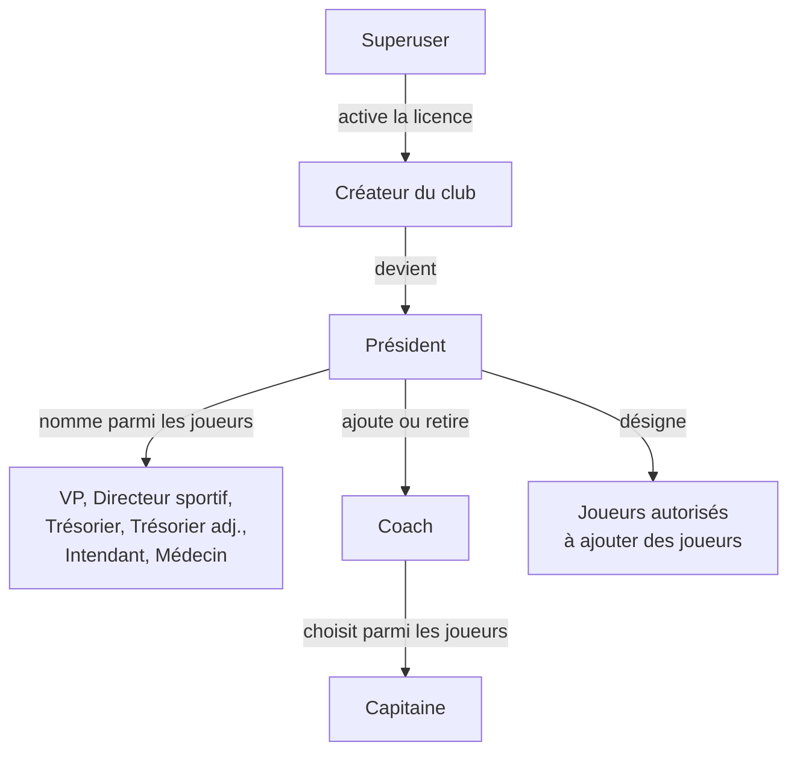
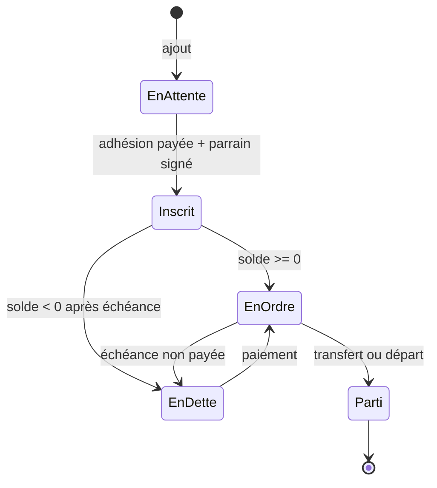
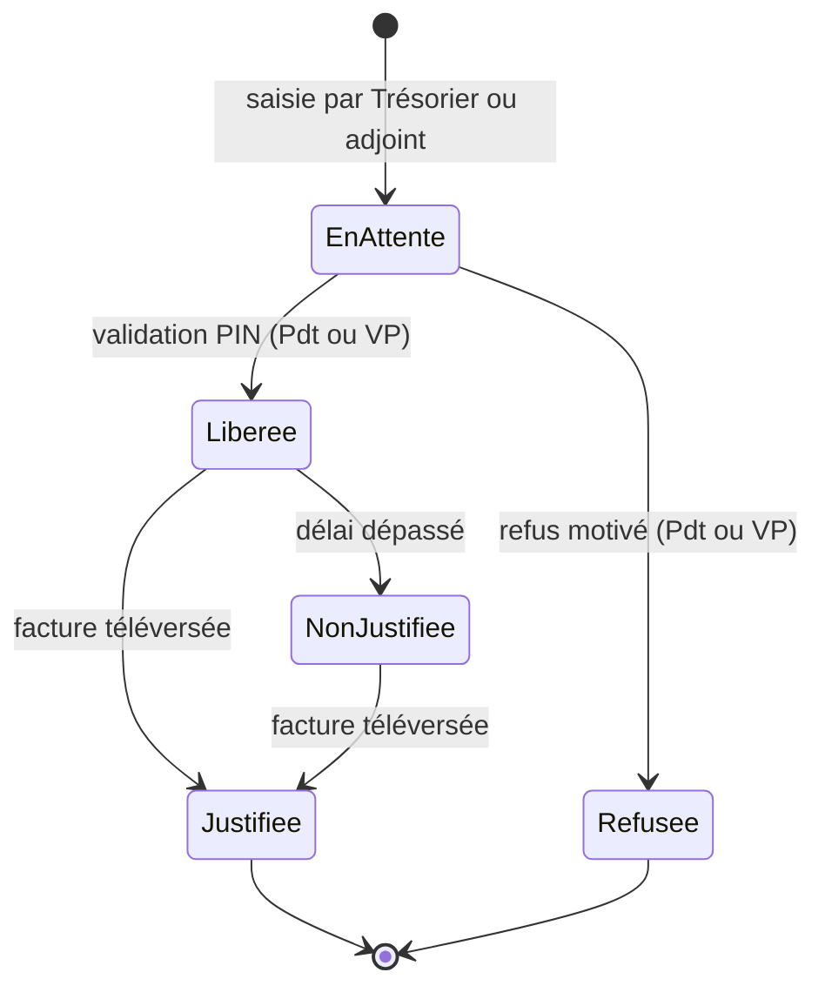
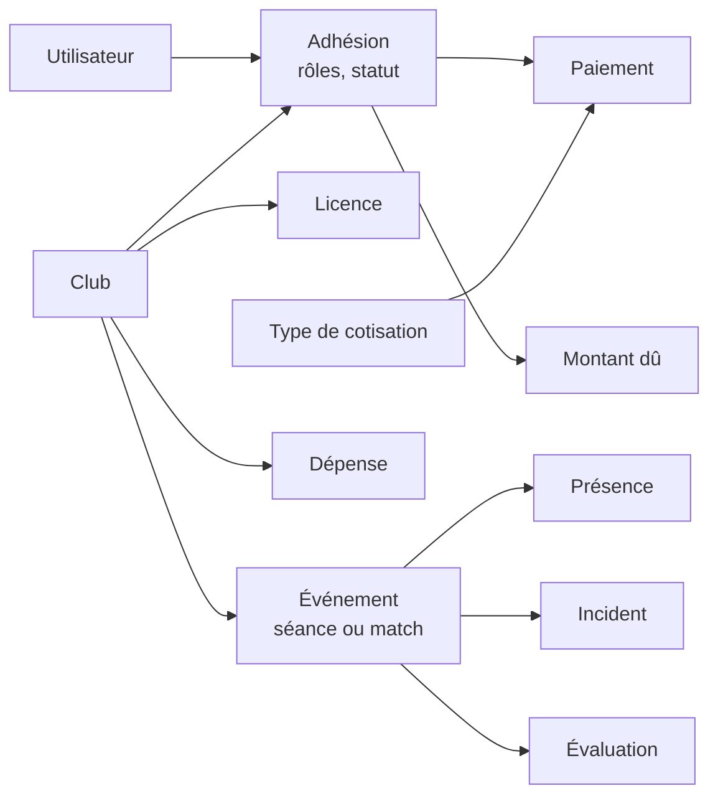

# Cahier des charges — Plateforme Vesta (v2)

Sep 25, 2026 · @Boendo Anicet

## 0. Pages liminaires

### 0.1 Objet du document

Ce cahier des charges définit la plateforme Vesta à reconstruire entièrement. Il remplace la version 1 et intègre les remarques du club pilote, Loisirs Club Discovery. Il sert de référence unique pour le développement, la recette et toute demande de changement.

### 0.2 Historique des versions

| Version | Date | Nature |
| --- | --- | --- |
| 2.1 | 25/09/2026 | Lot 0 : décisions Q1 à Q20 tranchées par le client (chapitre 10.2, entrées 15 à 37) ; confidentialité médicale (2.4, 4.12), licences (1.4), quorum d'AG (4.15), réinitialisation de mot de passe (7.1), signalement d'une publication (4.16) et caisse hors connexion (4.4.5, 6.6) précisés en conséquence |
| 2.0 | 25/09/2026 | Refonte complète, reconstruction de zéro |
| 1.0 | 2026 | Version initiale (remplacée) |

### 0.3 Principe structurant

Sur Vesta, **tout utilisateur d'un club est un joueur**, à commencer par le Président. Les fonctions (Président, Trésorier, Coach, Capitaine, Médecin, etc.) sont des rôles attribués à des joueurs. Seuls les Superusers ne sont pas joueurs : ils administrent la plateforme et les licences des clubs.

### 0.4 Glossaire

| Terme | Définition |
| --- | --- |
| Éditeur | Entité qui développe, héberge et exploite Vesta. Ses techniciens détiennent le rôle Superuser. |
| Superuser | Compte de l'Éditeur, non joueur. Gère les licences, les clubs, les comptes et le support. |
| Club (Tenant) | Équipe inscrite sur Vesta. Ses données privées sont strictement isolées des autres clubs. |
| Licence | Droit d'utilisation de Vesta accordé à un club pour une durée donnée (date de début, date de fin) ; aucune formule ni tarif au MVP (10.2 n° 20). |
| Joueur | Tout utilisateur membre d'un club, quelle que soit sa fonction. |
| Rôle | Fonction attribuée à un joueur dans son club (Président, Trésorier, Coach…). Un joueur peut en cumuler plusieurs. |
| Adhésion (Membership) | Lien entre un joueur et un club : dates d'entrée et de sortie, statut, rôles. |
| Statut du joueur | En attente, Inscrit, En ordre, En dette, Suspendu, Blessé, Parti. |
| Type de cotisation | Rubrique de recette définie par le club (mensuelle, spéciale, vestiaire, adhésion…). |
| Cotisation obligatoire | Cotisation dont le non-paiement à l'échéance crée une dette. |
| Cotisation libre | Cotisation volontaire, au montant choisi par le joueur. Elle ne crée jamais de dette. |
| Solde | Somme des paiements validés moins la somme des montants dus. Toujours calculé, jamais saisi. |
| En ordre | Joueur dont le solde des cotisations obligatoires échues est positif ou nul. |
| Quitus | Attestation numérique qu'un joueur n'a aucune dette envers son club. Requise pour un transfert. |
| Parrain | Joueur du club qui valide l'adhésion d'un nouveau joueur par sa signature électronique. |
| Code PIN | Code de 4 à 6 chiffres qui confirme une action sensible. |
| Séance | Entraînement du club, avec pointage et répartition en équipes A et B. |
| Feuille de match | Composition officielle d'un match, avec résultats et incidents. |
| Incident de terrain | Carton, blessure ou fait disciplinaire survenu en séance ou en match. |
| Ghost Mode | Affichage anonymisé des actions d'un Superuser : le club voit « Système Vesta ». |
| Boîte modale | Fenêtre qui s'ouvre au-dessus de la page courante sans la quitter. |

## 1. Présentation du projet

### 1.1 Vesta et son engagement solidaire

Une partie des revenus de Vesta est reversée à des orphelinats locaux. Cet engagement apparaît dans le footer de l'application. Le cahier des charges doit fixer :

- le pourcentage reversé et sa base de calcul (revenus des licences) ;
- la périodicité du reversement et les bénéficiaires ;
- le reporting publié (montant reversé par an).

Question ouverte : pourcentage et bénéficiaires, à définir par l'Éditeur.

### 1.2 Vision

Vesta est le « vestiaire numérique » d'un club de football amateur. Il réunit deux espaces :

- **l'espace privé du club** : trésorerie, présences, matchs, discipline, matériel, gouvernance ;
- **l'espace public** : fil d'actualité, cartes de joueurs, mercato, défis entre clubs.

L'objectif est d'automatiser les règles du club (cotisations, blocages, suspensions) tout en gardant la convivialité du football de loisir.

### 1.3 Public cible

| Cible | Besoins principaux |
| --- | --- |
| Équipes de vétérans (pilote : Loisirs Club Discovery) | Cotisations rigoureuses, présences du dimanche, convivialité, interface très simple |
| Clubs amateurs et locaux | Présences, statistiques, matériel, sans logiciel coûteux |
| Ligues et championnats de loisirs | Matchs amicaux, tournois, défis entre équipes |

### 1.4 Modèle économique : licences d'utilisation

Chaque club utilise Vesta sous licence, gérée par les Superusers.

- **Formules** : aucune formule ni tarif au MVP (décidé le 25/09/2026, 10.2 n° 20). Une licence est définie uniquement par une date de début et une date de fin, saisies par le Superuser. Le modèle de données doit permettre d'ajouter des formules plus tard sans migration destructive.
- **Durée** : la période d'essai suit la même mécanique (date de début/fin de 30 jours) ; au-delà, dates saisies par le Superuser à chaque attribution ou prolongation.
- **Cycle de vie** : essai → active → expirée (période de grâce) → suspendue → résiliée. Une licence suspendue bloque l'accès du club ; seule une licence expirée après la période de grâce passe le club en lecture seule (10.2 n° 19).
- **Effet d'une licence expirée** : après la période de grâce, le club passe en lecture seule. Ses données sont conservées et restent exportables.
- **Relances** : le Président est notifié 30 jours, 7 jours et 1 jour avant l'expiration.

Question ouverte restante : mode de paiement des licences côté Éditeur. Les formules et leur tarification ne sont plus une question ouverte : il n'y en a aucune au MVP (10.2 n° 20). Durée de l'essai et de la période de grâce actées (10.2 n° 1).

### 1.5 Périmètre du MVP

Inclus dans le MVP :

- gestion des clubs, des joueurs, des rôles et des licences ;
- trésorerie complète avec paiement par lien externe et validation manuelle ;
- entraînements, matchs, discipline, évaluations, plan tactique ;
- module médical ;
- logistique, assemblées générales, mercato ;
- fil public, communiqués, chat d'équipe interne ;
- notifications in-app et email, journal d'activité.

Hors MVP, prévus dans des lots ultérieurs :

- intégration de la passerelle FlexPaie ;
- API WhatsApp Business et SMS (le partage WhatsApp par lien simple est inclus) ;
- applications mobiles natives (le MVP est une PWA) ;
- tournois et championnats structurés entre clubs.

Toute demande absente de cette liste suit le processus de changement du chapitre 9.

## 2. Acteurs, rôles et gouvernance

### 2.1 Principe : tout utilisateur est un joueur

Chaque compte d'un club est d'abord un joueur, avec une fiche joueur complète (poste, numéro, statistiques, cotisations). Le Président, le bureau, le Coach, le Capitaine et le Médecin figurent donc dans le vestiaire, cotisent et peuvent être alignés. Les rôles s'ajoutent au statut de joueur, ils ne le remplacent pas.

Seuls les Superusers n'ont pas de fiche joueur. Ils n'apparaissent dans aucune liste de club.

### 2.2 Liste des rôles

| Rôle | Portée | Mission |
| --- | --- | --- |
| Superuser | Plateforme | Licences, clubs, comptes, support, surveillance des logs |
| Président | Club | Direction du club, nominations, validation des dépenses, identité du club |
| Vice-président | Club | Suppléance du Président, validation des dépenses, évaluations |
| Directeur sportif | Club | Mercato, suivi sportif global |
| Trésorier | Club | Encaissements, dépenses, types de cotisation, grille des cotisations |
| Trésorier adjoint | Club | Encaissements et saisie des dépenses |
| Intendant | Club | Matériel et inventaires |
| Coach | Club | Séances, matchs, compositions, tactique, discipline, évaluations |
| Capitaine | Club | Pointage des présences, répartition A/B, saisie des incidents |
| Médecin | Club | Fiches de santé, blessures, soins et suivi |
| Joueur | Club | Profil, cotisations, consultation des compositions et du vestiaire |

Un joueur peut cumuler plusieurs rôles (par exemple Capitaine et Trésorier adjoint). Ses droits sont alors l'union des droits de ses rôles.

### 2.3 Qui nomme qui



Règles de nomination :

- Le joueur qui crée le club devient Président. Il crée en même temps sa propre fiche joueur.
- Le Président nomme les membres du bureau et le Médecin parmi les joueurs du club. Il peut les révoquer.
- Le Président ajoute ou retire le Coach, qui est lui aussi un joueur du club.
- Le Coach choisit le Capitaine parmi les joueurs. Il peut le changer.
- Le Président désigne les joueurs autorisés à ajouter de nouveaux joueurs.
- Le changement de Président se fait par passation (le Président sortant désigne son successeur) ou, en cas de blocage, par le Superuser sur demande écrite du club, après une assemblée générale.
- Un club a toujours un et un seul Président. Le nombre de titulaires par rôle du bureau est **configurable par club**, un seul par défaut (décidé le 25/09/2026, 10.2 n° 24 — extension acceptée du 10.2 n° 3).
- Toute nomination ou révocation génère un log et une notification au joueur concerné.

### 2.4 Matrice des permissions

Légende : **É** = lecture et écriture, **L** = lecture seule, **P** = uniquement ses propres données, **D** = seulement si désigné par le Président, **—** = aucun accès. Abréviations : Pdt (Président), VP, DS (Directeur sportif), Trés (Trésorier), Adj (Trésorier adjoint), Int (Intendant), Coach, Cap (Capitaine), Méd (Médecin), J (Joueur).

| Fonctionnalité | Pdt | VP | DS | Trés | Adj | Int | Coach | Cap | Méd | J |
| --- | --- | --- | --- | --- | --- | --- | --- | --- | --- | --- |
| Identité du club (nom, logo, couleurs) | É | L | L | L | L | L | L | L | L | L |
| Nomination du bureau et du Médecin | É | L | L | L | L | L | L | L | L | L |
| Ajout ou retrait du Coach | É | L | L | L | L | L | L | L | L | L |
| Choix du Capitaine | L | L | L | L | L | L | É | L | L | L |
| Ajout et import de joueurs | É | D | D | D | D | D | D | D | D | D |
| Profil et fiche joueur | P | P | P | P | P | P | P | P | P | P |
| Numéro de maillot et poste des joueurs | L | L | L | L | L | L | É | L | L | L |
| Types de cotisation | É | L | — | É | L | — | — | — | — | — |
| Enregistrement des paiements | L | L | — | É | É | — | — | — | — | P |
| Grille des cotisations (tous joueurs) | L | L | — | É | É | — | — | — | — | P |
| Catégories de dépenses | É | L | — | É | L | — | — | — | — | — |
| Saisie d'une dépense | L | L | — | É | É | — | — | — | — | — |
| Validation d'une dépense | É | É | — | L | L | — | — | — | — | — |
| Demande d'assistance sociale | P | P | P | P | P | P | P | P | P | P |
| Séances : création | L | L | L | — | — | — | É | L | L | L |
| Séances et matchs : pointage, répartition A/B | É | L | L | — | — | — | É | É | L | L |
| Feuille de match et composition | L | L | L | L | L | L | É | L | L | L |
| Incidents et cartons | L | L | L | — | — | — | É | É | L | P |
| Évaluation des performances | É | É | L | — | — | — | É | — | — | P |
| Plan tactique | L | L | L | L | L | L | É | L | L | L |
| Fiches de santé et blessures | L | — | — | — | — | — | L | — | É | P |
| Matériel et inventaires | L | L | — | L | — | É | L | — | — | — |
| Mercato : offres et transferts | É | L | É | L | — | — | L | — | — | P |
| Assemblées générales | É | É | L | L | L | L | L | L | L | L |
| Communiqués officiels | É | É | L | L | L | L | L | L | L | L |
| Fil public : publier | É | É | É | É | É | É | É | É | É | É |
| Chat d'équipe | É | É | É | É | É | É | É | É | É | É |
| Journal d'activité | — | — | — | — | — | — | — | — | — | — |

Précisions :

- Sur les fiches de santé, le Coach ne voit que l'aptitude (apte, apte avec restriction, inapte) et la date de retour prévue, jamais le diagnostic, **sans aucune exception**. Le Président voit la même chose par défaut, sauf si le joueur lui a donné, depuis son profil, un consentement explicite à un accès complet à son dossier médical ; ce consentement est révocable à tout moment par le joueur, avec effet immédiat, et attaché à la fonction de Président (il ne se transmet pas automatiquement à un nouveau titulaire). Chaque octroi, chaque révocation et chaque consultation du dossier par le Président sont journalisés, sans copier le contenu médical dans le journal (voir 4.12 et 10.2 n° 15).
- Le Joueur voit en lecture seule le plan tactique, les compositions publiées et le vestiaire.
- Le journal d'activité n'est visible que par les Superusers.

### 2.5 Superuser et gestion des licences

Le Superuser est un technicien de l'Éditeur. Il n'est membre d'aucun club et n'a pas de fiche joueur. Il dispose d'un espace d'administration séparé de l'espace club.

Ses fonctions :

- **Licences** : créer, activer, prolonger, suspendre ou résilier la licence d'un club ; consulter l'historique et les échéances. La résiliation exige la saisie du nom du club en confirmation, en plus du motif habituel (décidé le 25/09/2026, 10.2 n° 26).
- **Clubs** : liste de tous les clubs, statut de licence, nombre de joueurs, date de dernière activité.
- **Comptes** : liste de tous les utilisateurs et de leur identifiant ; réinitialisation du mot de passe sur demande (mot de passe temporaire aléatoire de 8 caractères, affiché une seule fois, valable 48 h — 10.2 n° 21), avec changement obligatoire à la connexion suivante.
- **Support** : intervention sur les données d'un club (correction d'un paiement, d'un score), en Ghost Mode.
- **Surveillance** : consultation et filtrage du journal d'activité de tous les clubs.
- **Paramètres globaux** : engagement solidaire, modèles de documents, versionnement des CGU (10.2 n° 27). Aucune formule de licence au MVP (10.2 n° 20).

Le Superuser a accès à tout. Ces pouvoirs sont mentionnés dans les CGU de Vesta, et chacune de ses actions est journalisée avec son identité réelle (voir chapitre 5).

## 3. Charte UX/UI et règles d'interface

Ce chapitre s'impose à tous les écrans. Il est validé par le client avant le début du développement, et tout écart est traité comme une anomalie.

### 3.1 Principes généraux

- **Mobile-first** : chaque écran est conçu d'abord pour un smartphone de 360 px de large, utilisé au bord du terrain, puis adapté à la tablette et à l'ordinateur.
- **Densité maîtrisée** : texte courant de 14 à 16 px, titres de page de 20 à 24 px au maximum. Pas de gros boutons ni de gros caractères décoratifs.
- **Boutons** : hauteur de 36 à 40 px, une seule action principale par zone. Les actions secondaires sont en bouton discret ou dans un menu « … ».
- **Zones tactiles** : 44 × 44 px minimum sur mobile, même si le bouton paraît plus petit.
- **Hiérarchie** : chaque page a un titre, une ligne de contexte (nom du club, période) et des sections en cartes. On consulte d'abord, on agit ensuite.
- **Cohérence** : mêmes composants, mêmes couleurs de statut et mêmes libellés sur toutes les pages.

### 3.2 Règle des formulaires : boîtes modales obligatoires

**Tout formulaire s'ouvre dans une boîte modale.** On ne crée jamais une page qui ne contient qu'un formulaire. La page affiche l'information ; le bouton d'action ouvre le formulaire par-dessus, et l'utilisateur revient à la même page une fois l'action terminée.

La règle couvre notamment :

- la création et la modification de toute donnée (joueur, paiement, dépense, séance, match, incident, type de cotisation, catégorie de dépense, publication) ;
- la modification du profil, de l'identifiant et du mot de passe ;
- la confirmation par code PIN ;
- les imports CSV ;
- les demandes (assistance sociale, offre de transfert) ;
- la gestion de la composition d'un match (liste à cases à cocher).

Comportement des modales :

- Fermeture par un bouton « Fermer » (croix en haut à droite), la touche Échap ou un clic en dehors.
- Si des données ont été saisies, la fermeture demande une confirmation (« Abandonner les modifications ? »).
- Sur mobile, la modale s'affiche en plein écran ou en panneau glissant depuis le bas.
- Les boutons « Annuler » et « Enregistrer » restent visibles en bas de la modale, même si le formulaire défile.
- Les erreurs s'affichent sous le champ concerné, en français clair, jamais sous forme de message technique.
- Après enregistrement : fermeture de la modale, message de confirmation bref, mise à jour de la page sans rechargement.

Exception : un processus à plusieurs étapes (inscription d'un club, création d'une assemblée générale) prend la forme d'un assistant pas à pas dans une grande modale. Une page dédiée n'est admise que sur justification validée par le client.

### 3.3 Règle des listes

- Par défaut, une liste affiche les derniers éléments, avec un bouton « Voir plus » en bas.
- Le nombre affiché dépend de la section : 5 pour les séances, matchs et incidents ; 20 pour les paiements ; 10 pour les notifications.
- Un clic sur un élément ouvre une modale de détail. Les actions possibles sur l'élément (modifier, supprimer) sont dans cette modale.
- Au-delà de 30 éléments possibles (joueurs, transferts), on utilise un tableau avec recherche, filtres et pagination. Une liste déroulante (select) n'est jamais utilisée pour choisir un joueur ; on utilise un champ de recherche avec suggestions.
- Les tableaux larges défilent horizontalement dans leur propre cadre, sans faire défiler la page.

### 3.4 Composants communs

- **Loader** : affiché à chaque chargement de page et pendant chaque action. Sur les listes, on affiche des blocs gris animés à la place du contenu.
- **États vides** : chaque section vide affiche un message et, si le rôle le permet, l'action pour commencer (« Aucun incident pour l'instant »).
- **Confirmations** : toute suppression ou action irréversible demande une confirmation ; les actions sensibles demandent le code PIN.
- **Badges de statut** : couleurs fixes pour toute l'application.

| Statut | Couleur |
| --- | --- |
| En ordre, Validé, Présent | Vert |
| En attente, À justifier | Orange |
| En dette, Refusé, Absent, Inapte | Rouge |
| Suspendu | Violet |
| Parti, Archivé | Gris |

- **Notifications** : l'icône cloche, avec un compteur, ouvre une modale listant les notifications.
- **Avatar** : la photo du joueur est affichée partout où son nom apparaît ; à défaut, ses initiales.

### 3.5 Identité visuelle par club (marque blanche)

L'application porte l'identité du club connecté, jamais un nom de club écrit en dur dans le code.

- En haut de la barre latérale : logo et nom du club.
- Page de connexion : logo du club en filigrane, lorsque le club est identifié par son adresse (voir 7.3).
- Fil public, documents PDF, espace Coach : nom et logo du club.
- Le Président modifie le nom, le logo et les couleurs du club dans une modale.
- Footer, sur toutes les pages : « VESTA by IMARA TECH Group — une partie de nos revenus est destinée aux orphelinats locaux ». C'est la seule mention de l'Éditeur dans l'application.
- Le bas de la barre latérale (nom de l'utilisateur connecté, déconnexion) doit tenir sur la largeur de la barre sans débordement.

### 3.6 Thèmes

- **Classic** : couleurs extraites du logo du club (couleur principale et secondaire).
- **Clair** et **Sombre** : versions neutres.
- Le choix du thème est propre à chaque utilisateur et mémorisé.
- Tous les textes respectent un contraste suffisant pour être lus en plein soleil.

### 3.7 Processus de validation du design

1. Maquette de chaque écran clé (accueil, profil, trésorerie, espace coach, séance, match, comité, mercato, AG) avant développement.
2. Validation écrite du client sur la maquette.
3. Développement conforme à la maquette validée.
4. Recette visuelle sur smartphone réel.

Le design déjà posé par le client sur la version précédente sert de point de départ aux maquettes.

## 4. Spécifications fonctionnelles par module

Chaque module décrit : objectif, acteurs, écrans et modales, règles métier, cas limites, logs et notifications, critères d'acceptation. Tout formulaire suit la règle 3.2 (boîte modale).

### 4.1 Comptes, inscription et profils

**Objectif** : créer le club et ses joueurs, et permettre à chacun de gérer son profil.

**Création d'un club** (assistant en modale) :

1. Informations du club : nom, logo, couleurs, ville, pays, devise (USD par défaut, CDF possible), fuseau horaire.
2. Fiche joueur du créateur, qui devient Président.
3. Activation de la licence d'essai (ou d'une licence fournie par le Superuser).

**Ajout d'un joueur** (modale, par le Président ou un joueur désigné) :

| Champ | Obligatoire | Remarque |
| --- | --- | --- |
| Prénom, nom | Oui |  |
| Email | Oui | Sert d'identifiant de connexion ; unique sur la plateforme |
| Téléphone (WhatsApp) | Non | Pour les reçus et communiqués |
| Poste | Oui à la création manuelle | Gardien, Défenseur, Milieu, Attaquant ; poste précis facultatif |
| Numéro de maillot | Non | Unique dans le club |
| Date de naissance | Non | L'âge est calculé |
| Poids (kg), taille (cm) | Non |  |
| Photo | Non à la création | Demandée au joueur à sa première connexion |
| Type de cotisation mensuelle | Oui | Par exemple catégorie 20 $, 10 $ ou 5 $ |
| Parrain | Oui pour un nouveau joueur | Voir 4.3 |

Aucun nom d'utilisateur n'est demandé : l'email est l'identifiant. Le mot de passe initial est l'email, conformément à la demande du club, mais **le joueur doit le changer à sa première connexion**. Tant qu'il ne l'a pas changé, il n'accède à aucune donnée.

**Import CSV des joueurs existants** (modale) :

- Colonnes : email, prenom, nom, telephone, poste, numero, date\_naissance, poids, taille, type\_cotisation.
- Seuls email, prenom et nom sont obligatoires. Un poste ou une date vide n'empêche pas l'import.
- Dates acceptées : JJ/MM/AAAA et AAAA-MM-JJ.
- Un email déjà présent dans le club met à jour la fiche au lieu de créer un doublon.
- Les joueurs importés sont membres historiques : ils passent directement « Inscrit », sans parrainage.
- Un modèle CSV est téléchargeable depuis la modale.
- Le rapport liste les lignes importées et les lignes en échec, avec le numéro de ligne et un message en français (« Ligne 12 : email invalide »).

**Page « Mon profil »** (consultation) :

- En-tête : photo, nom, poste, numéro, rôles, badge de statut.
- Informations personnelles et physiques : âge, poids, taille, téléphone.
- Situation financière : solde, prochaines échéances, derniers paiements, bouton « Contribuer » (voir 4.6).
- Statistiques de la saison et historique de carrière.
- Aptitude médicale (apte, restriction, inapte).
- Bouton « Modifier mon profil » : modale à onglets « Informations », « Photo », « Identifiant et mot de passe », « Code PIN ».

**Mot de passe oublié** : le joueur envoie une demande depuis la page de connexion. Le Superuser réinitialise le mot de passe : un mot de passe temporaire aléatoire de 8 caractères est généré, affiché une seule fois au Superuser, valable 48 heures ; le joueur doit le changer obligatoirement à la connexion suivante (décidé le 25/09/2026, 10.2 n° 21). La création initiale d'un compte reste inchangée : mot de passe = email, changement obligatoire à la première connexion.

**Statuts du joueur** :



Les statuts « Suspendu » (discipline) et « Blessé » (médical) se superposent à la situation financière : un joueur peut être à la fois En ordre et Suspendu.

**Critères d'acceptation** : un club importé de 40 joueurs sans poste ni date passe sans échec ; un joueur ne peut rien consulter avant d'avoir changé son mot de passe initial.

### 4.2 Cartes de joueurs et statistiques

**Carte de joueur** (style FC/FIFA) : photo, nom, poste, numéro, note globale, et six indicateurs lisibles en toutes lettres (matchs, buts, passes décisives, cartons, taux de présence, note moyenne). Aucun libellé tronqué.

**Fiche détaillée** (inspirée de Football Manager), ouverte au clic sur une carte :

- **Aperçu** : identité, attributs sur graphique radar, forme récente (5 dernières notes).
- **Statistiques** : par saison et en cumul.
- **Évaluations** : courbe des notes par séance et par match.
- **Présences** : taux, retards, absences.
- **Discipline** : cartons avec leur cause, suspensions.
- **Carrière** : clubs successifs sur Vesta.
- **Aptitude** : apte, restriction ou inapte, sans diagnostic.

**Attributs** : les attributs du radar (par exemple technique, physique, mental, discipline, assiduité, contribution offensive) sont calculés à partir des évaluations (4.10) et des statistiques.

**Comparaison de joueurs** : sélection de 2 à 4 joueurs par recherche, tableau côte à côte et radar superposé. La comparaison est possible entre joueurs de clubs différents sur les données publiques.

**Visibilité publique** : la carte et les statistiques sportives sont publiques. Le poids, la taille, le téléphone, les finances et la santé ne le sont jamais.

### 4.3 Adhésion et parrainage

**Objectif** : valider l'entrée d'un nouveau joueur par un paiement et la signature d'un parrain.

Déroulement :

1. Le joueur est ajouté avec le statut « En attente » et un parrain choisi parmi les joueurs inscrits.
2. Les frais d'adhésion sont payés. Ils correspondent au type de cotisation marqué « adhésion », dont le montant est fixé par le club (5 $ pour Discovery).
3. Le système génère la fiche d'adhésion en PDF, aux couleurs du club.
4. Le parrain reçoit une notification et signe par son code PIN.
5. La fiche signée est archivée ; le joueur passe « Inscrit ».

Cas limites :

- **Le parrain refuse** : il indique un motif ; le Président est notifié et décide de désigner un autre parrain ou d'annuler l'adhésion. Le sort du paiement (remboursement ou conservation) est enregistré.
- **Le parrain ne répond pas** : rappel après 3 jours, alerte au Président après 7 jours.
- **Le joueur ne paie pas** : il reste « En attente » et ne peut être aligné nulle part.

**Logs et notifications** : ajout, paiement, génération de la fiche, signature ou refus.

### 4.4 Trésorerie et cotisations

**Objectif** : suivre toutes les recettes du club, calculer la situation de chaque joueur et en déduire automatiquement qui est en ordre.

#### 4.4.1 Types de cotisation

Le Président et le Trésorier créent, modifient et archivent les types de cotisation dans une modale.

| Attribut | Valeurs | Rôle |
| --- | --- | --- |
| Nom | Texte | Par exemple « Mensuelle catégorie 20 $ » |
| Nature | Obligatoire ou libre | Seule une cotisation obligatoire crée une dette |
| Montant | Fixe (obligatoire) ou suggéré (libre) | En devise du club |
| Périodicité | Mensuelle, annuelle, ponctuelle | Les ponctuelles ont une date limite |
| Échéance | Jour du mois (par exemple le 10) | Date après laquelle l'impayé devient une dette |
| Frais d'adhésion | Oui ou non | Son paiement fait passer le joueur « Inscrit » |
| Concernés | Tous, une liste de joueurs, les joueurs rattachés | Les mensuelles se rattachent joueur par joueur |
| État | Actif ou archivé |  |

Un type qui a déjà reçu des paiements ne peut pas être supprimé, seulement archivé. Une modification de montant ne s'applique qu'aux mois suivants, jamais aux mois passés.

Exemples pour Discovery : trois types mensuels obligatoires (20 $, 10 $, 5 $), l'adhésion (5 $, frais d'adhésion), la cotisation spéciale (libre, ponctuelle), la cotisation vestiaire (libre).

#### 4.4.2 Échéances et calcul du solde

Chaque premier du mois, une tâche automatique crée le montant dû du mois pour chaque joueur actif, selon son type mensuel. Ce montant ne devient une dette qu'après la date d'échéance du type, plus une tolérance configurable par le club (0 jour par défaut). Ainsi, personne n'est bloqué le 1er du mois.

Le solde n'est jamais saisi ni stocké. Il est recalculé à chaque consultation :

```latex
\text{Solde} = \sum \text{Paiements validés (types obligatoires)} - \sum \text{Montants dus échus (types obligatoires)}
```

Les cotisations libres (spéciale, vestiaire) sont suivies et affichées, mais n'entrent jamais dans le solde. Le solde est reporté d'un mois et d'une saison à l'autre.

Un joueur est « En ordre » si son solde est positif ou nul, « En dette » sinon. Le statut change dès qu'un paiement est validé.

Cas particuliers à trancher par le club : joueur arrivé en cours de mois (mois entier dû ou non), joueur blessé de longue durée ou absent (suspension temporaire des cotisations par décision du Président, tracée).

#### 4.4.3 Répartition des paiements

Un paiement sur un type obligatoire est affecté automatiquement, dans cet ordre : les mois impayés les plus anciens, puis le mois courant, puis les mois à venir.

Exemple : un joueur à 10 $ par mois, à jour, verse 40 $ en mars. Le paiement couvre mars, avril, mai et juin.

La modale d'enregistrement affiche cette répartition avant validation.

#### 4.4.4 Enregistrement d'un paiement

Modale « Enregistrer un paiement » (Trésorier ou adjoint) :

- joueur, choisi par recherche sur le nom ;
- type de cotisation, choisi dans la liste des types actifs ;
- montant, mode (espèces, mobile money, lien de paiement), référence, date ;
- pièce jointe facultative ;
- aperçu de la répartition et du nouveau solde ;
- confirmation par code PIN.

Chaque paiement validé génère un reçu numéroté (PDF aux couleurs du club) envoyé au joueur par email et consultable dans son profil.

Un paiement validé n'est jamais supprimé. Une erreur se corrige par une écriture d'annulation, avec motif, validée par le Président.

#### 4.4.5 Caisse Terrain Express

Écran simplifié pour le dimanche au bord du terrain :

- ouverture d'une **session de caisse** par le Trésorier ou l'adjoint, en ligne, avec vérification du code PIN par le serveur ; la session reste valable jusqu'à minuit (fuseau du club) ;
- recherche du joueur par nom ou numéro, avec photo et solde affichés ;
- saisie du montant en espèces et du type (par défaut la mensuelle du joueur) ; aucun code PIN n'est redemandé pendant la session de caisse, y compris hors connexion ;
- le joueur devient immédiatement sélectionnable s'il est désormais en ordre.

Cet écran fonctionne hors connexion (voir 6.6) : les encaissements saisis hors connexion pendant une session de caisse ouverte sont synchronisés au retour du réseau et journalisés avec l'identifiant de la session (décidé le 25/09/2026, 10.2 n° 22 ; aucun code PIN n'est stocké sur l'appareil).

#### 4.4.6 Tableau de bord Trésorerie

- **Indicateurs** : encaissé du mois, taux de recouvrement, total des dettes, caisse disponible (encaissements moins dépenses libérées).
- **Membres du club** : tableau avec filtres par type de cotisation, statut et nom ; clic sur un joueur pour ouvrir son détail financier.
- **Derniers paiements** : les 20 derniers, bouton « Voir plus » ; clic sur un paiement pour ouvrir son détail en modale.
- **Actions** : enregistrer un paiement, Caisse Terrain Express, importer des cotisations.

#### 4.4.7 Grille des cotisations

Menu dédié dans la barre latérale pour le Trésorier, l'adjoint et le Président.

- Un tableau par type de cotisation, avec une année sélectionnable.
- Lignes : les joueurs rattachés. Colonnes : janvier à décembre, puis total.
- Cellule : montant affecté au mois, couleur selon l'état (payé, partiel, impayé échu, à venir).
- Un paiement anticipé s'étale sur plusieurs mois selon la règle 4.4.3.
- Le tableau défile horizontalement, la colonne des joueurs reste figée.
- Clic sur une cellule : détail des paiements du mois.
- Export CSV.

Chaque joueur voit sa propre ligne dans son profil.

#### 4.4.8 Import des cotisations historiques (CSV)

L'import reprend les fichiers de suivi existants du club (une ligne par joueur, une colonne par mois).

- La modale demande le **type de cotisation** concerné et l'année.
- Colonnes : email ou nom du joueur, puis un mois par colonne.
- « ok » dans une cellule = mois payé au montant plein du type.
- Un montant dans une cellule = paiement de ce montant, réparti selon la règle 4.4.3 (60 $ sur un type à 10 $ couvrent le mois et les 5 suivants).
- Une cellule vide = rien payé.
- Un aperçu de la grille résultante est montré avant l'import définitif.
- Le rapport liste les lignes en échec (joueur introuvable, valeur illisible).

### 4.5 Dépenses et assistance sociale

#### 4.5.1 Catégories de dépenses

Le Président et le Trésorier créent, modifient et archivent les catégories : nom, plafond facultatif, justificatif obligatoire (oui par défaut), et **« réservée aux membres en ordre »**. Cette dernière option s'applique aux dépenses qui bénéficient à un joueur, comme l'assistance sociale.

#### 4.5.2 Circuit d'une dépense



- La saisie comprend : catégorie, montant, bénéficiaire, motif, date, justificatif (facultatif à la saisie).
- Le justificatif (photo ou PDF) est obligatoire pour clôturer la dépense. Les photos sont compressées à l'envoi.
- Délai de justification : 7 jours après la libération (configurable).

**Blocage automatique** : tant qu'une dépense est « Non justifiée », aucune nouvelle dépense ne peut être libérée. Le Trésorier, l'adjoint et le Président reçoivent une alerte rouge.

**Dérogation** : en cas d'urgence (décès, blessé à soigner), le Président peut libérer une dépense malgré le blocage, avec un motif et son code PIN. La dérogation est journalisée et signalée à la prochaine assemblée générale.

#### 4.5.3 Assistance sociale

- Un joueur fait une demande dans une modale : événement (naissance, mariage, décès), date, description, pièce justificative.
- La modale affiche avant l'envoi l'éligibilité, le montant prévu par le barème du club et le délai de traitement.
- Éligibilité : être en ordre à la date de l'événement. Un joueur en dette voit le montant à régulariser pour devenir éligible ; il peut néanmoins envoyer sa demande sans être éligible (décidé le 25/09/2026, 10.2 n° 33).
- Le Président ou le Vice-président valide ; la demande devient une dépense de la catégorie correspondante. L'éligibilité reste une condition de la validation, pas seulement de l'envoi : une demande d'un joueur toujours en dette ne peut pas être approuvée ni libérée (décidé le 25/09/2026, 10.2 n° 37).
- Le joueur suit l'état de sa demande dans son profil.

### 4.6 Paiement en ligne

**Phase 1 (MVP) : lien de paiement externe.**

- Chaque club configure son lien de paiement dans ses paramètres (pour Discovery, sa page de paiement laxtech). Aucun lien n'est écrit en dur.
- Le bouton « Contribuer » du profil ouvre ce lien dans un nouvel onglet.
- Au retour, le joueur peut déclarer son paiement par le bouton « J'ai payé » (modale : type, montant, référence de transaction, capture).
- La déclaration apparaît chez le Trésorier comme « À valider ». Une fois validée, elle est traitée comme un paiement normal.

**Phase 2 : intégration FlexPaie.**

- Le joueur choisit le type et le montant dans Vesta, puis paie par mobile money ou carte.
- La confirmation de FlexPaie valide automatiquement le paiement, met à jour le statut et envoie le reçu, sans intervention du Trésorier.

**Préparation dès la phase 1** : chaque transaction porte un fournisseur (manuel, lien, FlexPaie), une référence externe et un statut (initié, en attente, réussi, échoué). Le passage à FlexPaie n'exige donc aucun changement du modèle de données.

### 4.7 Entraînements

**Objectif** : organiser la séance du dimanche, pointer les présences et répartir les joueurs en équipes A et B.

**Création d'une séance** (Coach, en modale) : date, heure de rassemblement, heure limite d'arrivée, terrain, couleurs des maillots (A bleu et B rouge par défaut, modifiables), consignes.

**Pointage** (Coach ou Capitaine) :

- La liste des joueurs du club s'affiche avec photo et numéro.
- Un appui sur « Arrivé » enregistre l'heure exacte. Le Coach peut corriger l'heure le jour même.
- Arrivée avant l'heure limite : **Présent**. Arrivée après : **En retard, compté absent**, par défaut — ce comptage est **configurable par club** (décidé le 25/09/2026, 10.2 n° 25 — extension acceptée du 10.2 n° 6).
- Un joueur non pointé est **Absent**. Le Coach peut marquer une absence comme excusée (blessé, voyage) ; elle reste une absence mais est distinguée dans les statistiques.
- Le pointage fonctionne hors connexion.

**Répartition en équipes A et B** (Président, Coach ou Capitaine) :

- Les joueurs présents sont répartis automatiquement selon leur ordre d'arrivée. Règle par défaut : alternance (1er en A, 2e en B, 3e en A…) ; le club peut choisir une autre règle.
- L'écran affiche **deux terrains** côte à côte (sur mobile, l'un au-dessus de l'autre), aux couleurs des maillots.
- Un joueur se déplace d'une équipe à l'autre par glisser-déposer ou par le bouton « Passer en A/B ».
- Décidé le 25/09/2026 (10.2 n° 6, n° 25, précisé au n° 38) : un joueur en retard est compté absent dans les statistiques ; ce comptage est configurable par club. Il n'est **pas réparti automatiquement** et arrive dans la zone « Non répartis », mais, à la différence d'un joueur en dette, suspendu ou inapte (jamais placeable, même manuellement), le Coach ou le Capitaine **peut le placer manuellement** en équipe A ou B.
- Décidé le 30/09/2026 (10.2 n° 39) : chaque équipe a son propre terrain positionné, plafonné à 11 joueurs sur le terrain, avec une formation propre (bibliothèque du 4.11) ; l'excédent reste sur un banc par équipe, placeable sur le terrain par glisser-déposer (échange avec un coéquipier déjà en place si la case est occupée).

**Modification** : une séance (pointage et répartition) n'est modifiable que le jour même, selon le fuseau du club. À minuit, elle est verrouillée. Seul un Superuser peut corriger une séance verrouillée, sur demande du Président.

**Liste des séances** : les 5 dernières, bouton « Voir plus ». Une séance s'ouvre en détail et se referme par un bouton « Fermer ».

**Vestiaire du jour** : la page Vestiaire affiche automatiquement les joueurs pointés présents à la séance ou au match du jour, avec leur équipe. Elle est visible par tous les joueurs du club et mise en avant sur l'accueil du Président.

- Décidé le 01/10/2026 (10.2 n° 40) : par exception à la consultation pure décrite ci-dessus et dans `docs/ecrans/sport-vestiaire.md`, la vue « Terrain » de cette page devient modifiable pour le Coach, le Capitaine et le Président (mêmes rôles qu'en 4.7) : choix de formation, glisser-déposer/toucher pour placer et échanger des joueurs sur le terrain, et déplacement d'un joueur du banc d'une équipe vers le banc de l'autre pour changer son équipe. Pour tous les autres rôles, le terrain reste strictement en lecture seule, comme décrit plus haut.

**Après la séance** : évaluation des joueurs (4.10) et saisie des incidents (4.9).

### 4.8 Matchs et feuilles de match

**Création d'un match** (Coach, en modale) : adversaire (club Vesta ou équipe extérieure saisie en texte), date, heure, lieu, type (amical, championnat, tournoi), domicile ou extérieur.

**Défi entre clubs** : un club peut envoyer une demande de match amical à un autre club Vesta. Si elle est acceptée, le match apparaît dans les deux clubs.

**Pointage** : mêmes règles que pour les séances (Coach ou Capitaine).

**Composition** (Coach) dans une modale :

- Liste de tous les joueurs du club avec case à cocher, recherche et filtre par poste.
- Aucune limite artificielle : le Coach peut cocher tous les joueurs disponibles.
- Chaque joueur coché est marqué titulaire ou remplaçant, avec son poste et son numéro du jour.
- Les joueurs non sélectionnables sont grisés avec la raison : en dette (montant affiché), suspendu (nombre de matchs restants), inapte (avis médical), en attente d'adhésion.
- Régularisation sur place : un paiement validé par la Caisse Terrain Express rend le joueur immédiatement sélectionnable.
- Bouton « Publier la composition » : visible par les joueurs du club, en lecture seule, après connexion ; notification aux joueurs convoqués.

**Feuille de match** (après la rencontre, Coach) :

- score ;
- buteurs et passeurs décisifs ;
- cartons avec leur cause (4.9) ;
- blessures, transmises au Médecin (4.12) ;
- équipements reçus pour le match (maillots, bas, bottines, ballons…), avec quantités, liés au registre du matériel (4.13).

Le Coach peut modifier les buts et les passes décisives après coup ; chaque modification est journalisée. Les statistiques des cartes de joueurs se mettent à jour automatiquement.

**Liste des matchs** : les 5 derniers, bouton « Voir plus » ; ouverture et fermeture du détail comme pour les séances.

**Publication** : le résultat peut être publié sur le fil public en un clic.

### 4.9 Discipline et incidents de terrain

**Saisie d'un incident** (Coach ou Capitaine, en modale) :

- joueur, séance ou match, minute (facultative) ;
- type : carton jaune, carton rouge, sanction interne ;
- cause : liste (contestation, faute grossière, comportement, retard, autre) et précision en texte ;
- arbitre ou auteur de la sanction.

**Règles automatiques** (paramétrables par le club) :

| Règle | Valeur par défaut | À confirmer |
| --- | --- | --- |
| Suspension au cumul de cartons jaunes | 5e jaune de la saison | Oui |
| Durée de la suspension (cumul de jaunes) | 1 match | Oui |
| Carton rouge direct | Suspension de 1 match | Oui |
| Remise à zéro des compteurs | Début de chaque saison | Oui |

- La saison est définie par ses dates de début et de fin dans les paramètres du club.
- Un joueur suspendu ne peut être ni composé ni placé dans un plan tactique.
- La suspension est levée automatiquement après le nombre de matchs du club prévu.
- Si le club inflige des amendes, elles prennent la forme d'une cotisation ponctuelle obligatoire affectée au joueur.

**Liste des incidents** : les 5 derniers, bouton « Voir plus », message si aucun incident.

**Notifications** : le joueur et le Coach sont notifiés de chaque carton et de chaque suspension.

### 4.10 Évaluation des performances

- **Évaluateurs** : le Coach, le Président et le Vice-président.
- **Moment** : après chaque séance et chaque match, dans les 48 heures ; ensuite l'évaluation est verrouillée.
- **Grille** : une note globale sur 10, et des critères facultatifs sur 10 (technique, physique, tactique, mental, attitude). Grille définitive à valider avec le club.
- **Saisie rapide** : un écran liste les joueurs présents avec un curseur de note chacun.
- **Plusieurs évaluateurs** : la note retenue est la moyenne.
- **Commentaire** : facultatif, visible ou non par le joueur au choix de l'évaluateur.
- **Usage** : les notes alimentent la fiche détaillée, le radar et la comparaison de joueurs. Le joueur voit ses propres notes.

### 4.11 Plan tactique et tableau noir

- **Formations** : bibliothèque à 11 (4-4-2, 4-3-3, 4-2-3-1, 3-5-2, 3-4-3, 5-3-2, 4-1-4-1, 4-5-1) et à effectif réduit (7 et 8 joueurs), plus formations personnalisées.
- **Terrain** : le Coach place les joueurs par glisser-déposer. Les joueurs en dette, suspendus ou inaptes sont grisés et ne peuvent pas être placés.
- **Joueurs** : le Coach peut modifier le numéro de maillot et le poste d'un joueur depuis le plan ; la fiche joueur est mise à jour.
- **Tableau noir** : flèches de déplacement, zones, annotations, consignes écrites par joueur ou par ligne.
- **Plans** : nommés, enregistrés, dupliqués et rattachés à un match.
- **Partage** : la publication se fait uniquement sur Vesta. Les joueurs se connectent pour voir le plan, en lecture seule, sans pouvoir le modifier ni le supprimer.
- **Mobile** : le plan est utilisable sur smartphone en orientation portrait et paysage.

### 4.12 Module médical

**Objectif** : connaître l'état de santé des joueurs, prendre en charge les blessures et suivre leur guérison.

**Fiche de santé** (une par joueur) :

- groupe sanguin, allergies, antécédents, traitements en cours ;
- contact d'urgence ;
- déclaration du joueur sur son état de santé ;
- aptitude : apte, apte avec restriction, inapte.

Le joueur remplit sa déclaration et donne son consentement au traitement de ces données à sa première connexion. Le Médecin complète la fiche et fixe l'aptitude.

**Déclaration d'une blessure** :

1. Pendant une séance ou un match, le Coach, le Capitaine ou le Médecin signale la blessure (joueur, moment, circonstances).
2. Le Médecin est notifié et complète : localisation, gravité (légère, modérée, grave), soins donnés sur place, orientation (repos, consultation, hôpital), durée d'indisponibilité estimée.
3. Le joueur passe « Blessé » et inapte : il ne peut plus être composé.
4. Le Médecin ajoute des entrées de suivi datées (évolution, soins, examens).
5. Le Médecin déclare le retour : le joueur redevient apte et sélectionnable.

**Confidentialité** : le diagnostic et le suivi ne sont visibles que par le Médecin et le joueur, sans exception pour le Coach. Le Président voit par défaut la même chose que le Coach (aptitude et date de retour prévue), sauf consentement explicite et révocable du joueur donné à la fonction de Président pour un accès complet (voir 2.4 et 10.2 n° 15) ; ce consentement, sa révocation et chaque consultation du dossier par le Président sont journalisés. Les autres joueurs du club (coéquipiers) ne voient jamais l'aptitude ni le motif : un joueur inapte, suspendu ou en attente d'adhésion leur apparaît simplement « Indisponible », sans distinction (10.2 n° 16).

**Décidé le 25/09/2026 (10.2 n° 17, réécrit)** : il n'existe pas de situation « sans Médecin ». Si le club n'a personne de qualifié, le Président nomme un joueur au rôle Médecin comme n'importe quel autre rôle (2.3) — affiché « Médecin / référent santé » dans ce cas — avec exactement les mêmes droits que le rôle Médecin, diagnostic inclus pour ce qu'il saisit lui-même. La décision antérieure du 10.2 n° 10 (« le Coach fixe l'aptitude sans Médecin ») est caduque.

### 4.13 Logistique et matériel

- **Catalogue** : articles par catégorie (maillots, bas, bottines, ballons, matériel divers : plots, chasubles, trousse médicale), avec quantité et état.
- **Registre des mouvements** (Intendant) : entrée (achat, dotation, retour) ou sortie (distribution, prêt pour un match, usure, perte), avec quantité, date, motif et joueur concerné s'il y a lieu.
- **Lien avec les dépenses** : un achat peut être rattaché à la dépense correspondante.
- **Lien avec les matchs** : les équipements reçus par le Coach (4.8) créent une sortie, puis un retour.
- **Inventaire trimestriel** : l'Intendant saisit le stock physique ; l'application affiche l'écart avec le stock théorique. Chaque écart doit être justifié (vol, usure, oubli, perte) avant la clôture.
- **Trimestre non clôturé** : l'inventaire suivant ne peut pas être ouvert, et le Président est alerté chaque semaine.

### 4.14 Mercato

- **Disponibilité** : chaque joueur choisit sur son profil « Fermé aux offres » ou « Sur le marché ».
- **Marché** : tableau des joueurs disponibles de tous les clubs, avec recherche et filtres (poste, âge, ville, club, note moyenne) et pagination. Clic sur une ligne : fiche détaillée publique.
- **Contact entre clubs** : le Président ou le Directeur sportif peut écrire au Président ou au Directeur sportif d'un autre club, par une messagerie dédiée aux clubs.
- **Offre de transfert** (modale) : joueur visé, message, conditions.

Déroulement d'un transfert :

1. Le club B envoie l'offre ; le joueur et le club A sont notifiés.
2. Le joueur accepte ou refuse.
3. S'il accepte, Vesta vérifie son solde dans le club A. En cas de dette, le transfert est bloqué et le joueur voit le montant à régulariser.
4. Sans dette, le quitus numérique est généré automatiquement.
5. L'adhésion au club A est clôturée ; une adhésion au club B est ouverte. L'historique financier reste dans le club A.
6. Une publication officielle apparaît sur le fil public.

Décidé (10.2 n° 11, confirmé le 25/09/2026 aux n° 30 et n° 34) : le club A ne peut pas s'opposer à un transfert d'un joueur sans dette, et le déblocage d'un transfert bloqué pour dette est automatique dès régularisation ; le joueur doit les frais d'adhésion au club B, sans frais de sortie du club A.

### 4.15 Assemblées générales

- **Création** (Président ou VP, assistant en modale) : type (ordinaire, extraordinaire), date, heure, lieu, ordre du jour point par point.
- **Convocation** : notification à tous les joueurs, rappel la veille.
- **Présences** : pointage le jour de l'AG, calcul du quorum. Seuil de quorum exprimé en pourcentage des joueurs actifs à la date de l'AG, configurable par club, **50 % par défaut** (décidé le 25/09/2026, 10.2 n° 18).
- **Décisions** : pour chaque point, résultat du vote (pour, contre, abstention) et décision retenue. Une décision peut être liée à une action dans Vesta (par exemple une nouvelle grille de cotisations).
- **Procès-verbal** : rédigé dans l'application, signé par le Président et le VP par code PIN, généré en PDF. Si le poste de Vice-président est vacant, le Président signe seul ; la vacance est actée dans le PV (10.2 n° 28).
- **Page AG** : les AG passées et à venir sous forme de cartes (date, type, statut) ; clic sur une carte pour ouvrir le détail en modale.

### 4.16 Communication

**Fil ****d****'****a****ctu****a****l****i****t****é****s** :

- publications avec texte et jusqu'à 4 images ;
- images redimensionnées et compressées avant l'envoi (1 600 px maximum de côté) ;
- j'aime et commentaires ;
- publications automatiques (résultats, transferts, nouveaux joueurs) ;
- visibilité : publique ou réservée au club ;
- suppression par l'auteur ou le Président ; bouton **« Signaler »** sur chaque publication, accessible à tout joueur, qui notifie le Superuser et écrit une entrée dans le journal d'activité (décidé le 25/09/2026, 10.2 n° 23).

**Communiqués officiels** (Président ou VP) : épinglés en tête de l'accueil, avec accusé de lecture. Un bouton « Partager sur WhatsApp » ouvre WhatsApp avec le texte et le lien Vesta ; le contenu reste accessible uniquement après connexion.

**Chat d'équipe** :

- un canal général par club et un canal du bureau ;
- messages texte et images ;
- mise à jour toutes les 10 secondes environ (pas de temps réel strict, voir 6.5).

La liaison automatique avec un groupe WhatsApp (API WhatsApp Business, payante) est hors MVP.

### 4.17 Notifications

- L'icône cloche, avec un compteur de non-lues, ouvre une modale : 10 dernières notifications, « Voir plus », « Tout marquer comme lu ». Un clic sur une notification mène à l'élément concerné.
- Aucune liste de notifications n'est affichée sur la page d'accueil.
- Chaque utilisateur choisit s'il reçoit aussi les notifications par email.

| Événement | Destinataires | Canal |
| --- | --- | --- |
| Paiement validé | Joueur | In-app, email (reçu) |
| Dette constatée à l'échéance | Joueur, Trésorier, adjoint | In-app |
| Déclaration « J'ai payé » | Trésorier, adjoint | In-app |
| Dépense saisie | Président, VP | In-app |
| Dépense non justifiée, blocage | Trésorier, adjoint, Président | In-app (alerte rouge) |
| Demande d'assistance sociale | Président, VP | In-app |
| Fiche d'adhésion à signer | Parrain | In-app |
| Rappel au parrain sans réponse (3 jours) | Parrain | In-app |
| Refus du parrain, ou silence après 7 jours | Président | In-app |
| Séance ou match créé | Tous les joueurs | In-app |
| Composition ou plan publié | Joueurs convoqués | In-app |
| Carton, suspension | Joueur, Coach | In-app |
| Blessure déclarée | Médecin, Coach | In-app |
| Offre de transfert | Joueur, Président et DS des deux clubs | In-app, email |
| Convocation d'AG | Tous les joueurs | In-app, email |
| Nomination ou révocation | Joueur concerné | In-app |
| Licence proche de l'expiration | Président | In-app, email |

### 4.18 Espace Superuser

Espace séparé, accessible uniquement aux Superusers :

- **Tableau de bord** : nombre de clubs actifs, licences arrivant à échéance, anomalies détectées.
- **Licences** : tableau des clubs avec dates, statut (aucune formule au MVP, 10.2 n° 20) ; actions activer, prolonger, suspendre, résilier (confirmation par saisie du nom du club, 10.2 n° 26) ; historique.
- **Utilisateurs** : recherche sur tous les comptes, identifiant, club, rôles ; réinitialisation du mot de passe avec changement forcé (mot de passe temporaire, 10.2 n° 21) ; désactivation d'un compte.
- **Support** : bouton « Intervenir sur ce club » avec un motif obligatoire ; la session de support dure 60 minutes au plus et fonctionne en Ghost Mode.
- **Journal d'activité** : voir chapitre 5.
- **Paramètres globaux** : engagement solidaire, modèles de documents, textes des CGU versionnés (10.2 n° 27).

## 5. Journal d'activité et audit

Toute action qui crée, modifie ou supprime une donnée écrit une entrée dans le journal d'activité. Le journal n'est visible que par les Superusers ; les joueurs sont informés par les notifications, selon leur rôle.

### 5.1 Contenu d'une entrée

| Champ | Contenu |
| --- | --- |
| Horodatage | Date et heure en UTC, affichées dans le fuseau du club |
| Club | Identifiant du club concerné (vide pour une action de plateforme) |
| Acteur | Identifiant réel de l'utilisateur ou du Superuser |
| Type d'action | Voir 5.2 |
| Objet | Type et identifiant de la donnée concernée |
| Avant / après | État de la donnée avant et après l'action (JSON) |
| Contexte | Adresse IP, navigateur, appareil, session de support éventuelle |

### 5.2 Types d'actions journalisées

- Comptes : connexion, échec de connexion, changement de mot de passe, réinitialisation, changement de code PIN.
- Club et rôles : modification du club, nomination, révocation, ajout et départ de joueur, import.
- Finances : type de cotisation, paiement, annulation, déclaration « J'ai payé », dépense (chaque changement d'état), dérogation, assistance sociale.
- Sport : séance, pointage, répartition A/B, match, composition, statistiques, incident, suspension, évaluation, plan tactique.
- Médical : consultation et modification d'une fiche de santé (le contenu médical n'est pas copié dans le journal).
- Logistique, mercato, AG, publications et modération.
- Plateforme : licences, sessions de support, paramètres globaux.

### 5.3 Inaltérabilité

- Le journal fonctionne en ajout seul : aucune interface, y compris celle des Superusers, ne permet de modifier ou supprimer une entrée.
- Les transactions financières sont chaînées : chaque ligne contient une empreinte calculée sur son contenu et sur l'empreinte de la ligne précédente du club. La clé de calcul est conservée hors de la base de données.
- Une vérification quotidienne recalcule la chaîne. Une rupture déclenche une alerte au Superuser et gèle les écritures financières du club concerné jusqu'à analyse. Aucun joueur n'est pénalisé automatiquement.

### 5.4 Ghost Mode

- Toute action faite par un Superuser dans un club s'affiche côté club comme « Action effectuée par le Système Vesta ».
- Le journal conserve l'identité réelle du Superuser et le motif de la session de support.
- Les CGU informent les clubs que l'équipe Vesta peut intervenir sur leurs données à des fins de support.

### 5.5 Surveillance

Le Superuser dispose d'un écran de consultation du journal :

- filtres par club, acteur, type d'action, période ;
- détail d'une entrée en modale, avec la comparaison avant / après ;
- alertes automatiques : échecs de connexion répétés, annulations de paiements fréquentes, dérogations répétées, rupture de la chaîne financière ;
- export CSV.

**Conservation** : 5 ans pour les entrées financières, 2 ans pour les autres — conservation minimale, sans purge automatique au MVP ; ces durées motivent un futur archivage hors ligne, jamais une suppression, cohérent avec le caractère append-only du journal (5.3 ; décidé le 25/09/2026, 10.2 n° 35).

## 6. Architecture technique

### 6.1 Stack

| Couche | Choix | Justification |
| --- | --- | --- |
| API | Django 5.2 LTS, Django REST Framework | Support de sécurité jusqu'en avril 2028 ; Django 4.2 n'est plus supporté depuis avril 2026 |
| Interface | React, en application web progressive (PWA) | Installation sur l'écran d'accueil, fonctionnement hors connexion |
| Base de données | MySQL/MariaDB (ou PostgreSQL si l'hébergement le permet) | Écritures simultanées de plusieurs clubs ; disponible sur cPanel |
| Authentification | JWT (jeton d'accès court, jeton de renouvellement) | API séparée de l'interface |
| Documents | Génération PDF côté serveur | Fiches d'adhésion, reçus, quitus, procès-verbaux |
| Emails | SMTP de l'hébergement | Reçus, convocations, alertes |

SQLite n'est pas retenu : il bloque toute la base à chaque écriture, ce qui est incompatible avec plusieurs clubs actifs en même temps.

### 6.2 Organisation du code

- Un dépôt pour l'API, un dépôt pour l'interface.
- Une application Django par domaine : comptes, clubs, licences, trésorerie, sport, médical, logistique, mercato, communication, notifications, audit.
- Les règles métier (calcul du solde, blocages, suspensions) sont dans une couche de services testée, jamais dans les vues ni dans l'interface.
- Tests automatisés obligatoires pour les règles financières, disciplinaires et d'étanchéité.

### 6.3 Multi-tenant

- **Modèle** : un compte utilisateur global et une table d'adhésion (utilisateur, club, rôles, dates d'entrée et de sortie, statut). Un joueur peut ainsi changer de club en gardant son compte et son historique.
- **Isolation** : chaque table privée porte l'identifiant du club. L'accès aux données passe par des gestionnaires de requêtes qui filtrent automatiquement sur le club actif ; une requête sans club actif est refusée.
- **Club actif** : déterminé à chaque requête à partir de l'adhésion en cours de l'utilisateur, et non figé dans le jeton. Un transfert est donc pris en compte immédiatement.
- **Données publiques** : cartes, statistiques, fil public et marché des transferts sont lus par des vues dédiées qui n'exposent que les champs publics.
- **Tests d'étanchéité** : pour chaque point d'accès de l'API, un test vérifie qu'un utilisateur du club A n'obtient aucune donnée du club B.

### 6.4 Modèle de données (entités principales)



Entités complémentaires : fiche de santé, blessure et suivi, article et mouvement de stock, inventaire, offre de transfert, assemblée générale et décision, publication, commentaire, message, notification, entrée de journal. Le schéma détaillé (champs, types, contraintes) est livré en annexe au Lot 1.

### 6.5 Contraintes de l'hébergement cPanel / LiteSpeed

- L'application Python tourne via Passenger ; il n'y a pas de processus permanent en arrière-plan.
- Les traitements périodiques (échéances du 1er, dettes, rappels, vérification de la chaîne financière, envoi des emails en file) sont des tâches cron, toutes les 5 minutes à une fois par jour selon le traitement.
- Pas de WebSockets : les notifications et le chat sont mis à jour par interrogation régulière (10 à 30 secondes), suspendue quand l'onglet n'est pas actif.
- Les actions qui envoient des emails ne font qu'enregistrer l'envoi ; la tâche cron l'exécute, pour que l'interface reste rapide.

### 6.6 Mode hors connexion

Certaines actions doivent fonctionner sans réseau, au bord du terrain :

- pointage des présences ;
- Caisse Terrain Express ;
- saisie des incidents et de la feuille de match.

Les actions sont enregistrées sur le téléphone avec leur heure réelle, puis envoyées au retour du réseau. En cas de conflit (deux saisies sur le même joueur), la première reçue fait foi et l'autre est signalée à son auteur. Un indicateur montre les actions en attente d'envoi.

### 6.7 Fichiers et images

- Photos de profil et images du fil : redimensionnées et compressées dans le navigateur avant l'envoi, puis vérifiées côté serveur.
- Justificatifs, fiches d'adhésion, reçus et documents médicaux : stockés hors du dossier public, servis uniquement par une vue authentifiée qui vérifie le club et le rôle.
- Formats acceptés : JPEG, PNG, WebP, PDF ; taille maximale 10 Mo avant compression.

## 7. Sécurité et protection des données

### 7.1 Authentification

- Identifiant : l'email. Mot de passe initial : l'email, **à changer obligatoirement à la première connexion** et après chaque réinitialisation.
- Mot de passe : 8 caractères minimum, différent de l'email.
- Après 5 échecs de connexion, le compte est bloqué 15 minutes et l'événement est journalisé.
- Jeton d'accès valable 15 minutes, jeton de renouvellement valable 7 jours ; déconnexion après 7 jours d'inactivité.
- « Déconnecter tous mes appareils » disponible dans le profil.
- Imitation de la blockchain

### 7.2 Code PIN

- 4 à 6 chiffres, défini par le joueur à sa première action sensible.
- Exigé pour : validation d'un paiement ou d'une dépense, dérogation, signature du parrain, signature d'un PV, annulation d'un paiement — y compris l'annulation d'une adhésion avec remboursement après un refus de parrain (10.2 n° 36).
- Après 3 codes erronés, les actions sensibles sont bloquées 30 minutes.
- Code oublié : redéfinition après saisie du mot de passe.

### 7.3 Adresse et page de connexion

- Adresse générale : `vesta.eschoolb.com/connexion`.
- Adresse propre à un club : `vesta.eschoolb.com/c/<nom-du-club>` (par exemple `/c/discovery`). La page de connexion affiche alors le logo du club en filigrane et son nom.
- Sur l'adresse générale, la page reste neutre ; après connexion, l'interface prend l'identité du club du joueur.

### 7.4 Sessions et onglets

Demande du client : un lien copié et ouvert dans un autre onglet doit redemander l'authentification.

- **Décision retenue** : la session est propre à chaque onglet. Un nouvel onglet ou un lien collé affiche la page de connexion.
- **Conséquence** : un dirigeant qui ouvre plusieurs onglets doit se connecter dans chacun. Le client accepte cette contrainte en validant ce cahier des charges.
- Un lien reçu par une autre personne ne donne jamais accès aux données sans connexion, quelle que soit l'option.

### 7.5 Protection des données personnelles

- Conformité au volet protection des données du Code du numérique de la RDC (2023), à vérifier par un juriste avant la mise en production.
- Consentement recueilli à la première connexion pour les données de santé et la publication de la carte de joueur.
- Droits du joueur depuis son profil : consulter et exporter ses données, corriger ses informations, demander la suppression de son compte. Les écritures financières sont conservées mais anonymisées.
- Données de santé : accès limité selon 2.4 ; chaque consultation est journalisée.
- Mineurs (clubs amateurs) : consentement d'un parent, carte publique masquée par défaut.
- CGU et politique de confidentialité de Vesta acceptées à la création du club et à la première connexion de chaque joueur. Les CGU sont **versionnées** : chaque acceptation garde la trace de la version acceptée, de la date et de l'utilisateur ; une nouvelle version publiée redemande l'acceptation à la connexion suivante (décidé le 25/09/2026, 10.2 n° 27).

### 7.6 Sécurité applicative

- HTTPS obligatoire sur les deux sous-domaines.
- L'API n'accepte que les appels provenant de `vesta.eschoolb.com`.
- Limitation du nombre de requêtes sur la connexion et les points sensibles.
- Vérification du type réel des fichiers envoyés.
- Dépendances mises à jour chaque mois pour les correctifs de sécurité.
- Aucun secret (clés, mots de passe de base) dans le code : variables d'environnement uniquement.
- Sauvegardes chiffrées.

## 8. Déploiement et exploitation

### 8.1 Environnements

| Environnement | Adresse | Usage |
| --- | --- | --- |
| Développement | Poste local | Développement et tests automatisés |
| Recette | Sous-domaine de test (à définir) | Validation par le club pilote avant chaque mise en production |
| Production | `vesta.eschoolb.com` (interface), `api.vesta.eschoolb.com` (API) | Utilisation réelle |

### 8.2 Mise en place sur cPanel / LiteSpeed

- **API** : application Python créée via « Setup Python App », environnement virtuel dédié, point d'entrée `passenger_wsgi.py`, sous-domaine `api.vesta.eschoolb.com`.
- **Interface** : fichiers compilés de React déposés à la racine du sous-domaine `vesta.eschoolb.com`, avec un `.htaccess` qui renvoie toutes les adresses vers `index.html`.
- **Fichiers statiques de l'API** : rassemblés par `collectstatic` dans un dossier servi directement par le serveur web.
- **Fichiers privés** : dossier hors de `public_html`, lu uniquement par l'API.
- **Configuration** : variables d'environnement (clé secrète, base de données, email, clé de chaînage financier, domaines autorisés).
- **Tâches cron** : liste et fréquence documentées dans le guide d'exploitation.
- Le dépôt ne contient que les fichiers utiles ; aucun dossier de déploiement séparé.

### 8.3 Procédure de mise en production

1. Validation de la version en recette par le club pilote.
2. Sauvegarde de la base et des fichiers de production.
3. Dépôt du code, installation des dépendances, migrations, `collectstatic`.
4. Redémarrage de l'application Python.
5. Vérification des parcours essentiels (connexion, paiement, composition).
6. Procédure de retour arrière documentée en cas d'échec.

### 8.4 Sauvegardes

- Base de données : sauvegarde quotidienne, conservée 30 jours, plus une sauvegarde mensuelle conservée 12 mois.
- Fichiers privés : sauvegarde quotidienne.
- Copie hors de l'hébergement au moins une fois par semaine.
- Test de restauration une fois par trimestre, consigné.

### 8.5 Supervision et support

- Journalisation des erreurs techniques de l'API et de l'interface, avec alerte email aux Superusers.
- Surveillance de la disponibilité des deux sous-domaines.
- Guide d'exploitation et guide utilisateur par rôle (Président, Trésorier, Coach, Joueur) livrés avec le MVP.

## 9. Planning, lots et recette

Le projet est découpé en 7 lots. Les durées sont des estimations indicatives pour une équipe de deux développeurs et un designer, à confirmer par l'équipe après le Lot 0.

### 9.1 Lots

| Lot | Contenu | Livrable | Durée indicative |
| --- | --- | --- | --- |
| 0. Cadrage et maquettes | Décisions ouvertes (chap. 10), charte UX/UI, maquettes des écrans clés, schéma de données | Maquettes et décisions validées par écrit | 2 semaines |
| 1. Socle | Comptes, clubs, licences, rôles, isolation multi-tenant, profils, import des joueurs, journal, notifications, espace Superuser | Deux clubs isolés, joueurs importés, rôles attribués | 4 semaines |
| 2. Trésorerie | Types de cotisation, échéances, solde, paiements, Caisse Terrain Express, grille, import historique, dépenses, assistance sociale, lien de paiement | Situation financière exacte de chaque joueur de Discovery | 4 semaines |
| 3. Sportif | Séances, pointage, équipes A/B, matchs, composition, discipline, évaluations, plan tactique, vestiaire du jour, hors connexion | Un dimanche complet géré dans Vesta | 5 semaines |
| 4. Club et communauté | Médical, logistique, mercato, AG, fil public, communiqués, chat, cartes et comparaison | Toutes les fonctions du MVP | 4 semaines |
| 5. Recette pilote et production | Recette avec Discovery, corrections, déploiement, formation | Vesta en production pour Discovery | 2 semaines |
| 6. FlexPaie (après MVP) | Paiement intégré, validation et reçus automatiques | Paiements sans intervention du Trésorier | À chiffrer |

Chaque lot se termine par une démonstration au club et une validation écrite avant le lot suivant.

### 9.2 Critères d'acceptation par lot

- **Lot 1** : un utilisateur du club A n'obtient aucune donnée du club B (tests automatisés sur tous les points d'accès) ; import de 40 joueurs sans échec ; changement de mot de passe forcé fonctionnel.
- **Lot 2** : les soldes calculés à partir des fichiers de cotisations de Discovery correspondent aux fichiers d'origine ; un paiement anticipé s'étale correctement ; le blocage des dépenses et la dérogation fonctionnent.
- **Lot 3** : un joueur en dette ne peut être ni composé ni placé dans un plan ; il devient sélectionnable dès son paiement en caisse ; le 5e carton jaune suspend le joueur ; le pointage fonctionne sans réseau.
- **Lot 4** : un transfert est bloqué en cas de dette et génère le quitus sinon ; le diagnostic d'une blessure est invisible pour le Coach ; un PV d'AG est signé et généré en PDF.
- **Lot 5** : scénario de recette complet réussi ; aucun écran contraire à la charte du chapitre 3.

### 9.3 Scénario de recette avec les données de Discovery

1. Création du club, import des joueurs et des cotisations historiques à partir des fichiers du club.
2. Nomination du bureau, du Coach et du Médecin ; choix du Capitaine par le Coach.
3. Adhésion d'un nouveau joueur avec parrainage.
4. Échéance mensuelle : apparition des dettes, paiements en caisse et par lien.
5. Séance du dimanche : pointage, retards, équipes A et B, évaluations.
6. Match : composition avec un joueur bloqué pour dette puis régularisé, feuille de match, cartons, blessure.
7. Dépense du vestiaire non justifiée, blocage, justification.
8. Assemblée générale avec décision sur les cotisations.
9. Transfert entre deux clubs de test.
10. Intervention du Superuser en Ghost Mode et contrôle du journal.

### 9.4 Gestion des demandes de changement

Toute demande qui n'est pas décrite dans ce cahier des charges suit ce circuit :

1. La demande est écrite et numérotée.
2. L'équipe évalue son impact (délai, coût, modules touchés).
3. Le client décide : intégration dans un lot, report, ou abandon.
4. Le cahier des charges est mis à jour et sa version incrémentée.

Aucune demande n'est développée sans passer par ce circuit.

## 10. Annexes et décisions à trancher

### 10.1 Annexes à produire

| Annexe | Contenu | Produite au |
| --- | --- | --- |
| A. Maquettes | Écrans clés validés, sur smartphone et ordinateur | Lot 0 |
| B. Schéma de données | Entités, champs, types, contraintes | Lot 0 |
| C. Formats CSV | Modèles d'import des joueurs et des cotisations, avec exemples | Lot 1 et 2 |
| D. Modèles de documents | Fiche d'adhésion, reçu, quitus, procès-verbal, aux couleurs du club | Lot 2 et 4 |
| E. Textes des notifications | Libellé de chaque notification et de chaque email | Lot 1 |
| F. CGU et politique de confidentialité | Textes de Vesta, dont le Ghost Mode et les données de santé | Lot 5 |
| G. Guides | Exploitation, et utilisateur par rôle | Lot 5 |

### 10.2 Décisions à trancher avant le Lot 1

| N° | Question | Section | Proposition par défaut |
| --- | --- | --- | --- |
| 1 | Formules, prix et durée d'essai des licences | 1.4 | Essai gratuit de 30 jours, période de grâce de 15 jours |
| 2 | Pourcentage reversé aux orphelinats et bénéficiaires | 1.1 | À fixer par l'Éditeur |
| 3 | Nombre de titulaires par rôle du bureau | 2.3 | Un seul par rôle |
| 4 | Tolérance après échéance avant dette | 4.4.2 | Échéance le 10, sans tolérance supplémentaire |
| 5 | Cotisation du mois d'arrivée et suspension pour absence longue | 4.4.2 | Mois entier dû ; suspension sur décision du Président |
| 6 | Un joueur en retard peut-il jouer la séance ? | 4.7 | Oui, mais compté absent |
| 7 | Règle de répartition A/B | 4.7 | Alternance selon l'ordre d'arrivée |
| 8 | Durées de suspension (5e jaune, rouge) | 4.9 | 1 match chacune |
| 9 | Grille d'évaluation des joueurs | 4.10 | Note sur 10 et 5 critères facultatifs |
| 10 | Qui fixe l'aptitude sans Médecin ? | 4.12 | **Caduque depuis le 25/09/2026** (voir n° 17, réécrit) : il n'y a plus de situation « sans Médecin », le Président nomme toujours un joueur à ce rôle |
| 11 | Opposition du club d'origine à un transfert, frais d'adhésion au nouveau club | 4.14 | Pas d'opposition sans dette ; frais d'adhésion dus |
| 12 | Liaison WhatsApp par API payante | 4.16 | Hors MVP ; partage par lien uniquement |
| 13 | Session propre à chaque onglet | 7.4 | Retenue, conformément à la demande |
| 14 | Durées de conservation du journal | 5.5 | 5 ans (finances), 2 ans (autres) |

Les entrées 15 à 37 ci-dessous ne sont pas des propositions par défaut : ce sont des **décisions tranchées par le client le 25/09/2026**, à la suite des questions ouvertes relevées pendant le Lot 0 (voir `docs/lot0/analyse.md` §4, Q1 à Q20). La colonne « Proposition par défaut » contient donc la règle retenue, pas une simple suggestion.

| N° | Question | Section | Décision retenue (25/09/2026) |
| --- | --- | --- | --- |
| 15 | Q1 — Consentement du joueur pour un accès complet du Président au diagnostic médical | 2.4, 4.12 | La règle du cahier des charges s'applique : consentement possible, révocable à tout moment, journalisé, attaché à la fonction de Président (ne se transmet pas à un successeur). Voir CLAUDE.md règle n° 11 |
| 16 | Q2 — Ce que voient les coéquipiers d'un joueur inapte, suspendu ou en attente | 2.4, 4.2 | Aptitude visible par Pdt/VP/DS/Coach/Médecin et le joueur ; les autres joueurs du club voient seulement « Indisponible », sans motif |
| 17 | Q3/Q22 — Sans Médecin, qui voit le détail clinique d'une blessure ? **Réécrit le 25/09/2026** | 4.12 | Pas de rôle séparé : le Président nomme un joueur au rôle Médecin (libellé « Médecin / référent santé »), avec les pleins droits du rôle, diagnostic inclus pour ce qu'il saisit. Le n° 10 est caduque. |
| 18 | Q9 + Q20 — Seuil et unité du quorum d'AG | 4.15 | Pourcentage des joueurs actifs à la date de l'AG, configurable par club, 50 % par défaut |
| 19 | Q6 — Une licence suspendue passe-t-elle en lecture seule ? | 1.4 | Non : elle bloque l'accès du club ; seule une licence expirée après la période de grâce passe en lecture seule |
| 20 | Q5 — Formules et tarifs de licence | 1.4 | Aucune formule ni tarif au MVP ; une licence = date de début + date de fin saisies par le Superuser ; modèle de données permettant d'ajouter des formules plus tard sans migration destructive |
| 21 | Q7 — Réinitialisation du mot de passe par le Superuser | 7.1 | Mot de passe temporaire aléatoire de 8 caractères, affiché une seule fois au Superuser, valable 48 h, changement obligatoire à la connexion suivante. La création initiale reste mot de passe = email |
| 22 | Q16 — Vérification du code PIN en mode hors connexion (Caisse Terrain Express) | 4.4.5, 6.6 | Aucun PIN stocké sur l'appareil : le Trésorier ouvre une session de caisse en ligne (PIN vérifié par le serveur), valable jusqu'à minuit (fuseau du club) ; les encaissements hors connexion de cette session ne redemandent pas le PIN et sont synchronisés/journalisés avec l'identifiant de la session |
| 23 | Q11 — Signalement d'une publication du fil public | 4.16 | Bouton « Signaler » sur chaque publication, accessible à tout joueur ; notifie le Superuser et écrit une entrée dans le journal |
| 24 | Nombre de titulaires par rôle du bureau (extension acceptée du n° 3) | 2.3 | Configurable par club, un seul par défaut |
| 25 | Comptage d'un retardataire comme absent (extension acceptée du n° 6) | 4.7 | Configurable par club, compté absent par défaut |
| 26 | Confirmation de résiliation d'une licence (ajout accepté, hors périmètre initial) | 4.18, 2.5 | Saisie du nom du club exigée en plus du motif |
| 27 | Versionnement des CGU (ajout accepté, hors périmètre initial) | 7.5 | Chaque acceptation trace la version, la date et l'utilisateur ; une nouvelle version redemande l'acceptation |
| 28 | Q10 — Signature du PV si le Vice-président est vacant | 4.15 | Le Président signe seul ; la vacance est actée dans le PV |
| 29 | Q4 — Un joueur en dette/suspendu/inapte/en retard peut-il être placé en équipe A/B de séance ? | 4.7 | Il peut être pointé mais reste dans une zone « Non répartis » jusqu'à régularisation |
| 30 | Q8 — Déblocage d'un transfert bloqué pour dette | 4.14 | Automatique dès que le solde redevient positif ou nul, sans nouvelle acceptation du joueur |
| 31 | Q12 — Textes secondaires (badges, aides, erreurs) à 13 px | 3.1 | Acceptés pour les libellés secondaires non porteurs d'information critique uniquement ; jamais pour le texte courant ou les montants |
| 32 | Q13 — Le tableau noir du plan tactique est-il une exception à la règle des boîtes modales ? | 3.2, 4.11 | Oui, exception actée |
| 33 | Q14 — Un joueur non éligible à l'assistance sociale peut-il envoyer sa demande ? | 4.5.3 | Oui, avec bandeau d'avertissement et montant à régulariser ; le Président/VP tranche au cas par cas |
| 34 | Q15 — Frais de sortie du club d'origine en plus du quitus | 4.14 | Aucun frais de sortie ; seuls les frais d'adhésion au club B sont dus |
| 35 | Q17 — Portée des durées de conservation du journal (n° 14) | 5.5, 5.3 | Conservation minimale sans purge automatique au MVP ; les durées motivent un futur archivage, pas une suppression |
| 36 | Q18 — PIN pour l'annulation d'une adhésion avec remboursement (refus de parrain) | 4.3, 7.2 | Oui, par analogie avec l'annulation d'un paiement |
| 37 | Q19 — Une demande d'assistance sociale d'un joueur non éligible peut-elle être approuvée et libérée ? | 4.5.1, 4.5.3 | Non : l'éligibilité reste une condition de validation, pas seulement d'envoi |
| 38 | Q21 — Un joueur en retard, compté absent, en équipe A/B de séance ? **Tranché le 25/09/2026** | 4.7 | Compté absent, non réparti automatiquement, arrive en zone « Non répartis », mais **placeable manuellement** par le Coach ou le Capitaine — à la différence d'un joueur en dette/suspendu/inapte, jamais placeable même manuellement |
| 39 | Équipes A/B de séance : terrain positionné (max. 11 par équipe, excédent sur un banc), échange par glisser-déposer, formation propre à chaque équipe. **Décidé le 30/09/2026**, hors périmètre initial de 4.7 (qui ne décrivait qu'une répartition en deux groupes) | 4.7 | Extension acceptée (comparable au n° 24) : chaque équipe a sa propre formation (bibliothèque déjà utilisée par le plan tactique, 4.11) et son propre terrain plafonné à 11 joueurs sur le terrain ; l'excédent reste sur un banc par équipe ; déposer un joueur du banc sur un coéquipier déjà en place les échange (celui en place repasse au banc) ; les règles d'éligibilité (dette/suspension/inaptitude, n° 5 des règles non négociables) s'appliquent à tout moment, y compris à un placement sur le terrain, pas seulement à la répartition initiale |
| 40 | Vestiaire du jour, vue « Terrain » : rendre le terrain modifiable, alors que `docs/ecrans/sport-vestiaire.md` §3 point 3 et §4 décrivent explicitement une consultation pure (« aucun glisser-déposer ni aucun menu d'action », « aucun bouton "Passer en A/B" »). **Décidé le 01/10/2026**, après signalement de la contradiction avant développement | 4.7 | Extension acceptée, par exception au principe de consultation pure de cet écran : pour le Coach, le Capitaine et le Président uniquement (mêmes rôles que 4.7 pour la répartition A/B), le terrain du Vestiaire devient éditable à l'identique de la page Séance (n° 39), avec en plus un glisser-déposer entre les bancs des deux équipes pour changer un joueur d'équipe directement depuis cette page. Pour tous les autres rôles, le terrain reste strictement en lecture seule. `docs/ecrans/sport-vestiaire.md` n'a pas encore été mis à jour pour refléter cette exception — à faire si la décision reste définitive |

Sans réponse du client à la fin du Lot 0, la proposition par défaut s'applique.
