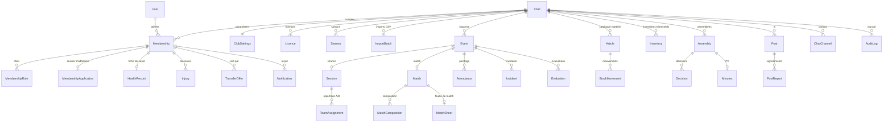

# Schéma de données — Vesta (Annexe B, 10.1)

Lot 0 (cadrage) · 25/09/2026 · Rédigé par `backend-dev`. Couvre le socle commun et tous les modules hors trésorerie. Le domaine trésorerie est rédigé par `finance-engine` dans `docs/lot0/schema-treasury.md` et intégré tel quel en section 14, sans modification de ses règles métier.

**Sources** : cahier des charges chapitres 0 (glossaire), 2 (acteurs, rôles, gouvernance), 3 (charte UX/UI, pour les contraintes de fichiers et de visibilité), 4.1–4.3 et 4.7–4.18 (spécifications fonctionnelles hors trésorerie), 5 (journal d'activité), 6.3–6.7 (architecture technique), 7 (sécurité), 10.2 (décisions à trancher). Règles non négociables 1, 5, 6, 8, 9, 10, 11 de `CLAUDE.md`. `docs/lot0/analyse.md` section 1.2 et §4 Q1 (confidentialité médicale — décision du client du 25/09/2026, cahier des charges 10.2 n° 15 ; voir §6 ci-dessous).

Ce document décrit des structures de données, pas du code. Noms d'entités et de champs en anglais (convention `CLAUDE.md` 7), descriptions en français.

---

## 1. Conventions communes

### 1.1 Types utilisés (identiques à `schema-treasury.md` §1.1)

| Notation | Signification |
| --- | --- |
| `id` | Clé primaire entière auto-incrémentée (`BigAutoField`) |
| `FK → X` | Clé étrangère vers l'entité X |
| `Money` | `Decimal(12,2)`, jamais `float` — utilisé uniquement quand ce document reprend une notion financière déjà définie par `finance-engine` |
| `Date` | Date calendaire, dans le fuseau du club |
| `DateTime` | Horodatage stocké en UTC, affiché dans le fuseau du club |
| `Enum(...)` | Liste fermée de valeurs, libellés français côté interface |
| `Text(n)` | Chaîne de longueur maximale n ; `Text` seul = texte long |
| `Image` | Fichier image **public** (logo, photo de profil, image de publication) : compressé/redimensionné côté client puis vérifié côté serveur, servi comme un asset public de l'application (nécessaire pour la marque blanche et le fil public, y compris avant connexion sur la page de connexion). N'est jamais un document personnel sensible. |
| `File` | Fichier **privé**, stocké hors `public_html`, servi uniquement par une vue authentifiée qui vérifie club et rôle (règle n° 10 ; documents médicaux, justificatifs, PV, fiches d'adhésion) |
| `UUID` | Identifiant généré côté client pour la déduplication hors connexion (règle 6.6) |

### 1.2 Isolation multi-tenant (règle non négociable n° 8)

- **Toute entité privée de club porte un champ `club`** (`FK → Club`, obligatoire, indexé). Exceptions explicites et justifiées : `User` (compte global, un utilisateur peut appartenir à plusieurs clubs dans le temps — 6.3), `Club` et `Licence` eux-mêmes (portée plateforme, gérés par le Superuser — 2.5), `AuditLog` (`club` facultatif, vide pour une action de plateforme — 5.1), `Notification` (`club` **facultatif** : obligatoire pour toute notification adressée à un membre de club, vide pour les alertes de plateforme adressées à un Superuser sans club — rupture de chaîne 5.3, surveillance 5.5, supervision 8.5 ; voir §11.1), `ImportBatch` (porte son propre `club`, obligatoire — c'est une entité privée classique, mentionnée ici pour mémoire).
- **Dénormalisation volontaire du `club` sur certaines entités enfants directes** : `Session`, `Match`, `MatchSheet`, `PostImage`, `AnnouncementRead`, `MercatoMessage` et `PostReport` portent chacune leur propre champ `club` (`FK → Club`, obligatoire, indexé), même si leur entité parente (`Event`, `Post`, `Announcement`, `MercatoThread`) porte déjà ce champ. Objectif : permettre aux gestionnaires tenant-aware de filtrer directement ces tables sans jointure obligatoire vers la table parente (règle n° 8). Ce champ est **synchronisé à la création**, copié depuis le `club` de l'entité parente, et n'est jamais modifié ensuite (pour `MercatoMessage`, dont le fil parent `MercatoThread` porte deux clubs, le champ est copié depuis le club de l'expéditeur au moment de l'envoi — voir §8.2).
- L'accès passe exclusivement par les gestionnaires de requêtes tenant-aware de `apps/core` : une requête sans club actif est refusée.
- Quand une entité référence une autre entité privée (adhésion, séance, type…), les deux doivent appartenir au **même club** ; contrôle fait en service et couvert par un test d'étanchéité, comme en trésorerie.
- Le club actif est toujours déduit de l'adhésion en cours de l'acteur (règle n° 9), jamais transmis par le client ni figé dans le JWT.
- **Exception documentée** : `TransferOffer` et `MercatoThread`/`MercatoMessage` (mercato, §8) référencent **deux clubs** (club d'origine et club destinataire). L'accès est restreint aux utilisateurs membres de l'un ou l'autre club, avec des champs strictement limités aux données publiques du joueur visé (6.3).

### 1.3 Journal d'activité (règle n° 6, CDC 5.1–5.3)

Toute création, modification ou suppression d'une entité de ce document appelle le service d'audit (`apps/audit`), qui écrit une entrée `AuditLog` (définie en §12) avec l'état avant/après en JSON. **Exception stricte** : le contenu médical (`HealthRecord`, `Injury`, `InjuryFollowUp`) n'est jamais copié dans le journal — seule la métadonnée « fiche consultée/modifiée » est tracée (CDC 5.2 « Médical »).

### 1.4 Confirmation des actions sensibles (règle n° 7, CDC 7.2) — modifié le 11/10/2026 (10.3 n° 177)

Le code PIN est supprimé. Les actions sensibles (signature parrain, signature PV) se valident par un bouton puis une modale de confirmation, et enregistrent l'acteur (`*_by`) et l'horodatage (`*_at`) ; l'action est journalisée (auteur, date, objet), le service refusant l'écriture sans acteur autorisé. Les anciens champs PIN de `User` ont été supprimés le 13/11/2026.

### 1.5 Fichiers (CDC 6.7)

Formats acceptés : JPEG, PNG, WebP, PDF ; 10 Mo maximum avant compression. Les photos (profil, fil, séance) sont redimensionnées et compressées côté client (1 600 px max de côté pour le fil, CDC 4.16), puis revérifiées côté serveur (type réel du fichier, règle 7.6).

---

## 2. Vue d'ensemble

Découpage du document : §3 comptes et adhésion, §4 club/licence/paramètres, §5 sport, §6 médical, §7 logistique, §8 mercato, §9 assemblées générales, §10 communication, §11 notifications, §12 journal d'activité, §13 espace Superuser, §14 trésorerie (par référence), §15 invariants transverses, §16 index, §17 tâches cron, §18 décisions par défaut, §19 points ouverts.

---

## 3. Comptes et adhésion (CDC 2.1–2.3, 4.1, 6.3, 6.4 ; règle n° 1)

### 3.1 `User` — Compte global

Un compte par personne, indépendant de tout club. Un Superuser n'a **jamais** de fiche joueur associée (règle n° 1).

| Champ | Type | Contraintes | Description |
| --- | --- | --- | --- |
| `id` | id | PK | |
| `email` | Text(255) | obligatoire, **unique sur toute la plateforme** | Identifiant de connexion (CDC 4.1). Aucun nom d'utilisateur distinct. |
| `password_hash` | Text | obligatoire | Mot de passe initial = email (haché), changement forcé à la première connexion. |
| `must_change_password` | Booléen | obligatoire, défaut vrai | Tant que vrai, aucune donnée n'est accessible (CDC 4.1, critère d'acceptation). |
| `temp_password_expires_at` | DateTime | facultatif | Renseigné lors d'une réinitialisation par le Superuser (`PasswordResetRequest`, §13.2) : échéance de validité (48 h) du mot de passe temporaire généré. Vide en dehors d'une réinitialisation en cours (10.2 n° 21). |
| `first_name`, `last_name` | Text(80) | obligatoires | |
| `phone` | Text(30) | facultatif | Téléphone WhatsApp (reçus, communiqués). |
| `birth_date` | Date | facultatif | L'âge est calculé, jamais stocké. |
| `weight_kg`, `height_cm` | Decimal(5,1) | facultatifs | Non publics (CDC 4.2). |
| `photo` | Image | facultatif à la création, demandée à la première connexion | Avatar ; initiales affichées à défaut. |
| `is_superuser` | Booléen | obligatoire, défaut faux | Compte Éditeur ; ne peut avoir aucun `Membership`. |
| `is_active` | Booléen | obligatoire, défaut vrai | Désactivation par un Superuser (CDC 4.18). |
| `failed_login_attempts` | Entier ≥ 0 | défaut 0 | |
| `login_locked_until` | DateTime | facultatif | Blocage 15 min après 5 échecs (CDC 7.1). |
| `card_publication_consent_at` | DateTime | facultatif | Consentement à la publication de la carte de joueur (CDC 7.5) — voir décision D2. |
| `preferred_theme` | Enum(`classic`, `light`, `dark`) | obligatoire, défaut `classic` | Préférence de thème (Classic = couleurs du club / Clair / Sombre), mémorisée par utilisateur, appliquée sur tous les clubs (CDC 3.6). |
| `last_login_at` | DateTime | facultatif | |
| `created_at`, `updated_at` | DateTime | obligatoires | |

Contraintes : `email` inchangeable sans repasser par la modale « Identifiant et mot de passe » (CDC 4.1) — journalisé. Un `User` avec `is_superuser = vrai` ne peut jamais recevoir de `Membership` (contrôle en service).

### 3.2 `Membership` — Adhésion (cœur du multi-tenant, CDC 6.3)

Lien entre un utilisateur et un club : rôles, dates, statut. Toute donnée « joueur » propre au club (poste, numéro, cotisation, parrain) vit ici, jamais sur `User`.

| Champ | Type | Contraintes | Description |
| --- | --- | --- | --- |
| `id` | id | PK | |
| `club` | FK → Club | obligatoire, indexé | **Isolation multi-tenant.** |
| `user` | FK → User | obligatoire | |
| `status` | Enum(`pending`, `active`, `departed`) | obligatoire, défaut `pending` | En attente / Inscrit / Parti. **« En ordre » et « En dette » ne sont jamais stockés** (calculés par `finance-engine.is_in_good_standing`), « Suspendu » et « Blessé » ne sont pas stockés ici non plus (voir 3.2.1). |
| `sponsor` | FK → Membership | facultatif ; même club ; obligatoire à la création si le joueur n'est pas un import historique | Parrain (CDC 4.3). |
| `position` | Enum(`goalkeeper`, `defender`, `midfielder`, `forward`) | obligatoire à la création manuelle, facultatif à l'import | Poste (CDC 4.1). Modifiable par le Coach (2.4). |
| `position_detail` | Text(60) | facultatif | Poste précis. |
| `jersey_number` | Entier 1–99 | facultatif ; **unique parmi les adhésions actives du club** | Modifiable par le Coach. |
| `is_on_transfer_market` | Booléen | obligatoire, défaut faux | « Fermé aux offres » / « Sur le marché » (CDC 4.14), géré par le joueur lui-même (P). |
| `market_status_changed_at` | DateTime | facultatif | |
| `joined_on` | Date | obligatoire | Date d'entrée. |
| `left_on` | Date | facultatif | Date de sortie. |
| `left_reason` | Enum(`transfer`, `resignation`, `other`) | requis si `left_on` renseigné | |
| `added_by` | FK → User | obligatoire | Président ou joueur désigné (CDC 2.4, « D »). |
| `left_by` | FK → User | facultatif ; rempli uniquement quand `status` passe à `departed` | Acteur réel ayant traité le départ (CDC 5.1). Distinct de `added_by` : jamais utilisé comme repli pour journaliser un départ. **Correction de bug** remontée par `test-engineer` pendant le Lot 1 (le journal attribuait à tort le départ à `added_by`) — pas une nouvelle règle métier du 10.2. |
| `created_at`, `updated_at` | DateTime | obligatoires | |

**3.2.1 Statut affiché (non stocké) — clarification faisant autorité.** L'énumération de `Membership.status` (`pending`, `active`, `departed`) ne contient **que les états du workflow d'adhésion** : En attente / Inscrit / Parti. Elle ne contient **jamais** « Suspendu », « Blessé », « En ordre » ni « En dette » — ces quatre qualificatifs ne sont ni des valeurs de cette énumération, ni des champs stockés ailleurs sous forme de chaîne unique :

- « En ordre » / « En dette » sont calculés par `finance-engine.is_in_good_standing(membership)` (domaine trésorerie, §14) ;
- « Suspendu » se déduit de l'existence d'une `Suspension` active (§5.9, `is_active(suspension)`) ;
- « Blessé » / l'aptitude se déduisent de `HealthRecord.fitness_status` et des `Injury` ouvertes (§6.1, §6.2).

Le badge de statut affiché au joueur est **composé à la volée** par le service qui expose le profil (jamais persisté comme une chaîne unique), à partir de `Membership.status` et des trois calculs ci-dessus. Un joueur peut ainsi être simultanément « Inscrit », « En ordre » et « Suspendu » (CDC 4.1).

Le rattachement à un type de cotisation mensuelle (« Type de cotisation mensuelle » du CDC 4.1) est réalisé par une `ContributionAssignment` (domaine trésorerie, §14), créée par le service d'adhésion au moment de la création du `Membership` — ce n'est pas un champ de `Membership`, pour ne pas dupliquer le schéma de `finance-engine`.

### 3.3 `MembershipApplication` — Dossier d'adhésion et parrainage (CDC 4.3)

Un par `Membership` nouvellement créé (hors import CSV historique, qui passe directement `active` sans parrainage, CDC 4.1).

| Champ | Type | Contraintes | Description |
| --- | --- | --- | --- |
| `id` | id | PK | |
| `club` | FK → Club | obligatoire, indexé | **Isolation multi-tenant.** |
| `membership` | FK → Membership | obligatoire, **unique** | |
| `membership_fee_payment` | FK → Payment (trésorerie, §14) | facultatif | Renseigné une fois les frais d'adhésion payés. |
| `application_pdf_file` | File | facultatif | Fiche d'adhésion générée (couleurs du club). |
| `generated_at` | DateTime | facultatif | |
| `sponsor_notified_at` | DateTime | facultatif | |
| `sponsor_decision` | Enum(`pending`, `signed`, `refused`) | obligatoire, défaut `pending` | |
| `sponsor_signed_by` | FK → User | requis si `signed` ; doit être `membership.sponsor.user` | Signature par bouton + modale de confirmation (règle n° 7). |
| `sponsor_signed_at` | DateTime | requis si `signed` | |
| `sponsor_refused_reason` | Text | requis si `refused` | |
| `sponsor_reminder_sent_at` | DateTime | facultatif | Rappel après 3 jours sans réponse. |
| `president_alerted_at` | DateTime | facultatif | Alerte au Président après 7 jours sans réponse. |
| `resolved_at` | DateTime | facultatif | Passage « Inscrit » ou annulation. |
| `cancelled_by`, `cancelled_reason` | FK → User, Text | requis si annulée | Décision du Président après refus du parrain. |

Règle attachée : le passage `Membership.status = active` exige `sponsor_decision = signed` **et** `has_paid_membership_fee(membership)` (service exposé par `finance-engine`, §14 §10).

### 3.4 `MembershipRole` — Rôles et nominations (CDC 2.2–2.4)

Un joueur peut cumuler plusieurs rôles ; ses droits sont l'union des droits de ses rôles (règle « rôles cumulables »).

| Champ | Type | Contraintes | Description |
| --- | --- | --- | --- |
| `id` | id | PK | |
| `club` | FK → Club | obligatoire, indexé | **Isolation multi-tenant** (dénormalisé pour les contraintes d'unicité ci-dessous). |
| `membership` | FK → Membership | obligatoire ; même club | |
| `role` | Enum(`president`, `vice_president`, `sports_director`, `treasurer`, `assistant_treasurer`, `steward`, `secretary`, `coach`, `assistant_coach`, `captain`, `doctor`, `player_recruiter`) | obligatoire | Le rôle « Joueur » n'est pas stocké : il est implicite à tout `Membership`. |
| `appointed_by` | FK → User | obligatoire | Président (bureau, Médecin, Coach), Coach (Capitaine, **Assistant du Coach** : `appointed_by` = le Coach qui l'a nommé, conservé même si ce Coach perd son rôle ; CDC 10.3 n° 179). |
| `appointed_at` | DateTime | obligatoire | |
| `revoked_by` | FK → User | facultatif | |
| `revoked_at` | DateTime | facultatif | |
| `revoked_reason` | Text | facultatif | |

Contraintes :

- **Au plus `ClubSettings.board_seats_per_role` titulaires actifs par `(club, role)`** (10.2 n° 3 et n° 24, défaut 1, configurable par club) pour tous les rôles sauf `player_recruiter` et `president`, qui ont une règle spécifique ci-dessous. `player_recruiter` (joueurs autorisés à ajouter des joueurs, CDC 2.3) admet toujours plusieurs titulaires actifs, quel que soit `board_seats_per_role`. `assistant_coach` est lui aussi exclu de ce plafond : sa règle est **un seul assistant actif par Coach** (CDC 10.3 n° 179), appliquée par `apps.clubs.services.appoint_assistant_coach` (transaction atomique, verrou sur l'adhésion du Coach et sur les assistants actifs du club) qui révoque l'assistant précédent du même Coach (ou orphelin, dont le nominateur n'est plus Coach) avant de créer le nouveau. Aucune révocation automatique quand le Coach change.
- `role = president` : toujours **exactement un** titulaire actif par club (« un club a toujours un et un seul Président », CDC 2.3). La révocation d'un Président n'est possible que via `PresidencyTransfer` (3.5), jamais par une révocation simple.
- Toute nomination ou révocation appelle le service d'audit **et** crée une `Notification` au joueur concerné (CDC 2.3).

### 3.5 `PresidencyTransfer` — Passation de présidence (CDC 2.3)

| Champ | Type | Contraintes | Description |
| --- | --- | --- | --- |
| `id` | id | PK | |
| `club` | FK → Club | obligatoire, indexé | **Isolation multi-tenant.** |
| `from_membership` | FK → Membership | obligatoire ; Président sortant | |
| `to_membership` | FK → Membership | obligatoire ; même club ; différent du sortant | Président entrant. |
| `method` | Enum(`handover`, `superuser_override`) | obligatoire | Passation directe, ou intervention du Superuser sur demande écrite après AG (CDC 2.3). |
| `assembly` | FK → Assembly | requis si `method = superuser_override` | AG justifiant l'intervention. |
| `superuser` | FK → User | requis si `superuser_override` | Trace l'identité réelle (Ghost Mode, §13). |
| `transferred_at` | DateTime | obligatoire | |

Effet : clôture (`revoked_at`) du `MembershipRole` `president` du sortant et création simultanée de celui de l'entrant, dans la même transaction de base.

### 3.6 `TermsVersion` et `TermsAcceptance` — Versionnement des CGU (CDC 7.5 ; décision du client du 25/09/2026, cahier des charges 10.2 n° 27)

Ajout hors périmètre initial, **accepté et acté** par le client (n° 27) : chaque acceptation des CGU trace la version, la date et l'utilisateur ; une nouvelle version redemande l'acceptation. Portée plateforme (`apps/accounts`), comme `User`.

| Champ (`TermsVersion`) | Type | Contraintes | Description |
| --- | --- | --- | --- |
| `id` | id | PK | |
| `version_number` | Text(20) | obligatoire, unique, **généré automatiquement** | Numéro de version (ex. « 2026-1 ») ; le Superuser ne le saisit pas, seulement `content` et `published_at`. |
| `published_at` | DateTime | obligatoire | Date d'entrée en vigueur de cette version — c'est le champ que la modale Superuser appelle « Date d'entrée en vigueur » (`superuser-espace.md`) ; même champ, un seul nom de référence dans ce document. |
| `content` | Text | obligatoire | Texte des CGU, ou référence au document publié (selon le choix d'implémentation du Lot 1). |
| `created_by` | FK → User | obligatoire, Superuser | |

| Champ (`TermsAcceptance`) | Type | Contraintes | Description |
| --- | --- | --- | --- |
| `id` | id | PK | |
| `user` | FK → User | obligatoire | |
| `terms_version` | FK → TermsVersion | obligatoire | |
| `accepted_at` | DateTime | obligatoire | À la création du club (Président fondateur) et à la première connexion de chaque joueur (CDC 7.5), ou de nouveau si une version plus récente que la dernière acceptée par cet utilisateur est publiée. |

Unique `(user, terms_version)`. Le blocage d'accès tant qu'une version plus récente n'est pas acceptée est un contrôle de service (comparable à `must_change_password`), pas un champ supplémentaire sur `User`.

---

## 4. Club, licence et paramètres (CDC 1.4, 2.5, 3.5–3.6, 4.1 ; règle n° 18)

### 4.1 `Club`

Identité et image de marque, lue par tous — y compris avant connexion (page de connexion, CDC 7.3). Ne porte aucun paramètre opérationnel (voir décision ci-dessous).

| Champ | Type | Contraintes | Description |
| --- | --- | --- | --- |
| `id` | id | PK | |
| `name` | Text(120) | obligatoire | |
| `slug` | Text(60) | obligatoire, unique | Adresse propre : `/c/<slug>` (CDC 7.3). |
| `logo` | Image | facultatif | Filigrane page de connexion, barre latérale, PDF (CDC 3.5). |
| `primary_color`, `secondary_color` | Text(7) | facultatifs (hex) | Thème « Classic » (CDC 3.6). |
| `city`, `country` | Text(80) | obligatoires | Renseignés à la création du club (cohérent avec `club-accueil.md`, qui les traite comme obligatoires à la création). |
| `status` | Enum(`active`, `read_only`) | obligatoire, défaut `active` | `read_only` quand la licence est expirée au-delà de la période de grâce (CDC 1.4). |
| `founder_membership` | FK → Membership | facultatif (renseigné après création du premier `Membership`) | Le créateur devient Président (CDC 2.3). |
| `created_at` | DateTime | obligatoire | |

### 4.2 `ClubSettings` — Paramètres opérationnels (1-1 avec `Club`)

**Décision de placement** (demandée par `finance-engine`, `schema-treasury.md` §2) : les champs financiers (`currency`, `timezone`, `debt_tolerance_days`, `expense_justification_days`, `payment_link_url`) vivent ici, dans `ClubSettings`, et non directement sur `Club`. Justification : `Club` est lu publiquement (page de connexion, fil public, marque blanche) et doit rester un objet léger d'identité ; `ClubSettings` regroupe tous les paramètres configurables par le Président, financiers et non financiers, en un seul point d'administration, avec un contrôle d'accès uniforme (lecture réservée aux membres du club, écriture au Président). Toute API publique (fiche joueur publique, marché des transferts) ne lit jamais `ClubSettings`.

| Champ | Type | Contraintes | Description |
| --- | --- | --- | --- |
| `club` | FK → Club | PK, 1-1 | **Isolation multi-tenant.** |
| `currency` | Currency (ISO 4217) | obligatoire, défaut `USD` | CDC 4.1 (USD par défaut, CDF possible) ; règle CLAUDE.md 7. |
| `timezone` | Text(60) | obligatoire | Fuseau du club (IANA, ex. `Africa/Kinshasa`) ; référence pour le verrouillage des séances (4.7) et l'affichage des horodatages. |
| `debt_tolerance_days` | Entier ≥ 0 | obligatoire, défaut 0 | Consommé par `finance-engine` (10.2 n° 4). |
| `expense_justification_days` | Entier > 0 | obligatoire, défaut 7 | Consommé par `finance-engine` (CDC 4.5.2). |
| `payment_link_url` | URL | facultatif | Lien de paiement externe (CDC 4.6) — jamais en dur dans le code. |
| `board_seats_per_role` | Entier ≥ 1 | obligatoire, défaut 1 | Configurable par club ; borne le contrôle d'unicité de `MembershipRole`. Décision du client, **acceptée et actée** (10.2 n° 3 et n° 24) — ce n'est plus une simple proposition hors périmètre. |
| `default_jersey_color_a`, `default_jersey_color_b` | Text(7) | obligatoires, défauts bleu/rouge | CDC 4.7. |
| `ab_assignment_rule` | Enum(`alternating`) | obligatoire, défaut `alternating` | 10.2 n° 7 ; extensible (règle unique à ce jour). |
| `late_arrival_counts_absent` | Booléen | obligatoire, défaut vrai | Configurable par club ; en retard = compté absent mais peut jouer. Décision du client, **acceptée et actée** (10.2 n° 6 et n° 25) — ce n'est plus une simple proposition hors périmètre. |
| `yellow_card_suspension_threshold` | Entier > 0 | obligatoire, défaut 5 | CDC 4.9, « à confirmer » (analyse 1.6). |
| `yellow_card_suspension_matches` | Entier > 0 | obligatoire, défaut 1 | 10.2 n° 8. |
| `red_card_suspension_matches` | Entier > 0 | obligatoire, défaut 1 | 10.2 n° 8. |
| `evaluation_window_hours` | Entier > 0 | obligatoire, défaut 48 | CDC 4.10. |
| `assembly_quorum_percentage` | Decimal(5,2) | obligatoire, **défaut 50** | Seuil de quorum d'une assemblée générale, en pourcentage des adhésions actives à la date de l'AG (CDC 4.15). Configurable ensuite par club (10.2 n° 18, ex-Q9/Q20 de `analyse.md` §4, tranchées par le client : « configurable par club, 50 % par défaut »). |
| `updated_at`, `updated_by` | DateTime, FK → User | obligatoires | Modifications réservées au Président (2.4). |

### 4.3 `Season` — Saison sportive

| Champ | Type | Contraintes | Description |
| --- | --- | --- | --- |
| `id` | id | PK | |
| `club` | FK → Club | obligatoire, indexé | **Isolation multi-tenant.** |
| `label` | Text(20) | obligatoire | Ex. « 2026 ». |
| `start_date`, `end_date` | Date | obligatoires ; pas de chevauchement avec une autre saison du club | CDC 4.9 (« définie par ses dates de début et de fin »). |
| `is_current` | Booléen | obligatoire, défaut faux ; **une seule saison courante par club** | Détermine la remise à zéro des compteurs de cartons (§5.9) et le regroupement des statistiques « par saison » (CDC 4.2). |
| `created_at`, `created_by` | DateTime, FK → User | obligatoires | |

### 4.4 Formules de licence — **retiré du schéma** (décision du client du 25/09/2026, cahier des charges 10.2 n° 20)

L'ancienne question Q5 (`analyse.md` §4) est tranchée : **aucune formule ni tarif au MVP**. Une entité `LicencePlan` avait été modélisée dans une version antérieure de ce document pour ne pas bloquer le schéma en attendant la réponse du client (voir l'historique conservé en §18, décision Q5) ; elle est **entièrement retirée** — plus de table `LicencePlan`, plus de champ `Licence.plan`. Une `Licence` (§4.5) est définie uniquement par ses dates de début et de fin, saisies par le Superuser à chaque attribution ou prolongation, comme actée au 10.2 n° 20.

**Exigence explicite du client pour l'évolution future** : l'ajout de formules (nom, prix, modules inclus) devra se faire par une **migration additive**, jamais destructive : création d'une nouvelle table (par exemple une future `LicencePlan`) et ajout d'une colonne `Licence.plan` **facultative** pointant vers elle, sans modifier ni supprimer aucun champ existant de `Licence`. Aucune structure anticipée n'est créée aujourd'hui pour cette évolution — ce n'est plus une supposition de modélisation mais une contrainte de migration à respecter le jour venu.

### 4.5 `Licence` (CDC 1.4, 2.5 ; 10.2 n° 20)

| Champ | Type | Contraintes | Description |
| --- | --- | --- | --- |
| `id` | id | PK | |
| `club` | FK → Club | obligatoire, indexé | Portée plateforme : lecture/écriture réservées au Superuser, pas de gestionnaire tenant-aware côté club (le club ne modifie jamais sa propre licence). |
| `status` | Enum(`trial`, `active`, `expired`, `suspended`, `terminated`) | obligatoire, défaut `trial` | Cycle de vie (CDC 1.4). Voir note ci-dessous sur `suspended`. |
| `start_date`, `end_date` | Date | obligatoires | Seules bornes de la licence, saisies par le Superuser à chaque attribution ou prolongation (10.2 n° 20 : pas de formule, pas de tarif, **pas de notion de périodicité de facturation** — une prolongation se fait en modifiant `end_date`, pas par un cycle automatique). |
| `grace_period_days` | Entier ≥ 0 | obligatoire, défaut 15 | 10.2 n° 1. |
| `created_by` | FK → User | obligatoire, Superuser | |
| `created_at` | DateTime | obligatoire | |

**Note — licence suspendue (10.2 n° 19, ancienne Q6 de `analyse.md` §4, désormais tranchée)** : une licence `suspended` **bloque l'accès du club**, elle ne passe pas en lecture seule. Seule l'**expiration au-delà de la période de grâce** fait passer `Club.status = read_only` (§4.1, CDC 1.4) ; ses données restent conservées et exportables. `status = suspended` n'a donc aucun effet sur `Club.status` : le blocage d'accès pour une licence suspendue est un contrôle d'accès applicatif (service d'authentification/permissions), pas un changement de `Club.status`.

### 4.6 `LicenceEvent` — Historique (CDC 2.5 « historique »)

| Champ | Type | Contraintes | Description |
| --- | --- | --- | --- |
| `id` | id | PK | |
| `licence` | FK → Licence | obligatoire | |
| `event_type` | Enum(`created`, `activated`, `extended`, `suspended`, `resumed`, `terminated`, `reminder_sent`) | obligatoire | Relances 30/7/1 jour = `reminder_sent`. |
| `event_date` | DateTime | obligatoire | |
| `actor` | FK → User | facultatif (vide pour une relance automatique) | Superuser. |
| `note` | Text | facultatif | |

### 4.7 `ImportBatch` — Lot d'import CSV (CDC 4.1 « import historique » ; référencée par `finance-engine`)

Définition manquante signalée par `finance-engine` : `Due.import_batch` et `Payment.import_batch` (`schema-treasury.md` §5, §6) référencent cette entité sans qu'elle soit définie dans le socle commun. Définie ici pour éviter toute variante concurrente.

| Champ | Type | Contraintes | Description |
| --- | --- | --- | --- |
| `id` | id | PK | |
| `club` | FK → Club | obligatoire, indexé | **Isolation multi-tenant.** |
| `import_type` | Enum(`players`, `historical_contributions`) | obligatoire | Import de joueurs (CDC 4.1, adhésion directe en `active` sans parrainage) ou import de cotisations/paiements historiques (`finance-engine`). |
| `source_file` | File | obligatoire | Fichier CSV source, conservé pour audit. |
| `imported_by` | FK → User | obligatoire | Président ou rôle habilité à importer. |
| `imported_at` | DateTime | obligatoire | |
| `row_count_success` | Entier ≥ 0 | obligatoire, défaut 0 | Nombre de lignes importées avec succès. |
| `row_count_failed` | Entier ≥ 0 | obligatoire, défaut 0 | Nombre de lignes échouées. |
| `report_file` | File | facultatif | Rapport détaillé (lignes échouées et motif), généré à l'issue de l'import. |

---

## 5. Sport (CDC 4.7–4.11 ; règle n° 5)

### 5.1 `Event` — Événement (séance ou match)

Entité commune portée par le diagramme du CDC 6.4 (« Club → Événement séance ou match → Présence / Incident / Évaluation »). `Session` et `Match` en héritent chacun en relation 1-1.

| Champ | Type | Contraintes | Description |
| --- | --- | --- | --- |
| `id` | id | PK | |
| `club` | FK → Club | obligatoire, indexé | **Isolation multi-tenant.** |
| `kind` | Enum(`session`, `match`) | obligatoire | |
| `event_date` | Date | obligatoire | Dans le fuseau du club. |
| `season` | FK → Season | obligatoire ; même club ; `event_date` dans `[season.start_date, season.end_date]` | |
| `created_by` | FK → User | obligatoire | Coach (CDC 4.7, 4.8). |
| `created_at` | DateTime | obligatoire | |
| `unlocked_by` | FK → User | facultatif | Superuser ayant déverrouillé un événement de la veille (4.7). |
| `unlocked_at`, `unlock_reason` | DateTime, Text | requis si `unlocked_by` renseigné | |

**Verrouillage (non stocké comme booléen)** : `is_locked(event)` = vrai si `event_date` < date du jour dans `club.timezone`, **sauf** déverrouillage explicite par un Superuser (`unlocked_by` renseigné pour la session en cours de correction). Toute écriture sur `Attendance`, `TeamAssignment`, `Incident` d'un événement verrouillé est refusée par le service, hors Superuser.

### 5.2 `Session` — Séance (CDC 4.7)

| Champ | Type | Contraintes | Description |
| --- | --- | --- | --- |
| `event` | FK → Event | PK, 1-1 ; `event.kind = session` | |
| `club` | FK → Club | obligatoire, indexé | **Isolation multi-tenant** (dénormalisé depuis `event.club`, §1.2). |
| `gathering_time` | Heure | obligatoire | Heure de rassemblement. |
| `late_arrival_cutoff` | Heure | obligatoire | Heure limite d'arrivée. |
| `location` | Text(160) | facultatif | Terrain. |
| `team_a_color`, `team_b_color` | Text(7) | obligatoires, défauts issus de `ClubSettings` | Modifiables par séance. |
| `instructions` | Text | facultatif | |

### 5.3 `Attendance` — Pointage (CDC 4.7, 4.8, 6.6)

| Champ | Type | Contraintes | Description |
| --- | --- | --- | --- |
| `id` | id | PK | |
| `club` | FK → Club | obligatoire, indexé | **Isolation multi-tenant.** |
| `event` | FK → Event | obligatoire | Séance ou match. |
| `membership` | FK → Membership | obligatoire ; même club | |
| `status` | Enum(`present`, `late_absent`, `absent`, `excused_absent`) | obligatoire | Présent / En retard compté absent / Absent / Absence excusée (blessé, voyage — reste une absence, CDC 4.7). |
| `excused_reason` | Text | facultatif | Motif de l'absence excusée (`sport-seance.md` 4.7 « absence excusée ») ; renseigné en pratique quand `status = excused_absent`, sans blocage technique si absent. |
| `arrived_at` | DateTime | requis si `present` ou `late_absent` | Corrigible par le Coach le jour même. |
| `marked_by` | FK → User | obligatoire | Coach ou Capitaine. |
| `client_uuid` | UUID | facultatif ; unique par `(club, client_uuid)` | Pointage hors connexion (6.6), déduplication à la synchronisation. |
| `client_recorded_at` | DateTime | requis si `client_uuid` | Heure réelle de la saisie hors connexion ; en cas de conflit, la première reçue fait foi, l'autre est signalée à son auteur. |
| `created_at` | DateTime | obligatoire | |

Contraintes : unique `(event, membership)`. **Un joueur en retard (`late_absent`) reste sélectionnable pour jouer** (10.2 n° 6) — ce n'est pas une exclusion de composition, à la différence de la dette, la suspension et l'inaptitude.

### 5.4 `TeamAssignment` — Répartition A/B (CDC 4.7)

| Champ | Type | Contraintes | Description |
| --- | --- | --- | --- |
| `id` | id | PK | |
| `club` | FK → Club | obligatoire, indexé | **Isolation multi-tenant.** |
| `session` | FK → Session | obligatoire | |
| `membership` | FK → Membership | obligatoire ; doit avoir une `Attendance` `present` ou `late_absent` sur le même événement | |
| `team` | Enum(`A`, `B`) | obligatoire | |
| `arrival_order` | Entier > 0 | obligatoire | Ordre d'arrivée, base de l'alternance automatique (10.2 n° 7). |
| `assigned_by` | FK → User | obligatoire | Président, Coach ou Capitaine (2.4). |
| `updated_at` | DateTime | obligatoire | Modifié par glisser-déposer ou bouton « Passer en A/B ». |

Contrainte : unique `(session, membership)`.

**Zone « Non répartis » (aucun champ stocké nécessaire) — deux catégories, décidées le 25/09/2026 (10.2 n° 29, n° 38)** : un joueur pointé (`Attendance present` ou `late_absent`) sans ligne `TeamAssignment` apparaît dans une zone « Non répartis » de l'écran de répartition A/B plutôt que dans une équipe. Cette zone ne correspond à **aucun champ stocké** sur `TeamAssignment` (pas de `team = "unassigned"`, pas de booléen) : elle se déduit simplement de l'absence de ligne pour ce `(session, membership)`. Deux cas bien distincts y mènent, avec un service qui ne les traite pas pareil :
- **Joueur en retard (`Attendance.status = late_absent`)** : exclu du seul **passage automatique** d'alternance à la création de la répartition (10.2 n° 7) — il n'obtient donc pas de ligne créée automatiquement. Il reste néanmoins **placeable manuellement** : le service `assign_team` **autorise** la création d'une ligne `TeamAssignment` pour lui si le Coach ou le Capitaine le place explicitement en A ou en B.
- **Joueur en dette, suspendu, inapte ou en attente d'adhésion** : le service `assign_team` **refuse toute création** de ligne `TeamAssignment` pour lui, automatique ou manuelle, avec la raison lisible (même logique que la composition et le plan tactique : `finance-engine.is_in_good_standing`, vérification d'une `Suspension` active, `HealthRecord.fitness_status`, `Membership.status = pending`) — recalculée à la volée, jamais persistée en doublon sur cette table.

### 5.5 `Match` — Match (CDC 4.8)

| Champ | Type | Contraintes | Description |
| --- | --- | --- | --- |
| `event` | FK → Event | PK, 1-1 ; `event.kind = match` | |
| `club` | FK → Club | obligatoire, indexé | **Isolation multi-tenant** (dénormalisé depuis `event.club`, §1.2). |
| `opponent_club` | FK → Club | facultatif | Adversaire Vesta (défi entre clubs). |
| `opponent_name` | Text(160) | requis si `opponent_club` vide | Équipe extérieure saisie en texte. |
| `match_type` | Enum(`friendly`, `championship`, `tournament`) | obligatoire | |
| `venue` | Enum(`home`, `away`) | obligatoire | |
| `kickoff_time` | Heure | obligatoire | Heure du coup d'envoi, en plus de `event.event_date` (CDC 4.8 « date, heure »). |
| `location` | Text(160) | facultatif | |
| `challenge_status` | Enum(`n_a`, `proposed`, `accepted`, `declined`) | obligatoire, défaut `n_a` | `n_a` pour un match hors défi inter-clubs ; sinon suit la demande de match amical. |
| `challenge_to_club` | FK → Club | requis si `challenge_status ≠ n_a` | Club destinataire du défi. |
| `is_composition_published` | Booléen | obligatoire, défaut faux | Bouton « Publier la composition » (4.8). |
| `composition_published_at` | DateTime | facultatif | |

Un match accepté en défi (`challenge_status = accepted`) apparaît comme deux `Match` liés (un par club), chacun avec son propre `Event` et son propre `club` — l'isolation multi-tenant est préservée (chaque club ne voit que sa ligne, avec `opponent_club` pointant vers l'autre).

### 5.6 `MatchComposition` — Composition (CDC 4.8)

| Champ | Type | Contraintes | Description |
| --- | --- | --- | --- |
| `id` | id | PK | |
| `club` | FK → Club | obligatoire, indexé | **Isolation multi-tenant.** |
| `match` | FK → Match | obligatoire | |
| `membership` | FK → Membership | obligatoire ; même club ; **doit passer le contrôle d'éligibilité** | Voir règle ci-dessous. |
| `role` | Enum(`starter`, `substitute`) | obligatoire | Titulaire / remplaçant. |
| `position` | Enum(`goalkeeper`, `defender`, `midfielder`, `forward`) | obligatoire | Poste du jour. |
| `jersey_number` | Entier 1–99 | obligatoire | Numéro du jour. |
| `added_by` | FK → User | obligatoire | Coach. |
| `added_at` | DateTime | obligatoire | |

Contrainte : **unique `(club, match, jersey_number)`** — deux joueurs d'un même club ne peuvent porter le même numéro de maillot du jour sur le même match (cas d'erreur attendu par `sport-espace-coach.md`).

**Règle métier non négociable** (règle n° 5, CDC 4.8) : la composition refuse un `membership` en dette (`finance-engine.is_in_good_standing` faux), suspendu (`Suspension` active, §5.9), inapte (`HealthRecord.fitness_status = inapte`) ou en attente d'adhésion (`Membership.status = pending`), avec la raison retournée par le service et affichée en français (montant dû pour le Président et le VP seulement, « Non éligible » pour le Coach (CDC 10.3 n° 188), nombre de matchs restants, date de retour d'un inapte sans diagnostic…). La régularisation en Caisse Terrain Express (trésorerie) rend le joueur immédiatement sélectionnable, sans latence perceptible.

### 5.7 `MatchSheet` et `MatchGoal` — Feuille de match (CDC 4.8)

| Champ (`MatchSheet`) | Type | Contraintes | Description |
| --- | --- | --- | --- |
| `match` | FK → Match | PK, 1-1 | |
| `club` | FK → Club | obligatoire, indexé | **Isolation multi-tenant** (dénormalisé depuis `match.club`, §1.2). |
| `score_home`, `score_away` | Entier ≥ 0 | obligatoires | |
| `filled_by`, `filled_at` | FK → User, DateTime | obligatoires | Coach. |
| `updated_at` | DateTime | obligatoire | Toute modification (buts, passes) journalisée (CDC 4.8). |

| Champ (`MatchGoal`) | Type | Contraintes | Description |
| --- | --- | --- | --- |
| `id` | id | PK | |
| `club` | FK → Club | obligatoire, indexé | **Isolation multi-tenant.** |
| `match_sheet` | FK → MatchSheet | obligatoire | |
| `scorer_membership` | FK → Membership | facultatif ; même club | Vide si le but est de l'adversaire (compté seulement dans le score). |
| `assist_membership` | FK → Membership | facultatif ; même club ; ≠ `scorer_membership` | Passe décisive. |
| `minute` | Entier 0–130 | facultatif | |
| `created_by`, `created_at` | FK → User, DateTime | obligatoires | |
| `updated_at` | DateTime | facultatif | |

Les statistiques des cartes de joueurs (buts, passes, matchs, cartons, présence, note) se **mettent à jour automatiquement** parce qu'elles sont **calculées à la lecture** (agrégations sur `MatchGoal`, `Attendance`, `Incident`, `Evaluation`) et jamais stockées — voir invariant J1 (§15). Les équipements reçus pour le match créent une `StockMovement` (§7.2), liée au `match`.

### 5.8 `Incident` — Discipline (CDC 4.9)

| Champ | Type | Contraintes | Description |
| --- | --- | --- | --- |
| `id` | id | PK | |
| `club` | FK → Club | obligatoire, indexé | **Isolation multi-tenant.** |
| `event` | FK → Event | obligatoire ; non verrouillé (§5.1), sauf Superuser | Séance ou match. |
| `membership` | FK → Membership | obligatoire ; même club | |
| `incident_type` | Enum(`yellow_card`, `red_card`, `internal_sanction`) | obligatoire | |
| `minute` | Entier 0–130 | facultatif | |
| `cause` | Enum(`contestation`, `serious_foul`, `behaviour`, `lateness`, `other`) | obligatoire | |
| `cause_detail` | Text | facultatif | Précision libre. |
| `issued_by` | Text(160) | facultatif | Arbitre ou auteur de la sanction (pas nécessairement un `User` Vesta). |
| `recorded_by`, `recorded_at` | FK → User, DateTime | obligatoires | Coach ou Capitaine. |

### 5.9 `Suspension` — Suspension disciplinaire (CDC 4.9)

| Champ | Type | Contraintes | Description |
| --- | --- | --- | --- |
| `id` | id | PK | |
| `club` | FK → Club | obligatoire, indexé | **Isolation multi-tenant.** |
| `membership` | FK → Membership | obligatoire ; même club | |
| `reason` | Enum(`cumulative_yellow`, `red_card`, `internal`) | obligatoire | |
| `triggering_incident` | FK → Incident | facultatif | Carton déclencheur (vide pour une sanction interne sans carton). |
| `season` | FK → Season | obligatoire | Le seuil du 5e jaune se compte sur les `Incident` `yellow_card` du joueur dans cette saison (remise à zéro automatique par changement de saison, analyse 1.6). |
| `matches_total` | Entier > 0 | obligatoire | `ClubSettings.yellow_card_suspension_matches` ou `red_card_suspension_matches`. |
| `matches_served` | Entier ≥ 0 | obligatoire, défaut 0 | Incrémenté à chaque `Match` du club auquel le joueur était éligible et où l'événement a eu lieu, tant que `matches_served < matches_total`. |
| `starts_event` | FK → Event | obligatoire | Match à partir duquel la suspension s'applique. |
| `lifted_at` | DateTime | facultatif | Renseigné automatiquement quand `matches_served = matches_total`. |
| `created_at` | DateTime | obligatoire | |

`is_active(suspension)` = `matches_served < matches_total` **et** `lifted_at` vide. Un `membership` avec une `Suspension` active est refusé en composition (§5.6) et en plan tactique (§5.11). Notification au joueur et au Coach à la création (CDC 4.9).

### 5.10 `Evaluation` — Évaluation des performances (CDC 4.10)

| Champ | Type | Contraintes | Description |
| --- | --- | --- | --- |
| `id` | id | PK | |
| `club` | FK → Club | obligatoire, indexé | **Isolation multi-tenant.** |
| `event` | FK → Event | obligatoire ; dans les 48 h (`ClubSettings.evaluation_window_hours`), sinon refusé | |
| `membership` | FK → Membership | obligatoire ; doit avoir une `Attendance` `present`/`late_absent` (séance) ou une `MatchComposition` (match) sur l'événement | |
| `evaluator` | FK → User | obligatoire ; rôle Coach, Président ou Vice-président | |
| `overall_score` | Decimal(3,1) | obligatoire, 0–10 | Note globale (10.2 n° 9). |
| `technical_score`, `physical_score`, `tactical_score`, `mental_score`, `attitude_score` | Decimal(3,1) | facultatifs, 0–10 | Critères facultatifs (10.2 n° 9), grille définitive à valider avec le club. |
| `comment` | Text | facultatif | |
| `comment_visible_to_player` | Booléen | obligatoire, défaut faux | Au choix de l'évaluateur. |
| `created_at` | DateTime | obligatoire | |
| `locked_at` | DateTime | calculé = `event.event_date` + 48 h | Au-delà, l'évaluation est verrouillée (lecture seule). |

Contrainte : unique `(event, membership, evaluator)`. La **note retenue** (moyenne de plusieurs évaluateurs) n'est **jamais stockée** : calculée à la lecture (invariant J1).

### 5.11 `TacticalPlan`, `TacticalPlanPlacement`, `TacticalPlanAnnotation` — Plan tactique (CDC 4.11)

| Champ (`TacticalPlan`) | Type | Contraintes | Description |
| --- | --- | --- | --- |
| `id` | id | PK | |
| `club` | FK → Club | obligatoire, indexé | **Isolation multi-tenant.** |
| `name` | Text(120) | obligatoire | |
| `formation` | Enum(`4-4-2`, `4-3-3`, `4-2-3-1`, `3-5-2`, `3-4-3`, `5-3-2`, `4-1-4-1`, `4-5-1`, `custom`) | obligatoire | Bibliothèque à 11 ; formations à 7/8 via `squad_size`. |
| `squad_size` | Entier ∈ {7, 8, 11} | obligatoire | |
| `match` | FK → Match | facultatif | Plan rattaché à un match. |
| `duplicated_from` | FK → TacticalPlan | facultatif | |
| `is_published` | Booléen | obligatoire, défaut faux | Lecture seule pour les joueurs une fois publié (CDC 4.11) ; ils ne peuvent ni modifier ni supprimer. |
| `published_at` | DateTime | facultatif | |
| `created_by`, `created_at`, `updated_at` | FK → User, DateTime, DateTime | obligatoires | Coach. |

| Champ (`TacticalPlanPlacement`) | Type | Contraintes | Description |
| --- | --- | --- | --- |
| `id` | id | PK | |
| `club` | FK → Club | obligatoire, indexé | **Isolation multi-tenant.** |
| `plan` | FK → TacticalPlan | obligatoire | |
| `membership` | FK → Membership | facultatif ; **doit passer le même contrôle d'éligibilité que la composition** (§5.6) si renseigné | Emplacement vide autorisé. |
| `x_coord`, `y_coord` | Decimal(5,2) | obligatoires, 0–100 | Position sur le terrain (pourcentage), glisser-déposer. |
| `jersey_number_override`, `position_override` | Entier, Enum | facultatifs | Modifiables depuis le plan ; répercutés sur `Membership` (CDC 4.11). |

| Champ (`TacticalPlanAnnotation`) | Type | Contraintes | Description |
| --- | --- | --- | --- |
| `id` | id | PK | |
| `club` | FK → Club | obligatoire, indexé | **Isolation multi-tenant.** |
| `plan` | FK → TacticalPlan | obligatoire | |
| `annotation_type` | Enum(`arrow`, `zone`, `note`) | obligatoire | Tableau noir. |
| `path_data` | Text (JSON) | requis si `arrow`/`zone` | Coordonnées du tracé. |
| `text` | Text | facultatif | Consigne écrite. |
| `target_membership` | FK → Membership | facultatif | Consigne par joueur. |
| `target_line` | Enum(`defense`, `midfield`, `attack`) | facultatif | Consigne par ligne. |
| `created_by`, `created_at` | FK → User, DateTime | obligatoires | |

Règle n° 5 rappelée : un joueur en dette, suspendu ou inapte ne peut être placé dans `TacticalPlanPlacement` — le service refuse l'écriture avec la raison, comme en composition.

---

## 6. Médical (CDC 4.12 ; règle n° 11 — confidentialité stricte, avec l'exception de consentement au Président décidée par le client le 25/09/2026, cahier des charges 10.2 n° 15)

**Rappel de confidentialité** : le diagnostic et le suivi (`Injury.circumstances`, `location_on_body`, `severity`, `on_site_care`, `referral`, `InjuryFollowUp.note`, et les champs cliniques de `HealthRecord`) ne sont exposés qu'au Médecin et au joueur concerné. Le Coach ne reçoit, via un service dédié (`get_fitness_summary`), que `fitness_status` et `fitness_return_date`, **sans aucune exception** (CDC 2.4, 4.12). Le Président reçoit par défaut la même chose que le Coach, **sauf** consentement explicite et révocable du joueur pour un accès complet à son dossier (CDC 2.4, 4.12 ; cahier des charges 10.2 n° 15 — ancienne question Q1 de `analyse.md` §4, **tranchée par le client, ce n'est plus une question ouverte**).

**Modélisation du consentement (§6.1, `HealthRecord`)** : le consentement est porté par deux champs sur `HealthRecord` — `president_access_granted_at` (octroi) et `president_access_revoked_at` (révocation) — et non par une entité ou un champ séparé sur `Membership` ou `MembershipRole`, pour rester au plus simple. Règle d'accès, appliquée par le service qui expose la fiche au Président :

- `can_president_read_full_record(health_record)` = vrai **si et seulement si** `president_access_granted_at` est renseigné, **et** (`president_access_revoked_at` est vide **ou** antérieur à `president_access_granted_at`), **et** `president_access_granted_at` est **postérieur à la date de la dernière `PresidencyTransfer.completed_at` de ce club** (s'il en existe une). Cette troisième condition est ce qui empêche un nouveau titulaire d'hériter automatiquement du consentement donné à son prédécesseur : le service ne vérifie toujours pas l'identité du Président, seulement que le consentement a été donné **pendant le mandat en cours**. Une passation de présidence ne modifie ni ne réinitialise `president_access_granted_at` — elle rend simplement la condition fausse tant qu'aucun nouveau consentement n'est donné après elle ; si le joueur consent à nouveau au même titulaire après une passation manquée puis rétablie, la date se met simplement à jour normalement.
- **Le service ne vérifie jamais l'identité du joueur ayant reçu le consentement à l'origine, ni l'identité du Président** : il vérifie uniquement que l'acteur courant occupe activement le rôle `MembershipRole.role = president` du club (§3.4). C'est ce qui matérialise le lien du consentement à la **fonction** de Président plutôt qu'à la personne : si le Président change (`PresidencyTransfer`, §3.5), les champs `president_access_granted_at`/`president_access_revoked_at` ne sont **ni réinitialisés ni transférés** — le nouveau titulaire n'a accès au dossier complet que si le joueur donne un **nouveau** consentement (un nouvel octroi, postérieur à sa prise de fonction ou non, selon la règle ci-dessus), qu'il ait ou non déjà consenti pour son prédécesseur.
- Chaque **octroi**, chaque **révocation** et chaque **consultation du dossier complet par le Président** appellent le service d'audit (`AuditLog`, `action_type` du type `medical.president_access.granted` / `medical.president_access.revoked` / `medical.record.viewed_by_president`) — métadonnée seule (acteur, horodatage, objet concerné), **jamais le contenu médical** (règle n° 6, CDC 5.2 ; voir §12.1).
- Révocation à effet immédiat : dès que `president_access_revoked_at` est renseigné (postérieur au dernier `president_access_granted_at`), l'accès complet est coupé sans délai, y compris en cours de session du Président.

Chaque consultation d'une fiche par le Médecin ou le joueur lui-même est également journalisée (métadonnée seule, jamais le contenu — CDC 5.2).

### 6.1 `HealthRecord` — Fiche de santé

Une par `Membership` (propre au club, cohérent avec l'isolation multi-tenant : les données médicales d'un joueur au club A ne sont jamais lisibles par le club B).

| Champ | Type | Contraintes | Description |
| --- | --- | --- | --- |
| `membership` | FK → Membership | PK, 1-1 | |
| `club` | FK → Club | obligatoire, indexé | **Isolation multi-tenant.** |
| `blood_group` | Enum(`A+`,`A-`,`B+`,`B-`,`AB+`,`AB-`,`O+`,`O-`) | facultatif | **Médecin + joueur uniquement.** |
| `allergies`, `medical_history`, `ongoing_treatments` | Text | facultatifs | **Médecin + joueur uniquement.** |
| `emergency_contact_name`, `emergency_contact_phone` | Text(160), Text(30) | facultatifs | Visibles par le Médecin (et le joueur) ; pas de restriction supplémentaire du CDC. |
| `self_declaration` | Text | facultatif | Déclaration du joueur sur son état de santé. |
| `consent_given_at` | DateTime | obligatoire avant toute écriture clinique | Consentement au traitement des données de santé, première connexion (CDC 4.12, 7.5). |
| `fitness_status` | Enum(`fit`, `fit_with_restriction`, `unfit`) | obligatoire, défaut `fit` | Apte / apte avec restriction / inapte — **seul champ visible du Coach et du Président.** |
| `fitness_return_date` | Date | facultatif | Date de retour prévue — **visible du Coach et du Président.** |
| `fitness_set_by` | FK → User | obligatoire | Toujours le titulaire du rôle Médecin (10.2 n° 17, réécrit 25/09/2026) : ce rôle peut être tenu par un joueur sans qualification médicale, nommé par le Président (libellé affiché « Médecin / référent santé »), avec les mêmes droits que le rôle Médecin. Il n'y a jamais de scénario « sans Médecin » ; `ClubSettings.no_doctor_fitness_setter` (ancienne modélisation, 10.2 n° 10) est retiré, caduc. |
| `fitness_set_at` | DateTime | obligatoire | |
| `president_access_granted_at` | DateTime | facultatif | Consentement du joueur donné depuis son profil (modale) pour un accès complet du Président au dossier. Attaché à la **fonction** de Président, pas à la personne (10.2 n° 15) : le champ lui-même n'est jamais réinitialisé par un `PresidencyTransfer` (§3.5), mais la règle d'accès (§6) exige qu'il soit postérieur à la dernière passation — un nouveau titulaire ne peut donc jamais hériter d'un consentement donné à son prédécesseur. Chaque octroi journalisé (§12.1). |
| `president_access_revoked_at` | DateTime | facultatif | Révocation par le joueur, effet immédiat. Voir la règle d'accès `can_president_read_full_record` en tête de §6. Chaque révocation journalisée (§12.1). |
| `updated_at` | DateTime | obligatoire | |

### 6.2 `Injury` — Blessure (CDC 4.12)

| Champ | Type | Contraintes | Description |
| --- | --- | --- | --- |
| `id` | id | PK | |
| `club` | FK → Club | obligatoire, indexé | **Isolation multi-tenant.** |
| `membership` | FK → Membership | obligatoire ; même club | |
| `event` | FK → Event | facultatif | Séance ou match où la blessure est survenue. |
| `reported_by`, `reported_at` | FK → User, DateTime | obligatoires | Coach, Capitaine ou Médecin. |
| `circumstances` | Text | obligatoire | **Médecin + joueur uniquement.** |
| `location_on_body` | Text(160) | facultatif, complété par le Médecin | **Médecin + joueur uniquement.** |
| `severity` | Enum(`mild`, `moderate`, `severe`) | facultatif, complété par le Médecin | **Médecin + joueur uniquement.** |
| `on_site_care` | Text | facultatif | **Médecin + joueur uniquement.** |
| `referral` | Enum(`rest`, `consultation`, `hospital`) | facultatif | **Médecin + joueur uniquement.** |
| `estimated_days_out` | Entier ≥ 0 | facultatif | |
| `status` | Enum(`open`, `resolved`) | obligatoire, défaut `open` | À `open`, `HealthRecord.fitness_status` du joueur passe `unfit` (Blessé, CDC 4.12 étape 3). |
| `doctor_completed_by`, `doctor_completed_at` | FK → User, DateTime | facultatifs | |
| `resolved_by`, `resolved_at` | FK → User, DateTime | requis si `resolved` | Déclaration du retour ; `HealthRecord.fitness_status` repasse `fit`. |

### 6.3 `InjuryFollowUp` — Entrée de suivi (CDC 4.12 étape 4)

| Champ | Type | Contraintes | Description |
| --- | --- | --- | --- |
| `id` | id | PK | |
| `club` | FK → Club | obligatoire, indexé | **Isolation multi-tenant.** |
| `injury` | FK → Injury | obligatoire | |
| `entry_date` | Date | obligatoire | |
| `note` | Text | obligatoire | Évolution, soins, examens. **Médecin + joueur uniquement.** |
| `created_by` | FK → User | obligatoire ; rôle Médecin exclusivement | |
| `created_at` | DateTime | obligatoire | |

---

## 7. Logistique (CDC 4.13)

### 7.1 `Article` — Catalogue

| Champ | Type | Contraintes | Description |
| --- | --- | --- | --- |
| `id` | id | PK | |
| `club` | FK → Club | obligatoire, indexé | **Isolation multi-tenant.** |
| `name` | Text(120) | obligatoire | |
| `category` | Enum(`jersey`, `socks`, `cleats`, `balls`, `misc`) | obligatoire | Maillots, bas, bottines, ballons, matériel divers (plots, chasubles, trousse médicale…). |
| `unit` | Text(20) | obligatoire, défaut « pièce » | |
| `reference_condition` | Enum(`new`, `good`, `worn`, `damaged`) | obligatoire, défaut `new` | État général de référence de l'article (les mouvements ne portent pas d'état individuel, CDC 4.13 ne le demande pas). |
| `status` | Enum(`active`, `archived`) | obligatoire, défaut `active` | |
| `created_at`, `created_by` | DateTime, FK → User | obligatoires | |

**Le stock théorique n'est jamais stocké** : `theoretical_quantity(article, at_date=None)` = somme signée des `StockMovement.quantity` (entrées positives, sorties négatives) — même logique que le solde trésorerie (invariant J1).

### 7.2 `StockMovement` — Mouvement de stock

| Champ | Type | Contraintes | Description |
| --- | --- | --- | --- |
| `id` | id | PK | |
| `club` | FK → Club | obligatoire, indexé | **Isolation multi-tenant.** |
| `article` | FK → Article | obligatoire ; même club | |
| `movement_type` | Enum(`in_purchase`, `in_donation`, `in_return`, `out_distribution`, `out_loan`, `out_wear`, `out_loss`) | obligatoire | Entrée (achat, dotation, retour) / sortie (distribution, prêt pour un match, usure, perte). |
| `quantity` | Entier > 0 | obligatoire | Signe implicite selon `movement_type`. |
| `movement_date` | Date | obligatoire | |
| `reason` | Text | facultatif | |
| `membership` | FK → Membership | facultatif | Joueur concerné, s'il y a lieu. |
| `expense` | FK → Expense (trésorerie, §14) | facultatif | Achat rattaché à la dépense correspondante (CDC 4.13). |
| `match` | FK → Match | facultatif | Sortie/retour d'équipements liés à un match (CDC 4.8, 4.13). |
| `recorded_by`, `created_at` | FK → User, DateTime | obligatoires | Intendant. |

### 7.3 `Inventory` et `InventoryLine` — Inventaire trimestriel

| Champ (`Inventory`) | Type | Contraintes | Description |
| --- | --- | --- | --- |
| `id` | id | PK | |
| `club` | FK → Club | obligatoire, indexé | **Isolation multi-tenant.** |
| `quarter_label` | Text(10) | obligatoire | Ex. « 2026-Q3 ». |
| `status` | Enum(`open`, `closed`) | obligatoire, défaut `open` | |
| `opened_at`, `opened_by` | DateTime, FK → User | obligatoires | Intendant. |
| `closed_at`, `closed_by` | DateTime, FK → User | requis si `closed` | Clôture uniquement si tous les écarts sont justifiés. |

Contrainte : impossible d'ouvrir un nouvel `Inventory` (`quarter_label` suivant) tant que le précédent n'est pas `closed` (CDC 4.13) ; alerte hebdomadaire au Président tant qu'il reste ouvert (cron, §17).

| Champ (`InventoryLine`) | Type | Contraintes | Description |
| --- | --- | --- | --- |
| `id` | id | PK | |
| `club` | FK → Club | obligatoire, indexé | **Isolation multi-tenant.** |
| `inventory` | FK → Inventory | obligatoire | |
| `article` | FK → Article | obligatoire ; même club | |
| `theoretical_quantity` | Entier ≥ 0 | obligatoire | **Instantané figé** de `theoretical_quantity(article)` au moment du comptage (valeur historique, donc légitimement stockée ici, à la différence du solde vivant). |
| `physical_quantity` | Entier ≥ 0 | obligatoire | Saisi par l'Intendant. |
| `discrepancy` | Entier | calculé = `physical_quantity − theoretical_quantity`, stocké comme instantané | Écart affiché. |
| `discrepancy_reason` | Enum(`theft`, `wear`, `oversight`, `loss`) | requis si `discrepancy ≠ 0`, avant clôture | Vol, usure, oubli, perte. |
| `justified_by`, `justified_at` | FK → User, DateTime | requis si `discrepancy ≠ 0` | |

---

## 8. Mercato (CDC 4.14 ; règle « transfert bloqué si dette »)

La disponibilité (« Fermé aux offres » / « Sur le marché ») est portée par `Membership.is_on_transfer_market` (§3.2).

### 8.1 `TransferOffer` — Offre de transfert

Entité à double appartenance de club (voir exception §1.2).

| Champ | Type | Contraintes | Description |
| --- | --- | --- | --- |
| `id` | id | PK | |
| `origin_club` | FK → Club | obligatoire | Club A, club actuel du joueur au moment de l'offre. |
| `target_club` | FK → Club | obligatoire ; ≠ `origin_club` | Club B, club offreur. |
| `target_membership` | FK → Membership | obligatoire ; `membership.club = origin_club` | Joueur visé. |
| `initiated_by` | FK → User | obligatoire ; rôle Président ou Directeur sportif de `target_club` | |
| `message`, `conditions` | Text | `message` obligatoire, `conditions` facultatif | |
| `status` | Enum(`sent`, `accepted_by_player`, `declined_by_player`, `blocked_debt`, `completed`, `cancelled`) | obligatoire, défaut `sent` | |
| `player_decision_by`, `player_decision_at` | FK → User, DateTime | requis dès `accepted_by_player`/`declined_by_player` | Le joueur lui-même. |
| `debt_checked_at` | DateTime | facultatif | Vérification du solde dans le club A via `finance-engine.is_in_good_standing`. |
| `debt_amount` | Money | facultatif ; requis si `blocked_debt` | Montant à régulariser affiché au joueur (CDC 4.14). |
| `quitus_generated_at` | DateTime | facultatif | |
| `quitus_file` | File | facultatif | Quitus numérique (PDF). |
| `membership_fee_due_at_target` | Booléen | obligatoire, défaut vrai | Frais d'adhésion dus au club B (10.2 n° 11) ; déclenche une nouvelle `MembershipApplication` au club B sans parrainage requis (voir Q — mercato). |
| `completed_at` | DateTime | facultatif | Clôture de l'adhésion au club A, ouverture au club B. |
| `created_at` | DateTime | obligatoire | |

Règle métier non négociable (règle n° 5 « bloqué si dette dans le club d'origine ; sinon quitus automatique ») : le passage `accepted_by_player → completed` appelle `finance-engine.is_in_good_standing(target_membership)` ; faux ⇒ `status = blocked_debt` avec `debt_amount` ; vrai ⇒ génération automatique du quitus et transition `completed`, sans intervention manuelle. **Pas d'opposition du club d'origine sans dette** (10.2 n° 11) : aucun champ de refus n'est prévu côté `origin_club`.

**Déblocage automatique (décision Q8, `analyse.md` §4)** : une offre `blocked_debt` transite automatiquement vers `completed` (génération du quitus, effets décrits ci-dessous) **dès que** `finance-engine.is_in_good_standing(target_membership)` redevient vrai dans le club d'origine — c'est-à-dire dès que le solde du joueur redevient positif ou nul, sans nouvelle acceptation du joueur. Cette vérification est déclenchée à chaque paiement validé du joueur (événement trésorerie), pas seulement par une tâche cron périodique.

Effet de `completed` : `Membership` du club A passe `departed`, `left_reason = transfer` ; un nouveau `Membership` est créé au club B, `status = pending` (dossier d'adhésion standard, `MembershipApplication`) ; l'historique financier reste dans le club A (`finance-engine`, règle n° 8 — jamais transféré). Une publication automatique est créée sur le fil public (`Post`, `post_kind = auto_transfer`, §10.1).

### 8.2 `MercatoThread` et `MercatoMessage` — Messagerie inter-clubs (CDC 4.14)

| Champ (`MercatoThread`) | Type | Contraintes | Description |
| --- | --- | --- | --- |
| `id` | id | PK | |
| `club_a`, `club_b` | FK → Club | obligatoires, `club_a ≠ club_b` | |
| `subject` | Text(160) | facultatif | |
| `transfer_offer` | FK → TransferOffer | facultatif | |
| `created_at` | DateTime | obligatoire | |

| Champ (`MercatoMessage`) | Type | Contraintes | Description |
| --- | --- | --- | --- |
| `id` | id | PK | |
| `club` | FK → Club | obligatoire, indexé | **Isolation multi-tenant, dénormalisée** (§1.2) : club de l'expéditeur (`sender`) au moment de l'envoi — `club_a` ou `club_b` du `thread` selon le cas. Ne détermine pas seul le contrôle d'accès (voir remarque ci-dessous). |
| `thread` | FK → MercatoThread | obligatoire | |
| `sender` | FK → User | obligatoire ; Président ou DS de `club_a` ou `club_b` | |
| `body` | Text | obligatoire | |
| `sent_at` | DateTime | obligatoire | |
| `read_at` | DateTime | facultatif | |

Remarque d'accès : comme pour `TransferOffer` (exception §1.2), la lecture d'un `MercatoMessage` reste ouverte aux utilisateurs membres de `club_a` **ou** `club_b` du `thread` — le `club` dénormalisé sert au filtrage direct (ex. « mes messages envoyés ») mais ne restreint pas à lui seul la lecture du fil.

---

## 9. Assemblées générales (CDC 4.15)

### 9.1 `Assembly`

| Champ | Type | Contraintes | Description |
| --- | --- | --- | --- |
| `id` | id | PK | |
| `club` | FK → Club | obligatoire, indexé | **Isolation multi-tenant.** |
| `assembly_type` | Enum(`ordinary`, `extraordinary`) | obligatoire | |
| `scheduled_date`, `scheduled_time` | Date, Heure | obligatoires | |
| `location` | Text(160) | facultatif | |
| `status` | Enum(`scheduled`, `held`, `cancelled`) | obligatoire, défaut `scheduled` | |
| `created_by`, `created_at` | FK → User, DateTime | obligatoires | Président ou VP. |

### 9.2 `AgendaItem` — Ordre du jour

| Champ | Type | Contraintes | Description |
| --- | --- | --- | --- |
| `id` | id | PK | |
| `club` | FK → Club | obligatoire, indexé | **Isolation multi-tenant.** |
| `assembly` | FK → Assembly | obligatoire | |
| `order` | Entier > 0 | obligatoire | |
| `title` | Text(160) | obligatoire | |
| `description` | Text | facultatif | |

### 9.3 `AssemblyAttendance` — Présences

| Champ | Type | Contraintes | Description |
| --- | --- | --- | --- |
| `id` | id | PK | |
| `club` | FK → Club | obligatoire, indexé | **Isolation multi-tenant.** |
| `assembly` | FK → Assembly | obligatoire | |
| `membership` | FK → Membership | obligatoire ; même club | |
| `checked_in_at` | DateTime | facultatif | |
| `present` | Booléen | obligatoire, défaut faux | |

Unique `(assembly, membership)`. Le quorum n'est **pas stocké** : calculé (`Σ present` / `Σ Membership actifs à la date de l'AG`) et comparé à `ClubSettings.assembly_quorum_percentage` (§4.2, 50 % par défaut, configurable par club, 10.2 n° 18).

### 9.4 `Decision`

| Champ | Type | Contraintes | Description |
| --- | --- | --- | --- |
| `id` | id | PK | |
| `club` | FK → Club | obligatoire, indexé | **Isolation multi-tenant.** |
| `assembly` | FK → Assembly | obligatoire | |
| `agenda_item` | FK → AgendaItem | obligatoire ; même assemblée | |
| `votes_for`, `votes_against`, `votes_abstain` | Entier ≥ 0 | obligatoires | |
| `outcome` | Text | obligatoire | Décision retenue. |
| `linked_object_type`, `linked_object_id` | Text(60), Entier | facultatifs | Référence générique à une action Vesta (ex. nouvelle grille de cotisations). |
| `recorded_by`, `recorded_at` | FK → User, DateTime | obligatoires | |

### 9.5 `Minutes` — Procès-verbal (PV)

| Champ | Type | Contraintes | Description |
| --- | --- | --- | --- |
| `assembly` | FK → Assembly | PK, 1-1 | |
| `club` | FK → Club | obligatoire, indexé | **Isolation multi-tenant.** |
| `content` | Text | obligatoire | Rédigé dans l'application. |
| `president_signed_by`, `president_signed_at` | FK → User, DateTime | requis pour générer le PDF | Signature par bouton + confirmation, rôle Président (règle n° 7). |
| `vp_signed_by`, `vp_signed_at` | FK → User, DateTime | **facultatifs si le poste de VP est vacant** (10.2 n° 28) | Signature par bouton + confirmation, rôle Vice-président. |
| `vp_vacant_at_signature` | Booléen | obligatoire, défaut faux | Renseigné à vrai si le PV est généré sans VP en poste ; le PDF mentionne alors la vacance (10.2 n° 28). |
| `pdf_file` | File | facultatif | Généré dès la signature du Président si `vp_vacant_at_signature` est vrai ; sinon une fois les deux signatures réunies. |
| `generated_at` | DateTime | facultatif | |

---

## 10. Communication (CDC 4.16)

### 10.1 `Post`, `PostImage`, `Comment`, `Like` — Fil d'actualité

| Champ (`Post`) | Type | Contraintes | Description |
| --- | --- | --- | --- |
| `id` | id | PK | |
| `club` | FK → Club | obligatoire, indexé | Club d'origine (toujours renseigné, même pour un post `public` — l'isolation s'applique en écriture ; une vue publique dédiée expose les champs publics en lecture, CDC 6.3). |
| `author` | FK → User | obligatoire | |
| `body` | Text | obligatoire si aucune image | |
| `visibility` | Enum(`public`, `club_only`) | obligatoire | |
| `post_kind` | Enum(`manual`, `auto_result`, `auto_transfer`, `auto_new_player`) | obligatoire, défaut `manual` | Publications automatiques (résultats, transferts, nouveaux joueurs). |
| `created_at` | DateTime | obligatoire | |
| `deleted_by`, `deleted_at` | FK → User, DateTime | facultatifs | Suppression par l'auteur ou le Président (CDC 4.16) — suppression logique, journalisée. Signalement par un joueur : voir l'entité `PostReport` dédiée (§10.4), pas ce champ. |

| Champ (`PostImage`) | Type | Contraintes | Description |
| --- | --- | --- | --- |
| `id` | id | PK | |
| `club` | FK → Club | obligatoire, indexé | **Isolation multi-tenant, dénormalisée** depuis `post.club` (§1.2). |
| `post` | FK → Post | obligatoire | au plus 4 images par post |
| `file` | Image | obligatoire | Redimensionnée et compressée (1 600 px max) avant l'envoi. |
| `order` | Entier 1–4 | obligatoire | |

| Champ (`Comment`) | Type | Contraintes | Description |
| --- | --- | --- | --- |
| `id` | id | PK | |
| `club` | FK → Club | obligatoire, indexé | **Isolation multi-tenant** en écriture (voir remarque `Post`). |
| `post` | FK → Post | obligatoire | |
| `author` | FK → User | obligatoire | |
| `body` | Text | obligatoire | |
| `created_at` | DateTime | obligatoire | |
| `deleted_by`, `deleted_at` | FK → User, DateTime | facultatifs | |

| Champ (`Like`) | Type | Contraintes | Description |
| --- | --- | --- | --- |
| `id` | id | PK | |
| `club` | FK → Club | obligatoire, indexé | |
| `post` | FK → Post | obligatoire | |
| `user` | FK → User | obligatoire | |
| `created_at` | DateTime | obligatoire | |

Unique `(post, user)`.

### 10.2 `Announcement` et `AnnouncementRead` — Communiqués officiels

| Champ (`Announcement`) | Type | Contraintes | Description |
| --- | --- | --- | --- |
| `id` | id | PK | |
| `club` | FK → Club | obligatoire, indexé | **Isolation multi-tenant.** |
| `title`, `body` | Text(160), Text | obligatoires | |
| `published_by`, `published_at` | FK → User, DateTime | obligatoires | Président ou VP. |
| `pinned` | Booléen | obligatoire, défaut vrai | Épinglé en tête de l'accueil. |
| `expires_at` | DateTime | facultatif | |

| Champ (`AnnouncementRead`) | Type | Contraintes | Description |
| --- | --- | --- | --- |
| `id` | id | PK | |
| `club` | FK → Club | obligatoire, indexé | **Isolation multi-tenant, dénormalisée** depuis `announcement.club` (§1.2). |
| `announcement` | FK → Announcement | obligatoire | |
| `membership` | FK → Membership | obligatoire ; même club | Accusé de lecture. |
| `read_at` | DateTime | obligatoire | |

Unique `(announcement, membership)`. Le partage WhatsApp (bouton, lien) n'introduit aucune entité : c'est une construction d'URL côté interface, le contenu restant accessible uniquement après connexion (CDC 4.16).

### 10.3 `ChatChannel` et `ChatMessage` — Chat d'équipe

| Champ (`ChatChannel`) | Type | Contraintes | Description |
| --- | --- | --- | --- |
| `id` | id | PK | |
| `club` | FK → Club | obligatoire, indexé | **Isolation multi-tenant.** |
| `channel_type` | Enum(`general`, `board`) | obligatoire | Canal général, canal du bureau. |
| `created_at` | DateTime | obligatoire | |

Unique `(club, channel_type)` — un canal général et un canal bureau par club, créés à la création du club.

| Champ (`ChatMessage`) | Type | Contraintes | Description |
| --- | --- | --- | --- |
| `id` | id | PK | |
| `club` | FK → Club | obligatoire, indexé | **Isolation multi-tenant.** |
| `channel` | FK → ChatChannel | obligatoire ; même club | Accès au canal `board` restreint aux rôles du bureau (service de permission). |
| `sender` | FK → User | obligatoire | |
| `body` | Text | requis si pas d'image | |
| `image` | Image | facultatif | |
| `sent_at` | DateTime | obligatoire | |

Le chat est mis à jour par interrogation régulière (10 à 30 s, CDC 4.16, 6.5) — aucune entité supplémentaire n'est nécessaire côté données ; la fréquence est un paramètre d'interface.

### 10.4 `PostReport` — Signalement d'une publication (CDC 4.16 ; décision du client du 25/09/2026, cahier des charges 10.2 n° 23)

Ancienne question Q11 de `analyse.md` §4, tranchée : bouton « Signaler » sur chaque publication du fil, accessible à tout joueur.

| Champ | Type | Contraintes | Description |
| --- | --- | --- | --- |
| `id` | id | PK | |
| `club` | FK → Club | obligatoire, indexé | **Isolation multi-tenant (règle n° 8)** — club de la publication signalée, dénormalisé comme `PostImage`/`AnnouncementRead` (§1.2), pour un filtrage direct sans jointure. |
| `post` | FK → Post | obligatoire | Publication signalée. |
| `reported_by` | FK → User | obligatoire | Tout joueur du club (ou visiteur connecté pour une publication `public`, CDC 1.2). |
| `reason` | Text | facultatif | Motif libre du signalement. |
| `created_at` | DateTime | obligatoire | |

Effet : crée une `Notification` (`event_type = post_reported`, `recipient` = Superuser, `club` **facultatif** — vide, comme les autres alertes de plateforme, §11.1) et appelle le service d'audit (`AuditLog`, `action_type = social.post.reported`).

---

## 11. Notifications (CDC 4.17)

### 11.1 `Notification`

| Champ | Type | Contraintes | Description |
| --- | --- | --- | --- |
| `id` | id | PK | |
| `club` | FK → Club | **facultatif** | Obligatoire pour toute notification adressée à un membre de club ; **vide** pour une alerte de plateforme adressée à un Superuser sans club de rattachement (rupture de chaîne 5.3, surveillance du journal 5.5, supervision d'inventaire 8.5). Voir exception documentée §1.2. |
| `recipient` | FK → User | obligatoire | |
| `event_type` | Enum | obligatoire | Une valeur par ligne du tableau CDC 4.17, complétée par les échéances et alertes des autres sections : `payment_validated`, `debt_due`, `i_paid_declared`, `expense_submitted`, `expense_blocking`, `social_assistance_request`, `membership_signature_pending`, `sponsor_reminder` (rappel au parrain à 3 jours, CDC 4.3), `sponsor_alert_president` (alerte au Président à 7 jours, CDC 4.3), `sponsor_refused` (refus du parrain, CDC 4.3), `event_created`, `composition_or_plan_published`, `card_or_suspension`, `injury_declared`, `transfer_offer`, `assembly_convened`, `assembly_reminder` (rappel d'AG la veille, CDC 4.15), `role_appointed_or_revoked`, `licence_expiring`, `inventory_open_alert` (alerte hebdomadaire d'inventaire non clôturé, CDC 4.13), `post_reported` (signalement d'une publication, `club` facultatif, adressée au Superuser, CDC 4.16, 10.2 n° 23). |
| `title`, `body` | Text(160), Text | obligatoires | |
| `link_object_type`, `link_object_id` | Text(60), Entier | facultatifs | Cible du clic (« mène à l'élément concerné », CDC 4.17). |
| `is_read`, `read_at` | Booléen, DateTime | obligatoire (défaut faux) / facultatif | |
| `email_requested` | Booléen | obligatoire | Vrai si l'événement fait partie des notifications à double canal (in-app + email, CDC 4.17) et que le destinataire a activé l'email (`NotificationPreference`). |
| `email_status` | Enum(`not_applicable`, `pending`, `sent`, `failed`) | obligatoire, défaut `not_applicable` | Traité par une commande cron (règle n° architecture : pas de tâche longue en requête). |
| `email_sent_at` | DateTime | facultatif | |
| `created_at` | DateTime | obligatoire | |

L'icône cloche affiche les 10 dernières (CDC 3.4, 4.17), avec « Voir plus » et « Tout marquer comme lu » ; aucune liste de notifications sur la page d'accueil.

### 11.2 `NotificationPreference`

| Champ | Type | Contraintes | Description |
| --- | --- | --- | --- |
| `user` | FK → User | PK, 1-1 | Préférence globale par utilisateur (le CDC ne demande pas de granularité par type d'événement — voir Q1). |
| `email_enabled` | Booléen | obligatoire, défaut vrai | |
| `updated_at` | DateTime | obligatoire | |

---

## 12. Journal d'activité (CDC 5.1–5.3 ; règle n° 6)

### 12.1 `AuditLog`

| Champ | Type | Contraintes | Description |
| --- | --- | --- | --- |
| `id` | id | PK | |
| `club` | FK → Club | facultatif | Vide pour une action de plateforme (licence, session de support hors club, paramètres globaux). |
| `actor` | FK → User | obligatoire | **Identité réelle**, y compris en Ghost Mode. |
| `acted_as_ghost` | Booléen | obligatoire, défaut faux | Vrai si l'acteur est un Superuser agissant dans un club ; le club voit « Système Vesta » (§13). |
| `support_session` | FK → SupportSession | facultatif | Renseigné si `acted_as_ghost`. |
| `action_type` | Text(80) | obligatoire | Valeur hiérarchique, ex. `auth.login`, `role.appointed`, `sport.incident.created`, `medical.record.viewed`, `treasury.payment.validated` (les entrées trésorerie utilisent ce même journal, porté par `apps/audit`, cf. `schema-treasury.md` §1.3). |
| `object_type` | Text(80) | obligatoire | Nom du modèle concerné. |
| `object_id` | Text(40) | obligatoire | |
| `before`, `after` | JSON | facultatifs | État avant/après. **Toujours vides pour `object_type` ∈ {`HealthRecord`, `Injury`, `InjuryFollowUp`}** — seule la métadonnée (type d'objet, identifiant, type d'action) est conservée (CDC 5.2 « le contenu médical n'est pas copié dans le journal »). |
| `ip_address` | Text(45) | obligatoire | |
| `user_agent`, `device` | Text | facultatifs | |
| `created_at` | DateTime | obligatoire | |

### 12.2 Inaltérabilité (CDC 5.3)

- Le journal fonctionne en **ajout seul** : aucune route, y compris côté Superuser, ne permet de modifier ou supprimer une entrée. Enforcé au niveau des vues (aucun verbe `PUT`/`PATCH`/`DELETE` exposé) et, en défense en profondeur, par une permission de base de données en écriture seule sur la table pour le rôle applicatif (mesure technique, documentée par `devops-cpanel`).
- Le chaînage cryptographique décrit au CDC 5.3 (empreinte HMAC, clé hors base) s'applique aux **transactions financières** (`Transaction`, domaine trésorerie) — voir `schema-treasury.md` §6. Il ne s'étend pas à `AuditLog` lui-même dans ce document ; c'est un choix cohérent avec le périmètre du 5.3, qui ne vise explicitement que les écritures financières.
- **Conservation** (10.2 n° 14, précisée par 10.2 n° 35) : 5 ans pour les entrées dont `action_type` commence par `treasury.`, 2 ans pour les autres — **conservation minimale, sans purge automatique au MVP** ; ces durées motivent un futur archivage hors ligne, pas une suppression. Cohérent avec le caractère append-only et inaltérable du journal (5.3).

### 12.3 Consultation (CDC 5.5)

Écran Superuser uniquement (2.4 : « Journal d'activité : — » pour tous les rôles de club) : filtres club/acteur/type/période, détail en modale avec comparaison avant/après, export CSV, alertes automatiques (échecs de connexion répétés, annulations fréquentes, dérogations répétées, rupture de chaîne). Ces alertes ne sont pas une entité de données supplémentaire : elles sont calculées par une requête planifiée sur `AuditLog` (et sur `LedgerVerificationRun` côté trésorerie).

---

## 13. Espace Superuser (CDC 2.5, 4.18, 5.4)

Les licences (§4.4–4.7, sans formule ni tarif, 10.2 n° 20) et le journal (§12) sont déjà couverts. Restent :

### 13.1 `SupportSession` — Session de support en Ghost Mode

| Champ | Type | Contraintes | Description |
| --- | --- | --- | --- |
| `id` | id | PK | |
| `club` | FK → Club | obligatoire, indexé | Club sur lequel porte l'intervention. |
| `superuser` | FK → User | obligatoire ; `is_superuser = vrai` | |
| `reason` | Text | obligatoire | Motif obligatoire (CDC 4.18). |
| `started_at` | DateTime | obligatoire | |
| `expires_at` | DateTime | calculé = `started_at` + 60 min | Durée maximale (CDC 4.18). |
| `ended_at` | DateTime | facultatif | Fin anticipée. |

Toute action effectuée par `superuser` sur des données du `club` pendant `[started_at, expires_at ou ended_at]` crée une `AuditLog` avec `acted_as_ghost = vrai` et `support_session` renseigné ; côté club, l'action s'affiche comme faite par « Système Vesta » (CDC 5.4).

### 13.2 `PasswordResetRequest` — Mot de passe oublié (CDC 4.1, 7.1 ; décision du client du 25/09/2026, cahier des charges 10.2 n° 21)

| Champ | Type | Contraintes | Description |
| --- | --- | --- | --- |
| `id` | id | PK | |
| `user` | FK → User | obligatoire | |
| `requested_at` | DateTime | obligatoire | Demande depuis la page de connexion. |
| `status` | Enum(`pending`, `done`) | obligatoire, défaut `pending` | |
| `handled_by`, `handled_at` | FK → User, DateTime | requis si `done` | Superuser, qui déclenche la génération du mot de passe temporaire. |

Effet de `done` (10.2 n° 21 — **changé par rapport à la proposition initiale de ce document**, qui prévoyait « le mot de passe redevient l'email ») :

1. Le service génère un **mot de passe temporaire aléatoire de 8 caractères**, jamais stocké en clair : il est **haché avant stockage** dans `User.password_hash`, exactement comme n'importe quel mot de passe (aucun champ « mot de passe en clair » n'existe sur `PasswordResetRequest` ni sur `User`).
2. Ce mot de passe temporaire est **affiché en clair une seule fois** au Superuser, immédiatement après la génération (réponse de l'API au moment de l'action `handled_by`/`handled_at`) ; il n'est **jamais renvoyé en clair par une réponse d'API ultérieure** — impossible à consulter à nouveau une fois l'écran fermé.
3. Il est valable **48 heures** : `User.temp_password_expires_at` (DateTime, facultatif) porte cette échéance, renseigné à la génération et effacé (ou ignoré) une fois le mot de passe changé ou expiré. Passé ce délai, le service refuse la connexion avec ce mot de passe temporaire et une nouvelle demande de réinitialisation est nécessaire.
4. `User.must_change_password` est **forcé à vrai**, comme pour la création initiale d'un compte : tant qu'il n'est pas passé à faux (changement effectif du mot de passe), aucune donnée n'est accessible (CDC 4.1).

La **création initiale d'un compte reste inchangée** : mot de passe = email (haché), `must_change_password = vrai` dès la création, sans passer par `PasswordResetRequest` ni par `temp_password_expires_at` (qui ne concerne que la réinitialisation par le Superuser).

### 13.3 Autres fonctions de l'espace Superuser sans entité dédiée

- **Tableau de bord** (nombre de clubs actifs, licences arrivant à échéance, anomalies) : vue agrégée sur `Club`, `Licence`, `LedgerVerificationRun` — pas de stockage propre.
- **Utilisateurs** (recherche, désactivation) : `User.is_active`, déjà défini (§3.1).
- **Paramètres globaux** (engagement solidaire, modèles de documents) : hors périmètre chiffré du MVP (1.4, 10.2 n° 2), traités comme des paramètres de configuration applicative (variables d'environnement ou table `PlatformSettings` à trancher au Lot 1, non bloquant pour le schéma des modules ci-dessus). Les formules de licence n'en font plus partie : elles sont tranchées, aucune formule au MVP (§4.4, 10.2 n° 20). Les CGU n'en font plus partie non plus : versionnées et tracées par `TermsVersion`/`TermsAcceptance` (§3.6, 10.2 n° 27).
- **Résiliation d'une licence** (CDC 4.18, 2.5) : décision du client, **acceptée et actée** (10.2 n° 26) — la confirmation exige la **saisie du nom du club** en plus du motif. Purement une validation de service côté vue de résiliation, sans champ de schéma supplémentaire : le nom saisi est comparé à `Club.name` et n'est conservé nulle part (seule l'entrée `AuditLog` et l'éventuel `LicenceEvent.event_type = terminated` tracent l'action, §4.6, §12.1).

---

## 14. Trésorerie (CDC 4.3–4.6, 5.3 ; domaine `finance-engine`)

**`docs/lot0/schema-treasury.md` est la seule référence pour le domaine trésorerie** (types de cotisation, montants dus, paiements, grand livre chaîné, dépenses, assistance sociale, services `get_balance`/`is_in_good_standing`/`allocate_payment`/`can_release_expense`). Ce document ne le résume plus et ne le reproduit pas, pour qu'il n'existe qu'un seul endroit à tenir à jour. Voir `docs/lot0/schema-index.md` pour la liste des entités du domaine et leur app Django.

Seule information de placement qui concerne aussi ce document (décision D4, §18) : `currency`, `timezone`, `debt_tolerance_days`, `expense_justification_days` et `payment_link_url` vivent sur `ClubSettings` (§4.2) et non sur `Club` ; `finance-engine` les lit via `club.settings.<champ>`.

---

## 15. Invariants transverses (hors trésorerie, qui a les siens en I1–I14 de `schema-treasury.md`)

| N° | Invariant | Traduction dans le schéma | Source |
| --- | --- | --- | --- |
| J1 | **Aucune donnée agrégée ou de solde n'est stockée** : statistiques de carte de joueur (matchs, buts, passes, cartons, taux de présence, note moyenne), stock théorique d'un article, quorum d'AG, note retenue d'une évaluation à plusieurs évaluateurs. Tout est calculé à la lecture à partir des entrées atomiques (`MatchGoal`, `Attendance`, `Incident`, `Evaluation`, `StockMovement`, `AssemblyAttendance`). | Aucun champ `goals_count`, `average_rating`, `theoretical_quantity` stocké sur une entité pérenne (seule exception assumée : `InventoryLine`, instantané historique figé, voir §7.3). | CDC 4.2, 4.13, 4.15, 4.10 ; cohérence avec I1 de `schema-treasury.md` |
| J2 | **Composition, plan tactique** : refus si dette, suspension active, inaptitude ou adhésion en attente, avec raison lisible en français. | Contrôle de service dans `MatchComposition` (§5.6) et `TacticalPlanPlacement` (§5.11), appelant `finance-engine.is_in_good_standing`, `Suspension.is_active`, `HealthRecord.fitness_status`, `Membership.status`. | Règle non négociable n° 5 |
| J3 | **Événement modifiable le jour même seulement**, verrouillé ensuite, sauf Superuser tracé. | `Event.event_date` + `unlocked_by`/`unlocked_at`/`unlock_reason` (§5.1) ; contrôle appliqué à `Attendance`, `TeamAssignment`, `Incident`. | CDC 4.7 ; règle « Séance modifiable uniquement le jour même » |
| J4 | **5e carton jaune de la saison → suspension ; carton rouge → suspension** ; durées et seuils paramétrables par club. | `Suspension.reason`, `ClubSettings.yellow_card_suspension_threshold/matches`, `red_card_suspension_matches`, comptage scopé par `Season`. | CDC 4.9 ; règle non négociable |
| J5 | **Transfert bloqué si dette dans le club d'origine, sinon quitus automatique.** | `TransferOffer.status = blocked_debt` vs génération automatique de `quitus_file` (§8.1), appelant `finance-engine.is_in_good_standing`. | Règle non négociable ; CDC 4.14 |
| J6 | **Confidentialité médicale stricte** : diagnostic = Médecin + joueur uniquement ; Coach = aptitude et date de retour seulement, sans exception ; Président = idem, **sauf** consentement révocable du joueur attaché à la fonction de Président (10.2 n° 15) ; jamais dans le journal. | Champs cliniques marqués « Médecin + joueur uniquement » en §6 ; `get_fitness_summary` comme service exposé au Coach ; `HealthRecord.president_access_granted_at`/`president_access_revoked_at` et `can_president_read_full_record` pour le Président (§6, §6.1) ; `AuditLog.before/after` vides pour les objets médicaux (§12.1). | Règle non négociable n° 11 ; CDC 2.4, 4.12 ; cahier des charges 10.2 n° 15 |
| J7 | **Isolation par club**, y compris pour les entités à double club (`TransferOffer`, `MercatoThread`). | `club` obligatoire sur chaque entité privée ; accès restreint à l'un ou l'autre club pour le mercato ; cohérence inter-tables vérifiée par les services. | Règle non négociable n° 8 |
| J8 | Toute création/modification/suppression journalisée, sauf contenu médical. | `AuditLog` (§12), appelé par chaque service de chaque module. | Règle non négociable n° 6 |
| J9 | Fichiers privés (documents médicaux, PV, fiches d'adhésion) jamais dans `public_html`, servis par vue authentifiée. | Type `File` (§1.1) utilisé pour `Injury`-liés, `Minutes.pdf_file`, `MembershipApplication.application_pdf_file`, `TransferOffer.quitus_file`, `Expense`/`SocialAssistanceRequest` (trésorerie). | Règle non négociable n° 10 |
| J10 | Le Superuser n'a jamais de fiche joueur. | `User.is_superuser` incompatible avec l'existence d'un `Membership` (contrôle de service). | Règle non négociable n° 1 |

---

## 16. Index et performance

| Table | Index recommandés | Raison |
| --- | --- | --- |
| `Membership` | `(club, status)` ; `(club, jersey_number)` unique partiel (adhésions actives) ; `(user, club)` unique | Recherche joueur (jamais de `<select>`, CDC 3.3), calculs d'éligibilité fréquents |
| `Attendance` | `(event, membership)` unique ; `(club, event)` | Pointage, hors connexion |
| `Incident` | `(club, membership, incident_type)` filtré par saison | Comptage du 5e jaune, requête à chaque composition |
| `Suspension` | `(club, membership)` avec filtre `matches_served < matches_total` | Contrôle d'éligibilité à chaque composition/plan |
| `Evaluation` | `(club, membership, event)` | Radar, comparaison de joueurs |
| `StockMovement` | `(club, article, movement_date)` | Calcul du stock théorique |
| `Notification` | `(club, recipient, is_read, created_at)` | Icône cloche, 10 dernières |
| `AuditLog` | `(club, created_at)` ; `(actor, created_at)` ; `(object_type, object_id)` | Filtres Superuser (5.5) |

---

## 17. Tâches périodiques liées au schéma (cron, CDC 6.5)

| Tâche | Fréquence | Tables écrites |
| --- | --- | --- |
| Relances de licence (30/7/1 j avant expiration), passage `expired` puis `read_only` après la période de grâce | quotidienne | `LicenceEvent`, `Club.status` |
| Incrémentation `matches_served` des suspensions actives à chaque match joué | à la clôture d'un `MatchSheet` (déclenchement événementiel, pas un cron pur) | `Suspension` |
| Alerte hebdomadaire « inventaire non clôturé » (`inventory_open_alert`) | hebdomadaire | Notification uniquement, pas d'écriture sur `Inventory` |
| Rappel d'assemblée générale la veille (`assembly_reminder`) | quotidienne | Notification uniquement, pas d'écriture sur `Assembly` |
| Envoi des emails de notification en file (§11.1) | toutes les 5 minutes | `Notification.email_status`, `email_sent_at` |
| Relance parrain à 3 jours (`sponsor_reminder_sent_at`), alerte Président à 7 jours (`president_alerted_at`) sur `MembershipApplication` | quotidienne | `MembershipApplication` |
| Signalement des entrées dépassant la durée de conservation (10.2 n° 14, n° 35) | mensuelle | Rapport d'archivage seul — **aucune suppression** ; `AuditLog` reste append-only, sans tâche de purge |

---

## 18. Décisions par défaut appliquées

| Réf. | Décision | Origine |
| --- | --- | --- |
| **10.2 n° 3 et n° 24** | Un seul titulaire actif par rôle du bureau (`board_seats_per_role = 1` par défaut), sauf `player_recruiter` qui admet plusieurs titulaires ; configurable par club. Extension (n° 24) **acceptée et actée** par le client, pas une simple proposition en attente. | Décision du client, 25/09/2026 |
| **10.2 n° 6 et n° 25** | Un joueur en retard (compté absent par défaut, `late_arrival_counts_absent`) reste sélectionnable pour jouer ; configurable par club. Extension (n° 25) **acceptée et actée** par le client, pas une simple proposition en attente. | Décision du client, 25/09/2026 |
| **10.2 n° 7** | Répartition A/B par alternance selon l'ordre d'arrivée. | Proposition par défaut du 10.2 |
| **10.2 n° 8** (+ analyse §1.6) | 5e carton jaune de la saison → suspension 1 match ; carton rouge direct → suspension 1 match ; remise à zéro des compteurs à chaque début de saison ; ces quatre valeurs sont configurables par club (`ClubSettings`). | Proposition par défaut du 10.2 + analyse §1.6 |
| **10.2 n° 9** | Grille d'évaluation : note globale sur 10 + 5 critères facultatifs sur 10. | Proposition par défaut du 10.2 |
| **10.2 n° 10** | **Caduque (25/09/2026, voir n° 17 réécrit)** : il n'y a plus de situation « sans Médecin » — le Président nomme toujours un joueur au rôle Médecin. `ClubSettings.no_doctor_fitness_setter` est retiré du schéma. | Décision du client, 25/09/2026 ; `analyse.md` §4 Q22 ; cahier des charges 10.2 n° 17 |
| **10.2 n° 11** | Pas d'opposition du club d'origine à un transfert sans dette ; frais d'adhésion dus au club B (`membership_fee_due_at_target = vrai` par défaut). | Proposition par défaut du 10.2 |
| **10.2 n° 12** | Pas d'entité de liaison WhatsApp Business ; partage par lien simple uniquement, hors du modèle de données. | Proposition par défaut du 10.2 |
| **10.2 n° 14, précisée par n° 35** | Conservation du journal : 5 ans (entrées `treasury.*`), 2 ans (les autres) ; **conservation minimale, sans purge automatique au MVP** — signalement mensuel des entrées dépassant le délai, à des fins d'archivage futur, jamais de suppression. | Décision du client, 25/09/2026 ; `analyse.md` §4 Q17 ; cahier des charges 10.2 n° 35 |
| **10.2 n° 20** (ex-Q5) | Formules de licence : **aucune formule ni tarif au MVP.** `LicencePlan` est **retiré du schéma** (§4.4) ; `Licence` = date de début + date de fin saisies par le Superuser. L'ajout futur de formules se fera par migration additive (nouvelle table + FK facultative sur `Licence`), non destructive — exigence explicite du client. *(Remplace l'ancienne décision D1 — formule unique inventée — puis l'entité générique `LicencePlan` provisoire, l'une et l'autre retirées après la décision finale du client.)* | Décision du client, 25/09/2026 ; `analyse.md` §4 Q5 ; cahier des charges 10.2 n° 20 |
| **D2** | `card_publication_consent_at` sur `User` (portée globale) plutôt que par `Membership` : la carte de joueur agrège des données globales (photo, nom) et le consentement, une fois donné, couvre la publication dans n'importe quel club où le joueur est actif. À confirmer (Q4). | Décision de modélisation, non tranchée par le CDC |
| **D3** | Champs physiques/personnels (téléphone, date de naissance, poids, taille, photo) portés par `User` (global), champs sportifs (poste, numéro, cotisation) portés par `Membership` (par club), pour permettre la « carrière : clubs successifs » (CDC 4.2) sans dupliquer l'identité. | Décision de modélisation, cohérente avec 4.2 et 6.3 |
| **D4** | `currency`, `timezone`, `debt_tolerance_days`, `expense_justification_days`, `payment_link_url` placés sur `ClubSettings` (1-1 avec `Club`), et non sur `Club` directement. | Décision demandée explicitement par `finance-engine` (`schema-treasury.md` §2), tranchée en §4.2 |
| **D5** | Confidentialité médicale (10.2 n° 15) : consentement du joueur pour un accès complet du Président au dossier médical, révocable à tout moment, **attaché à la fonction de Président et non à la personne** — modélisé par `HealthRecord.president_access_granted_at`/`president_access_revoked_at` (§6, §6.1). Le service ne vérifie jamais l'identité du Président, seulement son rôle actif **et** que le consentement a été donné après la dernière passation de présidence (`PresidencyTransfer.completed_at`) : c'est ce qui empêche un successeur d'hériter automatiquement de l'accès. | Décision du client, 25/09/2026 ; `analyse.md` §1.2, §4 Q1 ; cahier des charges 10.2 n° 15 |
| **D6** | `assemblies` est une app à part entière ; le « communication » du 6.2 se traduit par l'app `social` (fil, chat, communiqués). | `analyse.md` §1.5, déjà actée par la structure `CLAUDE.md` §5 |

---

## 19. Points ouverts / questions pour le client

Ces ambiguïtés sont propres aux domaines couverts par ce document et ne figurent pas déjà au 10.2 ou dans `schema-treasury.md` §14. Aucune de ces propositions n'est une règle acquise ; validation attendue selon le circuit 9.4 si elle ajoute une règle métier.

1. **Q1 — Granularité des préférences de notification.** Le CDC 4.17 ne demande qu'un choix global (« s'il reçoit aussi les notifications par email »). Faut-il une granularité par type d'événement (ex. désactiver les rappels de dette mais garder les convocations d'AG) ? Le schéma actuel (`NotificationPreference` 1-1 par utilisateur) suit le texte littéral ; à étendre si le client le demande.
2. **Q2 — Résolue (10.2 n° 35, 25/09/2026).** « 5 ans / 2 ans » est une durée de conservation minimale, sans purge automatique au MVP, cohérente avec le caractère append-only et inaltérable du journal (5.3) : voir 10.2 n° 35 et §12/§18 ci-dessus.
3. **Q3 — Paramètres globaux du Superuser (partiellement résolue).** Le CDC 4.18 mentionne « formules de licence, engagement solidaire, modèles de documents, textes des CGU » comme paramètres globaux. Deux points sont désormais tranchés et retirés de cette question ouverte : les formules de licence (aucune au MVP, §4.4, 10.2 n° 20) et le versionnement des CGU (`TermsVersion`/`TermsAcceptance`, §3.6, 10.2 n° 27). Reste ouvert : une table `PlatformSettings` (clé/valeur ou table dédiée par catégorie) est-elle suffisante pour l'engagement solidaire et les modèles de documents ? À trancher avant le Lot 1 ou le Lot 5.
4. **Q4 — Consentement à la publication de la carte de joueur.** Portée globale (proposée, D2) ou par club ? Un joueur actif dans deux clubs simultanément (rare mais non exclu par le modèle) pourrait vouloir des réglages différents.
5. **Q5 — Mineurs et carte publique masquée (CDC 7.5).** Aucun champ d'âge minimum ni de consentement parental n'est modélisé ici (hors périmètre du club pilote, vétérans). À spécifier si un club amateur avec mineurs rejoint la plateforme : ajouterait probablement un champ `guardian_consent_at` sur `Membership` ou `User` et un indicateur `card_masked_by_default`.
6. **Q6 — Poste et numéro par club ou par carrière.** Le schéma retient `position`/`jersey_number` sur `Membership` (par club, D3). Si un joueur change de poste en changeant de club, l'historique de carrière (4.2) affichera des postes différents par club — comportement jugé correct, mais à confirmer avec le club pilote.
7. **Q7 — Plafond et limite du nombre d'images par publication.** Le CDC fixe 4 images maximum (4.16) ; aucune limite de longueur de texte n'est donnée pour `Post.body`/`Comment.body`. Proposition : limite technique raisonnable (ex. 2 000 caractères), à confirmer.
8. **Q8 — `MercatoThread` : un seul fil par couple de clubs ou plusieurs fils simultanés ?** Le CDC ne précise pas si plusieurs discussions peuvent coexister entre les mêmes deux clubs pour des joueurs différents. Le schéma autorise plusieurs `MercatoThread` par couple de clubs (un par `transfer_offer` le cas échéant) ; à confirmer.
9. **Q9 — Frais d'adhésion au club B lors d'un transfert.** Le 10.2 n° 11 tranche « frais d'adhésion dus », mais ne précise pas si le parrainage est requis pour ce second dossier d'adhésion. Proposition retenue : `MembershipApplication` standard au club B, mais sans blocage sur l'absence de parrain si le club B choisit de ne pas l'exiger pour un joueur transféré (à trancher, champ `sponsor` déjà facultatif sur `Membership`).
10. **Q10 — Suppression physique vs anonymisation d'un compte (CDC 7.5).** Le droit à la suppression du compte est prévu (« écritures financières conservées mais anonymisées »). Pour les entités hors trésorerie (posts, commentaires, incidents, évaluations), la même logique d'anonymisation doit-elle s'appliquer (conserver la ligne, vider l'identité) plutôt qu'une suppression physique ? Proposition : oui, par cohérence avec le principe retenu en trésorerie, mécanisme à spécifier au Lot 1.
