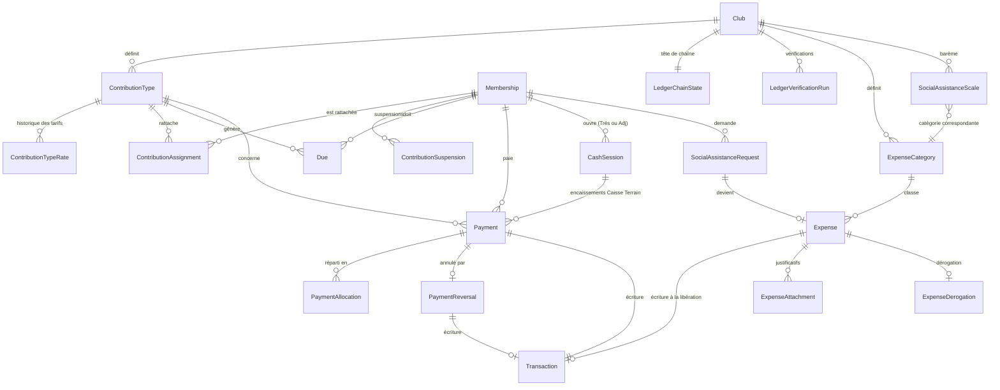
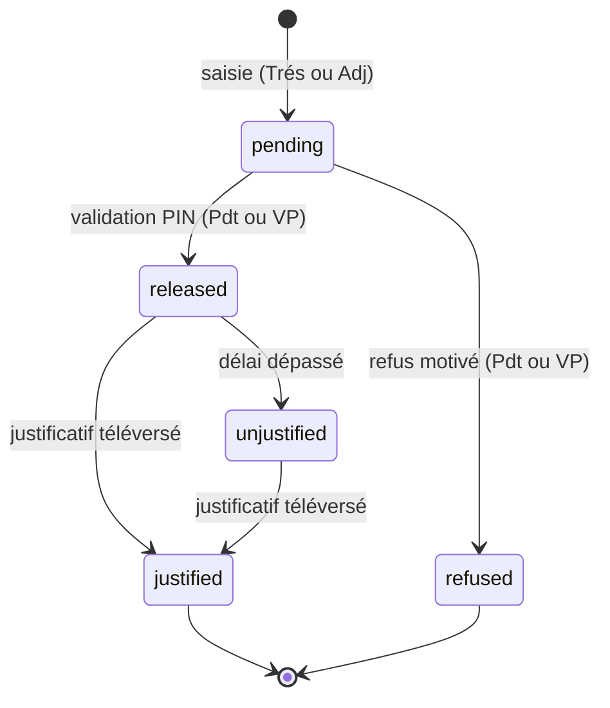

# Schéma de données — Domaine Trésorerie

Lot 0 (cadrage) · 25/09/2026 · Rédigé par `finance-engine`. Annexe B (cahier des charges 10.1), partie trésorerie. Ce document est intégré par référence dans `docs/lot0/schema-donnees.md` (§14) ; il suit les décisions de ce dernier pour les entités du socle (`Club`, `ClubSettings`, `Membership`), voir section 2.

**Sources** : cahier des charges 0.4 (glossaire), 2.4 (permissions), 4.3 (adhésion), 4.4 (trésorerie et cotisations), 4.5 (dépenses et assistance sociale), 4.6 (paiement en ligne), 5.3 (inaltérabilité), 6.3 (multi-tenant), 6.5 (cron), 6.6 (hors connexion), 7.2 (code PIN), 7.5 (anonymisation), 10.2 n° 4, 5 et 22. Règles non négociables n° 2, 3, 4, 6, 7, 8 et 12 de `CLAUDE.md`.

Ce document décrit des structures de données. Il ne contient pas de code. Les noms des entités et des champs sont en anglais (convention `CLAUDE.md` 7), les descriptions en français.

---

## 1. Conventions communes au domaine

### 1.1 Types utilisés

| Notation | Signification (équivalent Django indicatif) |
| --- | --- |
| `id` | Clé primaire entière auto-incrémentée (`BigAutoField`) |
| `FK → X` | Clé étrangère vers l'entité X |
| `Money` | `Decimal`, 12 chiffres dont 2 décimales (`DecimalField(max_digits=12, decimal_places=2)`). **Jamais `float`.** Toute valeur est arrondie à 2 décimales avant écriture (`ROUND_HALF_UP`). |
| `SignedMoney` | `Money` pouvant être négatif (uniquement dans `Transaction.amount`) |
| `Currency` | Code ISO 4217 sur 3 lettres (`USD`, `CDF`…), recopié depuis la devise du club (`ClubSettings.currency`, voir 2) |
| `Date` | Date calendaire, exprimée dans le fuseau du club (`ClubSettings.timezone`) : échéances, date de paiement, date d'événement |
| `DateTime` | Horodatage stocké en UTC, affiché dans le fuseau du club |
| `Enum(...)` | Liste fermée de valeurs (stockée en chaîne courte, libellés français côté interface) |
| `Text(n)` | Chaîne de longueur maximale n ; `Text` seul = texte long |
| `File` | Référence à un fichier privé stocké hors du dossier public, servi uniquement par une vue authentifiée (règle n° 10, CDC 6.7) |
| `Hash` | Chaîne hexadécimale de 64 caractères (HMAC-SHA256) |

### 1.2 Isolation multi-tenant (règle non négociable n° 8)

- **Toute entité de ce domaine est une donnée privée de club.** Chacune porte un champ `club` (`FK → Club`, obligatoire, indexé, suppression protégée).
- L'accès passe exclusivement par le gestionnaire de requêtes tenant-aware du socle (`apps/core`) : une requête sans club actif est refusée.
- **Cohérence inter-tables** : quand une entité référence une autre entité privée (adhésion, type, catégorie, paiement…), les deux doivent appartenir au **même club**. Ce contrôle est fait par la couche de services à chaque écriture et couvert par un test d'étanchéité.
- Le club est toujours celui de l'adhésion en cours de l'acteur (règle n° 9), jamais une valeur transmise par le client.

### 1.3 Suppression et modification

- Aucune entité financière n'est supprimée physiquement. Toutes les clés étrangères de ce domaine utilisent une suppression **protégée** (`PROTECT`) : on ne peut pas supprimer un club, une adhésion ou un type référencés.
- Les seules suppressions permises sont listées explicitement (type de cotisation jamais utilisé, voir 4.1).
- Toute création, modification ou changement d'état écrit une entrée dans le journal d'activité (règle n° 6, CDC 5.2 « Finances »). Le journal est porté par l'app `audit` et n'est pas redéfini ici.

### 1.4 Code PIN (CDC 7.2, règle n° 7)

Aucun PIN n'est stocké dans les tables de ce domaine. Les actions qui l'exigent (validation d'un paiement, validation ou libération d'une dépense, dérogation, annulation d'un paiement) enregistrent l'acteur (`*_by`) et l'horodatage (`*_at`). La présence de ces deux champs atteste qu'une vérification PIN a réussi : le service refuse l'écriture sinon, et la vérification est tracée dans le journal.

**Exception unique : la Caisse Terrain Express** (CDC 4.4.5, 10.2 n° 22). Le PIN n'y est pas vérifié à chaque encaissement mais **une seule fois, par le serveur, à l'ouverture d'une session de caisse** (`CashSession`, 5.4). Les paiements `field_cash` de cette session, y compris ceux saisis hors connexion puis synchronisés, ne redemandent pas le PIN : leur attestation est le rattachement à une session ouverte et non expirée (`Payment.cash_session`, dont `pin_verified_at` fait foi). **Aucun PIN, haché ou non, n'est stocké sur l'appareil.**

---

## 2. Références externes (socle commun)

Ces entités appartiennent à d'autres apps et sont définies dans `docs/lot0/schema-donnees.md`, qui fait foi pour elles. Elles sont seulement référencées ici ; seuls les attributs dont la trésorerie dépend sont listés.

| Entité | App | Attributs utilisés par la trésorerie |
| --- | --- | --- |
| `User` | `accounts` | Identité de l'acteur (`*_by`). Un Superuser agissant en support apparaît « Système Vesta » côté club (CDC 5.4), le journal garde son identité réelle. |
| `Club` | `clubs` | Identité du club uniquement (`schema-donnees.md` §4.1). **Ne porte aucun paramètre financier.** Toutes les entités de ce document référencent `Club` pour l'isolation multi-tenant. |
| `ClubSettings` | `clubs` | Paramètres opérationnels, liés 1-1 à `Club` (`schema-donnees.md` §4.2, décision D4), lus via `club.settings.<champ>` : `currency` (Currency, obligatoire, défaut `USD`), `timezone` (fuseau IANA), `debt_tolerance_days` (entier ≥ 0, **défaut 0**, 10.2 n° 4), `expense_justification_days` (entier > 0, **défaut 7**, CDC 4.5.2), `payment_link_url` (URL facultative, CDC 4.6 — jamais en dur). Dans tout ce document, « devise du club », « fuseau du club », « tolérance du club » et « délai de justification » désignent ces champs de `ClubSettings`. |
| `Membership` | `clubs` | Adhésion d'un joueur à un club (`schema-donnees.md` §3.2) : `club`, `user`, `status`, `joined_on` (date d'entrée), `left_on` (date de sortie, facultative) ; rôles portés par `MembershipRole`. `status` ne porte que les **états de workflow** : `pending` (En attente), `active` (Inscrit), `departed` (Parti). **Aucun autre statut n'y est stocké** (`schema-donnees.md` §3.2.1) : « En ordre » / « En dette » sont calculés par `is_in_good_standing` (ce document) ; « Suspendu » découle d'une suspension disciplinaire active (entité `Suspension`, domaine sport) ; « Blessé » et l'aptitude découlent de `HealthRecord.fitness_status` / `Injury` (domaine médical). Ces statuts se superposent à la situation financière (CDC 4.1) sans être stockés sur `Membership`. |
| `Assembly` | `assemblies` | Assemblée générale à laquelle une dérogation est signalée (CDC 4.5.2). |
| `ImportBatch` | socle commun (import CSV) | Lot d'import CSV (CDC 4.4.8), pour tracer l'origine des paiements et montants dus importés. **Entité du socle commun, sous la responsabilité de `backend-dev` / `data-import` ; la trésorerie ne la définit pas et n'en crée aucune variante**, elle ne fait que la référencer par clé étrangère (`Due.import_batch`, `Payment.import_batch`). À la date de ce document, sa définition détaillée n'apparaît pas encore dans `schema-donnees.md` : voir point ouvert Q21. |

**Distinction de vocabulaire** : la `ContributionSuspension` de ce document (4.4) est une suspension **des cotisations** décidée par le Président (10.2 n° 5). Elle n'a aucun lien avec la `Suspension` disciplinaire du domaine sport (« Suspendu », cartons) et n'affecte pas `Membership.status`.

**Portée de `is_in_good_standing`** : ce service ne rend compte que de la situation **financière** (En ordre / En dette). Il ne consulte ni `Suspension`, ni `HealthRecord`, ni `Membership.status`. Le contrôle complet d'éligibilité à une composition ou à un plan tactique (dette, suspension, inaptitude, adhésion en attente — règle n° 5) est composé par le domaine sport (`schema-donnees.md` §5.6, invariant J2), qui appelle ce service pour la seule partie financière.

---

## 3. Vue d'ensemble

Découpage fonctionnel :

- **Cotisations** : `ContributionType`, `ContributionTypeRate`, `ContributionAssignment`, `ContributionSuspension`, `Due`.
- **Encaissements** : `Payment`, `PaymentAllocation`, `PaymentReversal`, `CashSession`.
- **Grand livre chaîné** : `Transaction`, `LedgerChainState`, `LedgerVerificationRun`.
- **Dépenses** : `ExpenseCategory`, `Expense`, `ExpenseAttachment`, `ExpenseDerogation`.
- **Assistance sociale** : `SocialAssistanceScale`, `SocialAssistanceRequest`.

Le **solde** n'apparaît dans aucune entité (voir 9, invariant I1).

---

## 4. Cotisations

### 4.1 `ContributionType` — Type de cotisation (CDC 4.4.1)

Rubrique de recette définie par le club. Créée, modifiée et archivée par le Président ou le Trésorier (2.4).

| Champ | Type | Contraintes | Description |
| --- | --- | --- | --- |
| `id` | id | PK | |
| `club` | FK → Club | obligatoire, indexé | **Isolation multi-tenant.** |
| `name` | Text(120) | obligatoire ; unique par `(club, name)` | Ex. « Mensuelle catégorie 20 $ » |
| `nature` | Enum(`mandatory`, `free`) | obligatoire ; **non modifiable dès qu'il existe un montant dû ou un paiement** sur le type | Obligatoire : crée une dette. Libre : n'en crée jamais. |
| `amount` | Money | obligatoire si `mandatory` (montant fixe, > 0) ; facultatif si `free` (montant suggéré, ≥ 0) | Montant **courant** affiché. Le montant applicable à un mois donné se lit dans `ContributionTypeRate`. |
| `periodicity` | Enum(`monthly`, `annual`, `one_off`) | obligatoire | Mensuelle, annuelle, ponctuelle |
| `due_day` | Entier 1–28 | obligatoire si `monthly` ou `annual` ; **défaut 10** (10.2 n° 4) | Jour du mois après lequel l'impayé devient dette. Limité à 28 pour exister dans tous les mois. |
| `due_month` | Entier 1–12 | obligatoire si `annual`, vide sinon | Mois de l'échéance annuelle (voir point ouvert Q3). |
| `deadline` | Date | obligatoire si `one_off`, vide sinon | Date limite d'une cotisation ponctuelle (CDC 4.4.1). |
| `is_membership_fee` | Booléen | défaut faux ; **au plus un type actif avec `true` par club** | Frais d'adhésion (CDC 4.3) : son paiement, avec la signature du parrain, fait passer le joueur « Inscrit ». |
| `scope` | Enum(`all`, `selected`, `attached`) | obligatoire | Tous les joueurs actifs / une liste de joueurs / les joueurs rattachés un par un. Pour `selected` et `attached`, la liste est dans `ContributionAssignment`. |
| `status` | Enum(`active`, `archived`) | obligatoire, défaut `active` | Seuls les types actifs sont proposés à l'enregistrement d'un paiement (CDC 4.4.4). |
| `archived_at` | DateTime | facultatif ; renseigné si `archived` | |
| `archived_by` | FK → User | facultatif | |
| `created_at`, `created_by` | DateTime, FK → User | obligatoires | |
| `updated_at` | DateTime | obligatoire | |

Règles attachées :

- **Suppression** : autorisée uniquement si le type n'a reçu **aucun paiement** (CDC 4.4.1) **et** n'a généré **aucun montant dû** (voir décision D6). Sinon, seul l'archivage est possible.
- **Archivage** : arrête la génération des montants dus à partir du mois suivant ; les montants dus déjà générés restent dans le solde.
- **Modification du montant** : ne modifie jamais `amount` rétroactivement ; elle crée une ligne `ContributionTypeRate` applicable au mois suivant (voir 4.2).

### 4.2 `ContributionTypeRate` — Historique des tarifs (CDC 4.4.1)

Matérialise la règle « une modification de montant ne s'applique qu'aux mois suivants, jamais aux mois passés ».

| Champ | Type | Contraintes | Description |
| --- | --- | --- | --- |
| `id` | id | PK | |
| `club` | FK → Club | obligatoire, indexé | **Isolation multi-tenant.** |
| `contribution_type` | FK → ContributionType | obligatoire | |
| `amount` | Money | obligatoire, > 0 pour un type obligatoire | |
| `effective_from` | Date | obligatoire ; toujours le **1er d'un mois** ; unique par `(contribution_type, effective_from)` | Premier mois d'application. |
| `created_at`, `created_by` | DateTime, FK → User | obligatoires | |

Règles attachées :

- À la création du type, une première ligne est créée avec `effective_from` = 1er du mois de création.
- Une modification faite pendant le mois M crée (ou remplace, si elle n'est pas encore entrée en vigueur) la ligne `effective_from` = 1er du mois M+1.
- Une ligne dont `effective_from` est passé ou égal au mois courant n'est jamais modifiée.
- Le montant applicable au mois P est celui de la ligne ayant le plus grand `effective_from` ≤ P.

### 4.3 `ContributionAssignment` — Rattachement d'un joueur à un type (CDC 4.4.1 « Concernés »)

| Champ | Type | Contraintes | Description |
| --- | --- | --- | --- |
| `id` | id | PK | |
| `club` | FK → Club | obligatoire, indexé | **Isolation multi-tenant.** |
| `contribution_type` | FK → ContributionType | obligatoire ; type avec `scope` ∈ {`selected`, `attached`} | |
| `membership` | FK → Membership | obligatoire ; même club | |
| `starts_on` | Date | obligatoire ; 1er d'un mois pour un type mensuel | Premier mois concerné. |
| `ends_on` | Date | facultatif ; ≥ `starts_on` | Dernier jour du rattachement (changement de catégorie, départ). |
| `created_at`, `created_by` | DateTime, FK → User | obligatoires | |

Contraintes :

- Pas de chevauchement de périodes pour un même couple `(contribution_type, membership)`.
- Un rattachement n'est jamais supprimé une fois qu'un montant dû en découle ; on le clôt par `ends_on`.
- Voir point ouvert Q2 sur l'unicité de la mensuelle obligatoire par joueur.

### 4.4 `ContributionSuspension` — Suspension temporaire des cotisations (CDC 4.4.2, 10.2 n° 5)

Suspension pour blessure longue ou absence, **sur décision du Président, tracée**.

| Champ | Type | Contraintes | Description |
| --- | --- | --- | --- |
| `id` | id | PK | |
| `club` | FK → Club | obligatoire, indexé | **Isolation multi-tenant.** |
| `membership` | FK → Membership | obligatoire ; même club | |
| `starts_on` | Date | obligatoire ; 1er d'un mois | Premier mois suspendu. |
| `ends_on` | Date | facultatif ; dernier jour d'un mois, ≥ `starts_on` | Vide = jusqu'à nouvel ordre. |
| `reason` | Text | obligatoire, non vide | Motif de la décision. |
| `decided_by` | FK → User | obligatoire ; doit détenir le rôle Président à la date de décision | |
| `decided_at` | DateTime | obligatoire | |
| `ended_by`, `ended_at` | FK → User, DateTime | facultatifs | Levée anticipée de la suspension. |

Effet : aucun montant dû n'est généré pour les mois couverts. La suspension ne s'applique qu'aux mois **non encore générés** (pas d'effacement rétroactif, voir Q6).

### 4.5 `Due` — Montant dû (échéance générée) (CDC 4.4.2)

Une ligne par joueur, par type obligatoire et par période. Créée par la tâche cron du 1er du mois (mensuelles), ou lors du rattachement / de l'arrivée d'un joueur, ou par import CSV.

| Champ | Type | Contraintes | Description |
| --- | --- | --- | --- |
| `id` | id | PK | |
| `club` | FK → Club | obligatoire, indexé | **Isolation multi-tenant.** |
| `membership` | FK → Membership | obligatoire ; même club | |
| `contribution_type` | FK → ContributionType | obligatoire ; même club ; **`nature = mandatory` uniquement** | Les types libres ne génèrent jamais de montant dû. |
| `period` | Date | obligatoire | Mensuel : 1er du mois concerné. Annuel : 1er janvier de l'année. Ponctuel : la date limite du type. |
| `amount` | Money | obligatoire, > 0 | **Copie figée** du tarif applicable à `period` au moment de la génération (4.2). |
| `due_date` | Date | obligatoire | Échéance : `due_day` du mois (mensuel), `due_day`/`due_month` (annuel), `deadline` (ponctuel). |
| `source` | Enum(`scheduler`, `arrival`, `assignment`, `import`) | obligatoire | Origine de la génération. |
| `import_batch` | FK → ImportBatch | facultatif ; requis si `source = import` | |
| `created_at` | DateTime | obligatoire | |

Contraintes :

- **Unique** `(membership, contribution_type, period)` : la tâche cron est idempotente (relancer la génération ne crée pas de doublon).
- **Immuable** après création : aucun champ n'est modifiable ; aucune suppression.
- **Pas de statut stocké** (« payé », « partiel », « impayé échu », « à venir ») : il est déduit des répartitions (5.2) et de la date.
- **Échu** : un montant dû devient une dette le lendemain de `due_date + ClubSettings.debt_tolerance_days` (lu via `club.settings.debt_tolerance_days`). Autrement dit, il est pris en compte dans le solde à la date D si `due_date + tolérance < D`. Avec l'échéance au 10 et 0 jour de tolérance, il compte à partir du 11 : personne n'est bloqué le 1er.
- **Joueur arrivé en cours de mois** : le mois entier est dû (10.2 n° 5) ; le montant dû du mois d'arrivée est créé immédiatement (`source = arrival`) avec le montant plein. Voir Q4 sur l'échéance appliquée.

---

## 5. Encaissements

### 5.1 `Payment` — Paiement (CDC 4.4.4, 4.4.5, 4.6)

Objet métier d'un encaissement : qui, quel type, combien, par quel moyen, avec quelles pièces. Le fait financier chaîné et le statut de traitement sont portés par la `Transaction` associée (6.1), liée 1-1.

| Champ | Type | Contraintes | Description |
| --- | --- | --- | --- |
| `id` | id | PK | |
| `club` | FK → Club | obligatoire, indexé | **Isolation multi-tenant.** |
| `membership` | FK → Membership | obligatoire ; même club | Joueur payeur. |
| `contribution_type` | FK → ContributionType | obligatoire ; même club ; type `active` au moment de l'enregistrement | |
| `amount` | Money | obligatoire, > 0 | Paiement partiel autorisé (inférieur au montant dû). |
| `currency` | Currency | obligatoire ; = `ClubSettings.currency` | Copie figée. |
| `method` | Enum(`cash`, `mobile_money`, `payment_link`, `card`) | obligatoire | Espèces, mobile money, lien de paiement (CDC 4.4.4) ; `card` réservé à la phase 2 FlexPaie (CDC 4.6). |
| `reference` | Text(120) | facultatif | Référence saisie (n° de reçu mobile money, référence laxtech…). |
| `paid_on` | Date | obligatoire ; ≤ date du jour | Date de valeur du paiement déclarée. |
| `source` | Enum(`treasurer_entry`, `field_cash`, `player_declaration`, `csv_import`, `gateway`) | obligatoire | Modale Trésorier, Caisse Terrain Express, « J'ai payé », import CSV, FlexPaie. |
| `attachment` | File | facultatif | Pièce jointe (CDC 4.4.4) ou capture (« J'ai payé », CDC 4.6). JPEG, PNG, WebP, PDF ; 10 Mo max. |
| `submitted_by` | FK → User | obligatoire | Trésorier/adjoint qui saisit, ou joueur qui déclare. |
| `submitted_at` | DateTime | obligatoire | |
| `validated_by` | FK → User | requis quand la transaction passe à `succeeded`, sauf `source = gateway` | Trésorier ou adjoint (PIN). Pour `field_cash` : l'utilisateur de `cash_session.opened_by`, sans nouvelle saisie du PIN (1.4). |
| `validated_at` | DateTime | idem | Pour `field_cash` : horodatage serveur de la réception (en ligne) ou de la synchronisation (hors connexion). |
| `cash_session` | FK → CashSession | **requis si `source = field_cash`, vide sinon** ; même club ; `cash_session.opened_by.user` = `submitted_by` | Session de caisse sous laquelle l'encaissement a été fait (CDC 4.4.5, 10.2 n° 22). Figé à la création. |
| `rejected_by`, `rejected_at` | FK → User, DateTime | facultatifs | Rejet d'une déclaration « J'ai payé ». |
| `rejection_reason` | Text | requis si rejet | |
| `receipt_number` | Entier positif | attribué à la validation ; **unique par `(club, receipt_number)`** ; séquence continue par club | Reçu numéroté (CDC 4.4.4). |
| `receipt_file` | File | facultatif jusqu'à génération | PDF aux couleurs du club, généré après validation. |
| `receipt_issued_at` | DateTime | facultatif | |
| `client_uuid` | UUID | facultatif ; **unique par `(club, client_uuid)`** | Identifiant généré sur le téléphone pour la Caisse Terrain Express hors connexion (CDC 6.6) : déduplication à la synchronisation. |
| `client_recorded_at` | DateTime | facultatif ; requis si `client_uuid` | Heure réelle de la saisie hors connexion. Pour `field_cash`, doit tomber dans la fenêtre de validité de `cash_session` (5.4). |
| `import_batch` | FK → ImportBatch | requis si `source = csv_import` | |

Règles attachées :

- Le **statut** du paiement (à valider, validé, rejeté, en cours chez le fournisseur) est celui de sa `Transaction` : il n'est pas dupliqué ici.
- Une fois la transaction scellée (`succeeded` ou `failed`), **aucun champ financier n'est modifiable** (`membership`, `contribution_type`, `amount`, `currency`, `method`, `reference`, `paid_on`). Seuls les champs du reçu (`receipt_file`, `receipt_issued_at`) peuvent être complétés.
- **Jamais supprimé.** Une erreur se corrige par un `PaymentReversal` (5.3).
- Circuit par source :
  - `treasurer_entry`, `csv_import` : fournisseur `manual`, la transaction est créée directement `succeeded` à la validation par PIN.
  - `field_cash` (Caisse Terrain Express) : fournisseur `manual`, la transaction est créée directement `succeeded` à la réception par le serveur (en ligne ou à la synchronisation), **sans redemander le PIN**, à condition qu'une `CashSession` valide couvre l'encaissement (5.4). Aucun PIN n'est vérifié ni stocké sur l'appareil.
  - `player_declaration` (« J'ai payé ») : fournisseur `link`, transaction `pending` (« À valider » chez le Trésorier), puis `succeeded` (validation PIN) ou `failed` (rejet motivé).
  - `gateway` (phase 2) : fournisseur `flexpaie`, `initiated` → `pending` → `succeeded` ou `failed`, sur confirmation du fournisseur, sans intervention du Trésorier.

### 5.2 `PaymentAllocation` — Répartition d'un paiement par mois (CDC 4.4.3, 4.4.7)

Projection **dérivée**, reconstructible à tout moment, qui alimente la grille des cotisations et le reçu. **Elle n'est jamais la source du solde** (le solde se calcule sur `Transaction` et `Due`, voir I1).

| Champ | Type | Contraintes | Description |
| --- | --- | --- | --- |
| `id` | id | PK | |
| `club` | FK → Club | obligatoire, indexé | **Isolation multi-tenant.** |
| `payment` | FK → Payment | obligatoire ; même club | |
| `membership` | FK → Membership | obligatoire ; = `payment.membership` | Dénormalisé pour la grille. |
| `contribution_type` | FK → ContributionType | obligatoire ; = `payment.contribution_type` | Dénormalisé pour la grille. |
| `period` | Date | obligatoire | Période couverte (1er du mois pour une mensuelle). |
| `amount` | Money | obligatoire, > 0 | Part du paiement affectée à cette période. |
| `computed_at` | DateTime | obligatoire | |

Contraintes :

- Unique `(payment, period)`.
- Σ `amount` des répartitions d'un paiement ≤ `payment.amount`. Le reste éventuel est un **crédit non affecté** (par exemple au-delà de la fin d'un rattachement).

Algorithme (règle 4.4.3), recalculé pour un couple `(membership, contribution_type)` à chaque validation, annulation ou changement de tarif :

1. Liste des périodes dans l'ordre chronologique : montants dus existants (`Due`), puis mois futurs projetés au tarif applicable (4.2), tant que le rattachement est ouvert et hors suspension.
2. Paiements validés et non annulés du couple, ordonnés par `paid_on` puis par numéro de séquence de la transaction.
3. Remplissage « premier entré, premier servi » : mois impayés les plus anciens → mois courant → mois à venir.

Exemple de référence (test obligatoire) : type à 10 $, joueur à jour fin février, 40 $ versés en mars → quatre lignes de 10 $ sur mars, avril, mai et juin.

Types libres : pas de montant dû ; le paiement est affecté en une seule ligne sur le mois de `paid_on`, pour l'affichage de la grille uniquement (décision D8).

### 5.3 `PaymentReversal` — Écriture d'annulation (CDC 4.4.4, 7.2)

Seul moyen de corriger un paiement validé.

| Champ | Type | Contraintes | Description |
| --- | --- | --- | --- |
| `id` | id | PK | |
| `club` | FK → Club | obligatoire, indexé | **Isolation multi-tenant.** |
| `payment` | FK → Payment | obligatoire ; **unique** (un paiement ne s'annule qu'une fois) ; paiement dont la transaction est `succeeded` | |
| `reason` | Text | obligatoire, non vide | Motif de l'annulation. |
| `reason_kind` | Enum(`error`, `refund`) | obligatoire, défaut `error` | `refund` : remboursement des frais d'adhésion après refus du parrain (CDC 4.3, décision D9). |
| `status` | Enum(`pending_approval`, `approved`, `rejected`) | obligatoire, défaut `pending_approval` | |
| `requested_by`, `requested_at` | FK → User, DateTime | obligatoires | Trésorier, adjoint ou Président. |
| `approved_by`, `approved_at` | FK → User, DateTime | requis si `approved` ; `approved_by` doit détenir le rôle **Président** (PIN) | |
| `rejected_by`, `rejected_at`, `rejection_reason` | FK → User, DateTime, Text | requis si `rejected` | |

Règles attachées :

- L'approbation crée une `Transaction` de type `payment_reversal`, d'un montant égal à l'opposé du paiement, scellée dans la chaîne. Le paiement d'origine reste intact.
- L'annulation est **totale** (voir Q7 pour l'annulation partielle). Pour corriger un montant, on annule puis on ressaisit.
- Les répartitions (5.2) du couple `(membership, contribution_type)` sont recalculées.

### 5.4 `CashSession` — Session de caisse (CDC 4.4.5, 6.6, 7.2, 10.2 n° 22)

Ouverte **en ligne** par le Trésorier ou l'adjoint avant les encaissements du dimanche. Le code PIN est vérifié **une seule fois**, par le serveur, à l'ouverture ; la session couvre ensuite tous les encaissements de la Caisse Terrain Express de son auteur, en ligne comme hors connexion, jusqu'à minuit (fuseau du club).

| Champ | Type | Contraintes | Description |
| --- | --- | --- | --- |
| `id` | id | PK | Identifiant de session, transmis à l'appareil à l'ouverture et joint à chaque encaissement (y compris dans la file hors connexion). |
| `club` | FK → Club | obligatoire, indexé | **Isolation multi-tenant.** Club de l'adhésion en cours de l'auteur (règle n° 9). |
| `opened_by` | FK → Membership | obligatoire ; même club ; doit détenir le rôle **Trésorier** ou **Trésorier adjoint** à l'ouverture | Auteur de la session. |
| `pin_verified_at` | DateTime | obligatoire | Horodatage de la vérification **serveur** du PIN à l'ouverture. Une session ne peut être créée qu'après une vérification réussie. |
| `opened_at` | DateTime | obligatoire | |
| `expires_at` | DateTime | obligatoire ; **calculé à la création, non modifiable** | Minuit (00:00) suivant le jour d'ouverture, dans le fuseau `ClubSettings.timezone`, stocké en UTC. Ex. : ouverture dimanche 08:30 à Kinshasa → expiration lundi 00:00 heure de Kinshasa. |
| `closed_at` | DateTime | facultatif ; `opened_at` ≤ `closed_at` < `expires_at` | Fermeture manuelle par l'auteur avant l'expiration. |
| `status` | Enum(`open`, `closed`, `expired`) | obligatoire, défaut `open` | Ouverte, fermée, expirée. |

Règles attachées :

- **Aucun PIN sur l'appareil** : ni le PIN, ni son empreinte, ni aucun secret dérivé n'est transmis ou conservé côté téléphone. L'appareil ne garde que l'identifiant de session et son `expires_at`, pour l'affichage.
- **Validité effective** : une session est valide à l'instant T si `opened_at` ≤ T < `expires_at` **et** (`closed_at` vide ou T < `closed_at`). Cette validité est **évaluée à la volée** à partir des horodatages ; elle ne dépend pas du champ `status`, qui n'est qu'un reflet mis à jour par la fermeture manuelle ou par le cron (12). Passé minuit, la session est donc expirée même si le cron n'est pas encore passé.
- **Condition de création d'un paiement `field_cash`** (en ligne ou synchronisé) : il existe une `CashSession` du **même club**, ouverte par **l'auteur de l'encaissement**, valide au **moment de l'encaissement** — l'heure de réception serveur pour une saisie en ligne, `client_recorded_at` pour une saisie hors connexion. À défaut, le serveur refuse l'encaissement : « Aucune session de caisse ouverte : ouvrez une session avec votre code PIN. »
- **Synchronisation après minuit** : un encaissement saisi hors connexion pendant la validité de la session est accepté même si la synchronisation a lieu après `expires_at` ; il reste rattaché à cette session. En revanche, `client_recorded_at` doit être ≤ l'heure de réception serveur, et un encaissement dont `client_recorded_at` tombe hors de la fenêtre de validité est refusé et signalé à son auteur dans la file de synchronisation.
- **Après expiration ou fermeture**, toute nouvelle session exige une **nouvelle vérification du PIN** en ligne. Une session fermée ou expirée n'est jamais rouverte.
- **Unicité** : au plus une session valide à la fois par `(club, opened_by)`. Plusieurs trésoriers (Trésorier et adjoint) peuvent avoir chacun leur session le même jour.
- **Journal** : l'ouverture (avec la vérification PIN), la fermeture et chaque encaissement de la session sont journalisés avec l'identifiant de la session (règle n° 6, CDC 4.4.5).
- **Gel du club** (6.2) : une session valide ne lève pas le gel ; aucun paiement `field_cash` n'est scellé tant que le gel dure (I14). Voir Q22 pour le sort des encaissements synchronisés pendant un gel.
- Jamais supprimée (trace d'audit des encaissements qu'elle couvre).

---

## 6. Grand livre chaîné (CDC 4.6, 5.3)

### 6.1 `Transaction` — Écriture financière chaînée

Table unique de tous les mouvements financiers du club. Elle porte dès le MVP les champs de préparation au paiement en ligne (CDC 4.6) et le chaînage cryptographique (CDC 5.3).

| Champ | Type | Contraintes | Description |
| --- | --- | --- | --- |
| `id` | id | PK | |
| `club` | FK → Club | obligatoire, indexé | **Isolation multi-tenant.** La chaîne est propre à chaque club. |
| `kind` | Enum(`payment`, `payment_reversal`, `expense_release`) | obligatoire | |
| `payment` | FK → Payment | **unique** ; requis si `kind = payment`, vide sinon | |
| `reversal` | FK → PaymentReversal | **unique** ; requis si `kind = payment_reversal`, vide sinon | |
| `expense` | FK → Expense | **unique** ; requis si `kind = expense_release`, vide sinon | |
| `membership` | FK → Membership | requis pour `payment` et `payment_reversal` ; facultatif pour `expense_release` (bénéficiaire joueur) | Dénormalisé et figé, pour l'agrégation SQL du solde. |
| `contribution_type` | FK → ContributionType | requis pour `payment` et `payment_reversal`, vide sinon | Dénormalisé et figé. |
| `amount` | SignedMoney | obligatoire, ≠ 0 | **Signé** : `payment` > 0 ; `payment_reversal` < 0 ; `expense_release` < 0. |
| `currency` | Currency | obligatoire ; = `ClubSettings.currency` | |
| `value_date` | Date | obligatoire | Date de valeur : `paid_on` du paiement ; pour une annulation, celle du paiement annulé (décision D10) ; pour une dépense, la date de libération. |
| `provider` | Enum(`manual`, `link`, `flexpaie`) | obligatoire | Fournisseur (CDC 4.6). |
| `external_ref` | Text(120) | facultatif ; unique par `(club, provider, external_ref)` si renseigné | Référence chez le fournisseur (laxtech, FlexPaie). |
| `status` | Enum(`initiated`, `pending`, `succeeded`, `failed`) | obligatoire | Initié, en attente, réussi, échoué (CDC 4.6). |
| `status_changed_at` | DateTime | obligatoire | |
| `sequence` | Entier positif | vide tant que non scellée ; **unique par `(club, sequence)`** ; continu, sans trou | Rang dans la chaîne du club. |
| `previous_hash` | Hash | vide tant que non scellée ; obligatoire ensuite | Empreinte de la transaction scellée précédente du club (`sequence - 1`), ou empreinte de genèse pour la première. |
| `hash` | Hash | vide tant que non scellée ; obligatoire et unique ensuite | Empreinte de la ligne (6.4). |
| `key_id` | Text(16) | obligatoire une fois scellée | **Identifiant** de la clé utilisée (ex. `v1`). La clé elle-même n'est jamais en base : elle est lue dans une variable d'environnement (règle n° 12). |
| `sealed_at` | DateTime | vide tant que non scellée | |
| `created_at` | DateTime | obligatoire | |

Cycle de vie et immuabilité :

- Une transaction `initiated` ou `pending` n'est **pas encore scellée** : seuls `status`, `status_changed_at` et `external_ref` peuvent évoluer, dans le sens `initiated → pending → succeeded | failed`.
- En atteignant `succeeded` ou `failed`, elle est **scellée** dans la même transaction de base : attribution de `sequence`, `previous_hash`, `hash`, `key_id`, `sealed_at`. Elle devient alors **entièrement immuable** (ni mise à jour, ni suppression).
- **Seules les transactions scellées `succeeded` comptent** dans le solde, la caisse et les indicateurs.
- Contrainte de cohérence : exactement une des trois FK `payment`, `reversal`, `expense` est renseignée, selon `kind`.
- Aucune donnée personnelle (nom, email, téléphone) n'entre dans le contenu haché : uniquement des identifiants. L'anonymisation d'un compte (CDC 7.5) ne casse donc pas la chaîne.

### 6.2 `LedgerChainState` — Tête de chaîne et gel du club

Une ligne par club. Sert de verrou de sérialisation lors du scellement (verrouillage de la ligne pendant l'écriture) et porte l'état de gel.

| Champ | Type | Contraintes | Description |
| --- | --- | --- | --- |
| `club` | FK → Club | PK, 1-1 | **Isolation multi-tenant.** |
| `last_sequence` | Entier ≥ 0 | obligatoire, défaut 0 | |
| `last_hash` | Hash | obligatoire | Empreinte de genèse tant qu'aucune transaction n'est scellée. |
| `last_receipt_number` | Entier ≥ 0 | obligatoire, défaut 0 | Compteur des numéros de reçu (5.1). |
| `is_frozen` | Booléen | obligatoire, défaut faux | **Gel des écritures financières** du club (CDC 5.3). |
| `frozen_at` | DateTime | requis si gelé | |
| `frozen_reason` | Text | requis si gelé | Ex. « Rupture de chaîne détectée à la séquence 1284 ». |
| `frozen_by_run` | FK → LedgerVerificationRun | facultatif | Vérification ayant déclenché le gel. |
| `unfrozen_at`, `unfrozen_by`, `unfreeze_reason` | DateTime, FK → User (Superuser), Text | facultatifs | Levée du gel après analyse (voir Q8). |

Tant que `is_frozen` est vrai : aucun scellement, donc aucune validation de paiement, annulation ou libération de dépense pour ce club. Les lectures (solde, grille) restent possibles.

### 6.3 `LedgerVerificationRun` — Vérification quotidienne de la chaîne (CDC 5.3, 6.5)

Historique des exécutions de la commande cron quotidienne.

| Champ | Type | Contraintes | Description |
| --- | --- | --- | --- |
| `id` | id | PK | |
| `club` | FK → Club | obligatoire, indexé | **Isolation multi-tenant.** |
| `started_at`, `finished_at` | DateTime | obligatoire / facultatif | |
| `result` | Enum(`ok`, `broken`, `error`) | obligatoire | |
| `checked_count` | Entier ≥ 0 | obligatoire | Nombre de transactions recalculées. |
| `first_broken_sequence` | Entier | facultatif ; requis si `broken` | Première ligne dont l'empreinte ne correspond pas. |
| `details` | Text | facultatif | Diagnostic technique (sans donnée personnelle). |

Une rupture (`broken`) : alerte au Superuser (CDC 5.5), gel du club (6.2). **Aucun joueur n'est pénalisé automatiquement** : la rupture ne modifie ni montant dû, ni paiement, ni statut (voir Q8).

### 6.4 Calcul de l'empreinte

- Algorithme : **HMAC-SHA256** avec la clé identifiée par `key_id`, lue dans une variable d'environnement (nom exact à fixer par `devops-cpanel`, par exemple une variable par version de clé).
- Message haché : sérialisation canonique (JSON à clés triées, sans espaces, montants en chaîne à 2 décimales, dates ISO 8601, horodatages UTC) des champs `club`, `sequence`, `kind`, `payment`, `reversal`, `expense`, `membership`, `contribution_type`, `amount`, `currency`, `value_date`, `provider`, `external_ref`, `status`, `sealed_at`, `key_id`, **concaténée à `previous_hash`**.
- Empreinte de genèse (première transaction d'un club) : 64 zéros.
- La vérification recalcule chaque ligne dans l'ordre de `sequence` et contrôle : empreinte recalculée = `hash`, `previous_hash` = `hash` de la ligne précédente, séquence continue sans trou.
- Changement de clé : jamais sans procédure planifiée ; les lignes anciennes gardent leur `key_id`, la clé ancienne doit rester disponible pour la vérification.

---

## 7. Dépenses (CDC 4.5.1, 4.5.2)

### 7.1 `ExpenseCategory` — Catégorie de dépense

Créée, modifiée et archivée par le Président ou le Trésorier (2.4).

| Champ | Type | Contraintes | Description |
| --- | --- | --- | --- |
| `id` | id | PK | |
| `club` | FK → Club | obligatoire, indexé | **Isolation multi-tenant.** |
| `name` | Text(120) | obligatoire ; unique par `(club, name)` | |
| `ceiling` | Money | facultatif, > 0 | Plafond (voir Q10 sur sa portée). |
| `receipt_required` | Booléen | obligatoire, **défaut vrai** | Justificatif obligatoire. |
| `good_standing_only` | Booléen | obligatoire, défaut faux | « Réservée aux membres en ordre » : le bénéficiaire doit être un joueur en ordre (ex. assistance sociale). |
| `status` | Enum(`active`, `archived`) | obligatoire, défaut `active` | |
| `created_at`, `created_by`, `updated_at` | DateTime, FK → User, DateTime | obligatoires | |

Une catégorie ayant reçu au moins une dépense ne peut être qu'archivée (même logique que 4.1, décision D6).

### 7.2 `Expense` — Dépense

| Champ | Type | Contraintes | Description |
| --- | --- | --- | --- |
| `id` | id | PK | |
| `club` | FK → Club | obligatoire, indexé | **Isolation multi-tenant.** |
| `category` | FK → ExpenseCategory | obligatoire ; même club ; catégorie active à la saisie | |
| `amount` | Money | obligatoire, > 0 | |
| `currency` | Currency | obligatoire ; = `ClubSettings.currency` | |
| `beneficiary_name` | Text(160) | obligatoire | Bénéficiaire (fournisseur, joueur, tiers). |
| `beneficiary_membership` | FK → Membership | facultatif ; **obligatoire si `category.good_standing_only`** ; même club | Joueur bénéficiaire. |
| `reason` | Text | obligatoire | Motif. |
| `expense_date` | Date | obligatoire | Date de la dépense. |
| `status` | Enum(`pending`, `refused`, `released`, `justified`, `unjustified`) | obligatoire, défaut `pending` | En attente, Refusée, Libérée, Justifiée, Non justifiée. |
| `created_by`, `created_at` | FK → User, DateTime | obligatoires | Trésorier ou adjoint. |
| `refused_by`, `refused_at`, `refusal_reason` | FK → User, DateTime, Text | requis si `refused` | Président ou VP ; motif obligatoire. |
| `released_by`, `released_at` | FK → User, DateTime | requis à partir de `released` | Président ou VP (PIN). |
| `justification_deadline` | Date | requis à partir de `released` si `receipt_required` | Date de `released_at` (dans le fuseau `ClubSettings.timezone`) + `ClubSettings.expense_justification_days` (7 jours par défaut), figée à la libération : une modification ultérieure du paramètre ne s'applique qu'aux dépenses libérées après elle. |
| `justified_by`, `justified_at` | FK → User, DateTime | requis si `justified` | |
| `unjustified_at` | DateTime | renseigné au passage en `unjustified` | |
| `social_assistance_request` | FK → SocialAssistanceRequest | facultatif ; unique | Dépense issue d'une demande d'assistance sociale (4.5.3). |

Machine à états (CDC 4.5.2) :

Règles attachées :

- **Libération** : crée une `Transaction` `expense_release` (montant négatif), scellée. À partir de là, `category`, `amount`, `currency`, `beneficiary_*`, `reason` et `expense_date` sont **immuables**.
- **Justification** : exige au moins un `ExpenseAttachment` de nature `receipt`.
- **Non justifiée** : le passage `released → unjustified` est écrit par une tâche cron (alerte rouge au Trésorier, à l'adjoint et au Président). **Le blocage, lui, ne dépend pas du cron** : il est évalué à la volée (voir invariant I8).
- **Catégorie « réservée aux membres en ordre »** : la libération est refusée si `beneficiary_membership` n'est pas en ordre (à la date de l'événement pour une assistance sociale, à la date de libération sinon).
- **Plafond** : voir Q10.
- Une dépense `refused` est définitive ; aucune dépense n'est supprimée.

### 7.3 `ExpenseAttachment` — Justificatif de dépense

| Champ | Type | Contraintes | Description |
| --- | --- | --- | --- |
| `id` | id | PK | |
| `club` | FK → Club | obligatoire, indexé | **Isolation multi-tenant.** |
| `expense` | FK → Expense | obligatoire ; même club | |
| `file` | File | obligatoire | Photo (compressée à l'envoi) ou PDF ; JPEG, PNG, WebP, PDF ; 10 Mo max avant compression. |
| `kind` | Enum(`supporting`, `receipt`) | obligatoire | Pièce jointe à la saisie / facture justificative. |
| `uploaded_by`, `uploaded_at` | FK → User, DateTime | obligatoires | |

Jamais supprimé une fois la dépense libérée.

### 7.4 `ExpenseDerogation` — Dérogation au blocage (CDC 4.5.2)

| Champ | Type | Contraintes | Description |
| --- | --- | --- | --- |
| `id` | id | PK | |
| `club` | FK → Club | obligatoire, indexé | **Isolation multi-tenant.** |
| `expense` | FK → Expense | obligatoire ; **unique** ; même club | Dépense libérée malgré le blocage. |
| `reason` | Text | obligatoire, non vide | Motif (décès, blessé à soigner…). |
| `granted_by` | FK → User | obligatoire ; doit détenir le rôle **Président** (PIN) | Le VP ne peut pas déroger. |
| `granted_at` | DateTime | obligatoire | |
| `blocking_expenses` | Liste d'identifiants de `Expense` (relation plusieurs-à-plusieurs) | obligatoire, au moins une | Dépenses non justifiées qui bloquaient au moment de la dérogation (instantané). |
| `reported_assembly` | FK → Assembly | facultatif | AG où la dérogation a été signalée. |
| `reported_at` | DateTime | facultatif | |

Immuable après création (seuls `reported_assembly` et `reported_at` se renseignent ensuite). Journalisée ; les dérogations répétées déclenchent une alerte Superuser (CDC 5.5).

---

## 8. Assistance sociale (CDC 4.5.3)

### 8.1 `SocialAssistanceScale` — Barème du club

Le cahier des charges mentionne « le montant prévu par le barème du club et le délai de traitement » : cette entité les porte.

| Champ | Type | Contraintes | Description |
| --- | --- | --- | --- |
| `id` | id | PK | |
| `club` | FK → Club | obligatoire, indexé | **Isolation multi-tenant.** |
| `event_type` | Enum(`birth`, `marriage`, `death`) | obligatoire ; unique par `(club, event_type)` parmi les lignes actives | Naissance, mariage, décès. |
| `amount` | Money | obligatoire, > 0 | Montant prévu. |
| `processing_days` | Entier > 0 | obligatoire | Délai de traitement annoncé. |
| `expense_category` | FK → ExpenseCategory | obligatoire ; même club ; `good_standing_only = vrai` | « Catégorie correspondante » de la dépense créée. |
| `status` | Enum(`active`, `archived`) | obligatoire | |
| `created_at`, `created_by`, `updated_at` | DateTime, FK → User, DateTime | obligatoires | |

Qui gère le barème : voir Q11.

### 8.2 `SocialAssistanceRequest` — Demande d'assistance sociale

| Champ | Type | Contraintes | Description |
| --- | --- | --- | --- |
| `id` | id | PK | |
| `club` | FK → Club | obligatoire, indexé | **Isolation multi-tenant.** |
| `membership` | FK → Membership | obligatoire ; même club | Demandeur (chaque joueur pour lui-même, 2.4 « P »). |
| `event_type` | Enum(`birth`, `marriage`, `death`) | obligatoire | |
| `event_date` | Date | obligatoire | |
| `description` | Text | obligatoire | |
| `attachment` | File | obligatoire | Pièce justificative. |
| `scale` | FK → SocialAssistanceScale | obligatoire | Barème appliqué. |
| `planned_amount` | Money | obligatoire | Copie figée du montant du barème à la soumission. |
| `eligible_at_submission` | Booléen | obligatoire ; **vrai ou faux accepté** (aucune contrainte) | Instantané informatif affiché avant l'envoi ; n'empêche jamais la soumission. |
| `amount_to_regularize` | Money | obligatoire, ≥ 0 | Montant à régulariser pour devenir éligible (0 si éligible), affiché dans le bandeau d'avertissement. |
| `status` | Enum(`submitted`, `approved`, `rejected`) | obligatoire, défaut `submitted` | Suivi dans le profil du joueur. |
| `submitted_at` | DateTime | obligatoire | |
| `decided_by`, `decided_at` | FK → User, DateTime | requis si décidée ; Président ou VP | |
| `rejection_reason` | Text | requis si `rejected` | |

Règles attachées :

- **Éligibilité** : être en ordre à la date de l'événement (`is_in_good_standing(membership, at_date=event_date)`). L'éligibilité est **recalculée** à la décision ; l'instantané de soumission ne sert qu'à l'affichage (voir Q12 sur la régularisation après l'événement).
- **Approbation** : crée une `Expense` de la catégorie du barème, `amount = planned_amount`, `beneficiary_membership = membership`, statut `pending`, qui suit ensuite le circuit 7.2 (voir Q13).
- **Soumission sans condition d'éligibilité** (lecture retenue : `docs/lot0/analyse.md` Q14) : un joueur non éligible **peut** envoyer sa demande. La modale affiche un bandeau d'avertissement et le montant à régulariser (`amount_to_regularize`). **Aucune contrainte d'éligibilité n'existe au niveau de la base de données ni du service de soumission** : `eligible_at_submission` et `amount_to_regularize` sont des instantanés purement informatifs, jamais bloquants.
- **Où s'applique la règle 4.5.3** : l'exigence « en ordre à la date de l'événement » (invariant I9) est contrôlée uniquement par les services, au moment de l'**approbation** de la demande (Président ou VP, qui tranche au cas par cas : rejet motivé, ou attente d'une régularisation selon Q12) et de la **libération** de la dépense issue de la demande (catégorie `good_standing_only`, 7.2). Le « cas par cas » ne permet pas d'approuver ni de libérer une assistance pour un joueur resté non éligible.

---

## 9. Invariants contraignant le schéma

| N° | Invariant | Traduction dans le schéma | Source |
| --- | --- | --- | --- |
| I1 | **Le solde n'est jamais stocké.** Solde(D) = Σ transactions `succeeded` de type `payment` ou `payment_reversal`, sur types **obligatoires**, `value_date` ≤ D − Σ `Due.amount` sur types obligatoires avec `due_date + ClubSettings.debt_tolerance_days < D`. | Aucun champ `balance`, `solde`, `in_good_standing` sur `Membership` ni ailleurs. Deux agrégations SQL (`SUM`) sur `Transaction` et `Due`. `PaymentAllocation` n'intervient jamais. | CDC 4.4.2, règle n° 2 |
| I2 | **Les types libres ne créent jamais de dette** et n'entrent pas dans le solde. | `Due.contribution_type` restreint aux types `mandatory` ; filtre `nature = mandatory` dans l'agrégation. `nature` figée dès le premier usage. | CDC 4.4.1, 4.4.2, règle n° 3 |
| I3 | Un montant dû ne devient dette qu'**après l'échéance + la tolérance** du club. | `Due.due_date` + `ClubSettings.debt_tolerance_days` (défaut 0). | CDC 4.4.2, 10.2 n° 4 |
| I4 | **Répartition** : impayés les plus anciens → mois courant → mois futurs. | `PaymentAllocation`, recalculée par couple joueur/type. | CDC 4.4.3 |
| I5 | **Un paiement validé n'est jamais supprimé ni modifié** ; correction par annulation motivée, validée par le Président (PIN). | `Payment` et `Transaction` immuables après scellement ; `PaymentReversal` unique par paiement, `approved_by` Président. | CDC 4.4.4, 7.2, règle n° 4 |
| I6 | **Chaînage** : empreinte = HMAC(contenu + empreinte précédente du club), clé hors base ; vérification quotidienne ; rupture = alerte + gel, sans pénalité. | `Transaction.sequence/previous_hash/hash/key_id`, `LedgerChainState`, `LedgerVerificationRun`. | CDC 5.3 |
| I7 | Un changement de montant n'affecte **que les mois futurs** ; un type ayant reçu des paiements ne peut être **qu'archivé**. | `ContributionTypeRate.effective_from` ≥ mois suivant ; `Due.amount` figé ; suppression refusée si paiement (ou montant dû). | CDC 4.4.1 |
| I8 | **Blocage des dépenses** : aucune libération tant qu'une dépense est non justifiée ; dérogation Président, motif, PIN, journalisée. | `can_release_expense(club)` = faux s'il existe une dépense `released` ou `unjustified` avec `justification_deadline` < aujourd'hui (évalué à la volée, sans attendre le cron) ; `ExpenseDerogation`. | CDC 4.5.2 |
| I9 | **Assistance sociale** réservée aux joueurs en ordre à la date de l'événement. | `ExpenseCategory.good_standing_only`, `SocialAssistanceRequest.event_date`, contrôle par les services à la décision et à la libération uniquement. **Aucune contrainte à la soumission** (demande envoyable avec avertissement, `analyse.md` Q14, voir 8.2). | CDC 4.5.3 |
| I10 | Frais d'adhésion payés + signature du parrain → **Inscrit**. | `ContributionType.is_membership_fee` (un seul actif par club) ; la trésorerie expose `has_paid_membership_fee` ; le passage `Membership.status` `pending` → `active` appartient à l'app `clubs` (`schema-donnees.md` §3.3). | CDC 4.3 |
| I11 | Chaque transaction porte `provider`, `external_ref`, `status` **dès le MVP**. | Champs obligatoires de `Transaction`. | CDC 4.6 |
| I12 | Montants en `Decimal`, 2 décimales, devise du club. | Types `Money` / `SignedMoney` / `Currency` ; `currency` copiée depuis `ClubSettings.currency` et contrôlée à chaque écriture. | Règle `CLAUDE.md` 7 |
| I13 | **Isolation par club**. | `club` obligatoire sur chaque entité ; cohérence inter-tables vérifiée par les services. | Règle n° 8, CDC 6.3 |
| I14 | Gel du club : aucune écriture financière nouvelle. | `LedgerChainState.is_frozen` contrôlé avant tout scellement. | CDC 5.3 |
| I15 | **Caisse Terrain Express : PIN vérifié une fois, à l'ouverture de la session de caisse**, pas à chaque encaissement ; aucun PIN stocké sur l'appareil. Un paiement `field_cash` (en ligne ou synchronisé) n'est créé que si une session du même club, ouverte par son auteur, était valide au moment de l'encaissement ; passé minuit (fuseau du club), la session expire et une nouvelle exige une nouvelle vérification du PIN. | `CashSession` (`pin_verified_at`, `expires_at` figé, `closed_at`) ; `Payment.cash_session` requis si et seulement si `source = field_cash` ; validité évaluée à la volée sur les horodatages (`client_recorded_at` hors connexion). | CDC 4.4.5, 6.6, 7.2, 10.2 n° 22 |

---

## 10. Services exposés aux autres modules (information)

Les autres apps (sport, mercato, médical, clubs) appellent ces services et **ne recalculent jamais un solde**. Signatures indicatives, implémentées dans `apps/treasury/services.py` au Lot 2 :

| Service | Retour | Usage |
| --- | --- | --- |
| `get_balance(membership, at_date=None)` | `Decimal` (devise `ClubSettings.currency`) | Profil, Caisse Terrain Express, mercato (quitus) |
| `get_balances(club, at_date=None)` | dictionnaire adhésion → `Decimal` | Tableau des membres (500 joueurs, deux requêtes agrégées) |
| `is_in_good_standing(membership, at_date=None)` | booléen + montant dû + raison lisible en français | Composition, plan tactique (partie financière seulement, voir 2), transfert, assistance sociale |
| `allocate_payment(payment)` | liste (période, montant) | Aperçu avant validation, grille, reçu |
| `can_release_expense(club)` | booléen + raison lisible | Circuit des dépenses |
| `has_paid_membership_fee(membership)` | booléen | Passage « Inscrit » (app `clubs`) |

---

## 11. Index et performance

Le calcul du solde doit rester rapide pour 500 joueurs : agrégations SQL uniquement, aucune boucle Python sur les transactions.

| Table | Index recommandés |
| --- | --- |
| `Transaction` | `(club, sequence)` unique ; `(club, membership, status, kind, value_date)` ; `(club, provider, external_ref)` |
| `Due` | `(membership, contribution_type, period)` unique ; `(club, membership, due_date)` |
| `PaymentAllocation` | `(club, contribution_type, period)` pour la grille annuelle ; `(payment, period)` unique |
| `Payment` | `(club, receipt_number)` unique ; `(club, client_uuid)` unique ; `(club, submitted_at)` pour « Derniers paiements » |
| `Expense` | `(club, status, justification_deadline)` pour le blocage |
| `CashSession` | `(club, opened_by, expires_at)` pour retrouver la session valide d'un trésorier ; `Payment` : `(club, cash_session)` pour le récapitulatif d'une session |
| `ContributionAssignment` | `(club, contribution_type, starts_on)` |

---

## 12. Tâches périodiques liées au schéma (cron, CDC 6.5)

| Tâche | Fréquence | Tables écrites |
| --- | --- | --- |
| Génération des montants dus (1er du mois ; annuelles au mois d'échéance) | quotidienne, idempotente | `Due` |
| Passage des dépenses en « Non justifiée » + alertes | quotidienne | `Expense` |
| Vérification de la chaîne de chaque club | quotidienne | `LedgerVerificationRun`, `LedgerChainState` |
| Génération et envoi des reçus en file | toutes les 5 minutes | `Payment.receipt_*` |
| Passage des sessions de caisse échues en `expired` (reflet d'affichage ; la validité est évaluée à la volée, 5.4) | quotidienne, après minuit | `CashSession.status` |

---

## 13. Décisions par défaut appliquées

| Réf. | Décision | Origine |
| --- | --- | --- |
| **10.2 n° 4** | Échéance le 10 du mois (`due_day` = 10 par défaut), tolérance 0 jour (`ClubSettings.debt_tolerance_days` = 0), configurable par club. | Proposition par défaut du 10.2 |
| **10.2 n° 5** | Mois d'arrivée entièrement dû (montant dû plein créé à l'arrivée) ; suspension des cotisations uniquement sur décision tracée du Président (`ContributionSuspension`). | Proposition par défaut du 10.2 |
| **10.2 n° 22** | **Décidé par le client le 25/09/2026 (Q16 résolue)** : aucun PIN stocké sur l'appareil ; session de caisse ouverte en ligne par le Trésorier ou l'adjoint, PIN vérifié une fois par le serveur, valable jusqu'à minuit (fuseau du club) ; les encaissements de la session, y compris hors connexion, ne redemandent pas le PIN et sont rattachés et journalisés avec l'identifiant de session (`CashSession`, `Payment.cash_session`, I15). | Décision du client (remplace la proposition par défaut « PIN haché mis en cache ») |
| **10.2 n° 14** | Écritures financières conservées au moins 5 ans ; en pratique jamais supprimées (chaîne). | Proposition par défaut du 10.2 |
| D6 | Un type (ou une catégorie) ayant généré un montant dû (ou une dépense) ne peut qu'être archivé, comme un type ayant reçu un paiement ; la nature d'un type est figée dès son premier usage. | Extension prudente du 4.4.1 pour ne pas effacer de dette ; à confirmer |
| D7 | Arrondi `ROUND_HALF_UP` à 2 décimales. | Choix technique, pas de règle métier |
| D8 | Paiement sur un type libre : affiché dans la grille sur le mois de paiement, sans étalement. | Le 4.4.3 ne vise que les types obligatoires |
| D9 | Le remboursement des frais d'adhésion après refus du parrain (CDC 4.3) s'enregistre comme une annulation `reason_kind = refund`, validée par le Président. | Le 4.3 demande seulement que « le sort du paiement » soit enregistré ; à confirmer |
| D10 | Une annulation neutralise le paiement depuis sa date de valeur d'origine (pour le calcul du solde à une date passée). | Cohérence du solde historique ; à confirmer |
| D11 | Annulation totale uniquement ; une correction de montant = annulation + nouveau paiement. | Le 4.4.4 ne prévoit pas d'annulation partielle |

---

## 14. Points ouverts / questions pour le client

Ces ambiguïtés sont propres au domaine trésorerie et ne figurent pas au 10.2. Une proposition est indiquée quand c'est possible. Le schéma ci-dessus prévoit déjà les champs nécessaires (par exemple `due_month`), mais **aucune de ces propositions n'est une règle acquise** : chacune doit être validée par le client, selon le circuit du 9.4 si elle ajoute une règle métier.

1. **Q1 — Frais d'adhésion et solde.** Si le type « adhésion » est obligatoire et que son paiement entre dans le solde sans montant dû correspondant, le nouveau joueur aurait un crédit de 5 $. Proposition : un montant dû unique est créé à l'ouverture de l'adhésion, avec échéance à la date d'entrée. Autre option : traiter l'adhésion hors solde. **À trancher.**
2. **Q2 — Une seule mensuelle obligatoire par joueur ?** Le 4.4.2 parle de « son type mensuel » (au singulier). Faut-il interdire qu'un joueur soit rattaché à deux mensuelles obligatoires en même temps ? Proposition : oui, un seul rattachement mensuel obligatoire actif.
3. **Q3 — Échéance des cotisations annuelles.** Le 4.4.1 ne donne qu'un jour du mois. Proposition : ajouter le mois d'échéance (`due_month`) saisi par le club.
4. **Q4 — Échéance du mois d'arrivée.** Avec « mois entier dû » et échéance le 10, un joueur arrivé le 20 serait en dette immédiatement. Proposition : échéance du mois d'arrivée = date d'arrivée + tolérance du club, ou le 10 du mois suivant. **À trancher.**
5. **Q5 — Joueur « En attente » et mois de départ.** Les mensuelles courent-elles dès la date d'entrée (même avant « Inscrit ») ? Le mois de départ est-il dû en entier ? Que devient un crédit (paiement anticipé) au départ ou au transfert : remboursé, conservé ?
6. **Q6 — Suspension rétroactive et montant dû généré par erreur.** Le schéma interdit de modifier ou supprimer un montant dû. Faut-il une écriture d'annulation de montant dû (motif + Président + PIN), comme pour les paiements ? Proposition : oui (voir aussi Q7).
7. **Q7 — Montants dus dans la chaîne cryptographique.** Le 5.3 chaîne les « transactions financières ». Les montants dus modifient le solde : une altération directe en base pourrait mettre un joueur en dette sans être détectée. Proposition : chaîner aussi `Due`.
8. **Q8 — Gel de la chaîne.** Qui lève le gel (Superuser seul ?), et comment ? Pendant le gel, les joueurs ne peuvent plus payer : faut-il suspendre le passage en dette des montants dus échus après la date de gel, pour qu'aucun joueur ne soit pénalisé ? Proposition : oui, calcul de l'échéance plafonné à `frozen_at` pendant le gel.
9. **Q9 — Changement de tarif après paiement anticipé.** Un joueur a payé 40 $ de mars à juin à 10 $ ; le tarif passe à 15 $ en mai. Selon la formule du solde, mai et juin sont dus à 15 $ et il devra compléter. Le club préfère-t-il figer le tarif des mois déjà payés d'avance ?
10. **Q10 — Portée du plafond de catégorie.** Par dépense, par mois ou par saison ? Dépassement bloquant ou simple alerte ?
11. **Q11 — Gestion du barème d'assistance sociale.** Le cahier des charges ne dit pas qui fixe les montants et délais du barème. Proposition : Président et Trésorier, comme les catégories de dépenses.
12. **Q12 — Régularisation après l'événement.** Le 4.5.3 exige d'être en ordre « à la date de l'événement » tout en montrant « le montant à régulariser pour devenir éligible ». Un paiement fait après l'événement rend-il éligible ? Proposition : comparer les montants dus échus à la date de l'événement avec les paiements validés jusqu'à la décision.
13. **Q13 — Double validation de l'assistance sociale.** L'approbation de la demande (Pdt ou VP) crée une dépense « En attente » qui doit ensuite être libérée (Pdt ou VP, PIN). Faut-il que l'approbation vaille libération directe ?
14. **Q14 — Paiement sur un type archivé.** Seuls les types actifs sont proposés. Comment un joueur règle-t-il une dette restante sur une mensuelle archivée ?
15. **Q15 — Auto-validation.** Le Trésorier (lui-même joueur) peut-il valider son propre paiement, et le Président approuver l'annulation d'un paiement le concernant ?
16. **Q16 — Caisse Terrain Express hors connexion et PIN. Résolue (10.2 n° 22, 25/09/2026).** Aucun PIN sur l'appareil ; le PIN est vérifié une fois par le serveur à l'ouverture d'une session de caisse valable jusqu'à minuit (fuseau du club) ; les encaissements de la session, en ligne ou synchronisés, ne redemandent pas le PIN et portent l'identifiant de session. Traduit par `CashSession` (5.4), `Payment.cash_session` (5.1) et l'invariant I15. Hors connexion, « immédiatement sélectionnable » (CDC 4.4.5) ne vaut que sur le téléphone qui encaisse jusqu'à la synchronisation (voir Q22).
17. **Q17 — Import CSV historique.** Une cellule vide = rien payé : l'import doit-il aussi créer les montants dus des mois importés (sinon les paiements importés créent un crédit) ? Proposition : oui, depuis la date d'entrée du joueur ou janvier de l'année importée.
18. **Q18 — Changement de devise du club.** Modifier `ClubSettings.currency` est-il autorisé une fois des transactions enregistrées ? Proposition : interdit.
19. **Q19 — Dépenses sans justificatif obligatoire.** Pour une catégorie `receipt_required = faux`, la dépense reste « Libérée » sans délai ni blocage : confirmer, ou prévoir un état de clôture distinct.
20. **Q20 — Correction d'une dépense libérée.** Le cahier des charges ne prévoit pas d'annulation de dépense libérée (erreur de montant). Faut-il une écriture d'annulation symétrique à celle des paiements ?
21. **Q21 — Définition de `ImportBatch` (question interne, pour `backend-dev` / `data-import`).** `Due.import_batch` et `Payment.import_batch` référencent une entité `ImportBatch` du socle commun, qui n'est pas encore définie dans `schema-donnees.md`. La trésorerie n'en propose pas de définition pour éviter une variante concurrente ; elle a seulement besoin d'un identifiant, du `club` (isolation) et de l'auteur/horodatage de l'import. À ajouter au schéma global.
22. **Q22 — Suites de la session de caisse (questions de détail, sans remettre en cause 10.2 n° 22).** (a) `client_recorded_at` est fourni par le téléphone : un encaissement antidaté dans la fenêtre d'une session passée serait accepté. Proposition : limiter l'acceptation d'une synchronisation à un délai après `expires_at` (par exemple 72 h) et signaler au Président les synchronisations tardives ; à valider avec `security-auditor`. (b) Si le club est gelé (6.2) au moment de la synchronisation, les encaissements restent-ils en file sur le téléphone jusqu'à la levée du gel, ou sont-ils conservés côté serveur non scellés ? (c) Si l'auteur perd le rôle Trésorier ou adjoint pendant la session, la session est-elle close immédiatement ? Proposition : oui, fermeture automatique (`closed_at` = heure du retrait du rôle).
